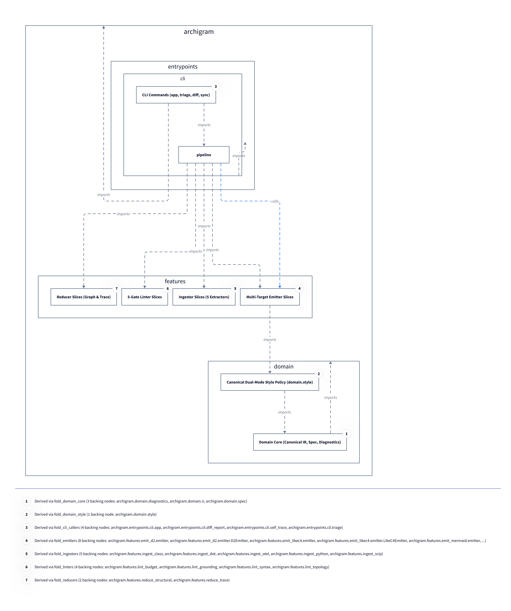

# ArchiGram

[](https://github.com/klcd/archigram/actions/workflows/verify.yml)
[](https://klcd.github.io/archigram/)
[](pyproject.toml)
[](docs/architecture/README.md)
[](LICENSE)

> **Pre-alpha:** ArchiGram is early-stage software. The CLI, MCP tools, spec format and output formats may change without notice.

Deterministic graph projection, runtime concurrency trace compaction (`R1–R6` + Series-Parallel poset lowering), and 5-gate semantic/topological linting CLI + MCP server.

### Stage 2: Triage Overlay on Raw `361`-Node AST (`55,890` Mermaid Chars)

[](https://klcd.github.io/archigram/#triage)

*Dense on purpose: this is the raw hairball that curation turns into Stage 3. [Open the interactive explorer ->](https://klcd.github.io/archigram/#triage) to zoom and pan. Crimson `[REMOVE]`, Amber `[BYPASS]`, Violet `[COLLAPSE]`, Emerald `[KEEP]` — computed from CLI rules ([full 3-stage showcase ->](docs/architecture/uml-and-curation-showcase.md))*

### Stage 3: 5-Gate-Verified Curated Result (`13` Nodes, `1,579` Chars)

[](docs/architecture/diagrams/showcase_cli_triage.3_curated.png)

*Dual-mode transparent styling (`fill: transparent`) + 90° orthogonal ELK routing ([animated runtime playback ->](docs/architecture/diagrams/l3_runtime_pipeline_steps_d2.d2.svg))*

## Why We Created ArchiGram

Software teams face three recurring failure modes whenever they try to keep architecture diagrams accurate and readable:

1. **Hand-drawn diagrams silently rot:** Diagrams sketched in Excalidraw, Lucidchart, or hand-edited Markdown have zero connection to the codebase. Within days of refactoring, boxes point to deleted modules, omit newly introduced dependencies, and turn architecture docs into misleading folklore.
2. **Naive auto-generators dump unreadable "hairballs":** Raw AST, dependency, and OpenTelemetry trace visualizers swing to the opposite extreme—dumping 500 classes or 1,000 runtime spans onto a canvas. The result overwhelms human working memory *and* breaks platform rendering limits (such as Gitea's `5,000`-character Mermaid cap).
3. **Unbounded LLM diagramming hallucinates topology and syntax:** Asking an LLM to write raw Mermaid, D2, or PlantUML directly invents non-existent symbols, silently drops critical security or data-flow paths when summarizing, trips over parser version skew, and produces noisy non-deterministic diffs on every run.

**ArchiGram's thesis is that architecture diagrams should be compiled and formally verified, not hand-drawn or freehand-prompted.** ArchiGram separates deterministic compilation (the **Data Plane**) from declarative abstraction intent (the **Control Plane**):

- **Ground-Truth Ingestion (`OBSERVED` Provenance):** Deterministic extractors ingest real symbols, types, edges, and happens-before spans from Python ASTs, SCIP indexes, Graphviz DOT, OOP class hierarchies, OpenTelemetry traces, or live `sys.monitoring` execution—stamping every fact with cryptographic provenance.
- **Declarative Curation (`CurationSpecV1`) Instead of Pixel Pushing:** Humans and AI agents never edit raw diagram syntax. Instead, they author small, version-controlled YAML views (`collapse_partition`, `k_hop_neighborhood`, `bypass_vertices`, `prune_leaves`, and `R1–R6` + Series-Parallel poset trace compaction) that distill large systems into focused `10–25` node views across zoom levels (`L0`–`L3`).
- **5-Gate Mathematical Verification Before Emission:** Every view must pass **Gate 1** (100% symbol grounding—zero hallucinations), **Gate 2** (protected boundary survival), **Gate 3** (transitive reachability, cycle discipline & concurrency happens-before preservation with concrete witness counterexamples), **Gate 4** (cognitive node/edge budgets), and **Gate 5** (headless target syntax validation).
- **Bounded Self-Healing AI Loop + Zero-Cost Deterministic CI:** When the local heuristic `archigram propose` loop or an LLM client of the stdio MCP server curates views, it only proposes `CurationSpecV1` rules inside a bounded 3-turn lint-and-repair loop guided by formal counterexamples. Once committed, `archigram apply --check` enforces **zero documentation drift** in CI and Git hooks in milliseconds with zero LLM calls and byte-identical output across Mermaid (`< 5,000` chars for Gitea/GitHub), D2 (+ animated `.d2.svg`), PlantUML, LikeC4, and Graphviz DOT.

## What an Agent May Do to a Diagram

An agent (or a person) never draws a diagram and never writes Mermaid or D2. It may only add rules to a view's spec. ArchiGram then recompiles the diagram from the code and runs the five gates, and a refused move writes nothing.

The examples use the six-module `shop` package from the [quickstart](docs/quickstart.md). Every move starts from the same diagram and is checked against the same contract: `shop.api` and `shop.repository` stay visible, `shop.api` still imports its way to `shop.repository`, and the view has at most 12 boxes.

**Allowed:** rules that reshape the facts the code already has.

| Move | Rule the agent adds | Result |
| --- | --- | --- |
| Hide a leaf | `prune_leaves` on `shop.audit*` | `audit` disappears; nothing depended on it |
| Group boxes | `collapse_partition` of `shop.repository*` and `shop.models*` | one `Storage` box takes over their arrows |
| Skip a layer | `bypass_vertices` on `shop.service*`, keeping `imports` and `calls` | `shop.api` points straight at what the service used |

**Refused:** moves that would make the diagram wrong.

| The agent tries to | Rule | Refused by |
| --- | --- | --- |
| Use a box the code does not have | `bypass_vertices` on `shop.cache` | Gate 1: `ZERO_MATCH_GLOB` |
| Hide a protected box | `prune_leaves` on `shop.repository*` and `shop.models*` | Gate 2: `PROTECTED_NODE_DROPPED` (and Gate 3) |
| Cut a required path | `bypass_vertices` on `shop.service*`, keeping only `calls` | Gate 3: `REACHABILITY_SEVERED` |
| Draw an arrow itself | `op: add_edge` | The spec schema: no such rule exists |

A refused move names the gate, the rule and the path, so the agent can repair its spec:

```text
$ uv run archigram lint examples/python-quickstart/shop --spec examples/agent-moves/06-refused-cut-path.yaml
ArchiGram 5-Gate Linter: FAILED (1 error(s), 0 warning(s))
  [ERROR] REACHABILITY_SEVERED (gate_3_topology_poset, view=cut_path, rule=skip_service): Reachability from 'shop.api' to 'shop.repository' via relations ['imports'] was severed in view 'cut_path'; ...
    Witness: shop.api -> shop.service -> shop.repository
```

Each move is one runnable spec in [`examples/agent-moves/`](examples/agent-moves/README.md), with the resulting diagrams. The [website](https://klcd.github.io/archigram/#moves) plays them as an animation. The gates check rules against the contract, not the contract against your intent: an agent that edits the contract itself is caught only in review, so review spec changes like code.

## Architecture Documentation (4 Zoom Levels + UML 2.5 Showcase)

ArchiGram dogfoods itself to generate and lint its own architecture docs (`0` hand-drawn drift, verified by `--sync-md --check` across all 5 Gates). Start at **[docs/architecture/README.md](docs/architecture/README.md)** or jump straight to the abstraction level you need:

| Level | Guide | Focus | Cognitive Scope |
| --- | --- | --- | --- |
| **L0** | [System & Hexagonal Rings](docs/architecture/L0-system-and-rings.md) | Hexagonal rings, Data Plane (CLI) vs. Control Plane (MCP), dependency direction | 9 capability groups |
| **L1** | [Feature-Slice Map](docs/architecture/L1-feature-slices.md) | All 16 strictly independent vertical slices + checklist to add a 17th slice | 16 slices + 4 rings |
| **L2** | [Subsystem Guides](docs/architecture/L2-subsystem-guides.md) | Focused `k_hop_neighborhood` zooms: Domain & Ports (L2a), Reducers (L2b), 5-Gate Linter (L2c), CLI & MCP (L2d) | 9–18 nodes per view |
| **L3** | [Runtime Execution & Self-Healing Traces](docs/architecture/L3-runtime-traces.md) | Live `sys.monitoring` trace of `compile_and_lint_pipeline` & 3-turn `run_propose_loop` compacted via `R1–R6` | 15 participants, 48 events |
| **Gallery** | [Styling Policy & Multi-Target Gallery](docs/architecture/diagram-styling-and-gallery.md) | Dual-mode transparent styling (`domain/style.py`), edge-only semantic colors, flowing D2 SVGs, animated `steps` playback, compact `< 5,000`-char Gitea-ready Mermaid & all modes | All 5 renderers × all modes |
| **UML & Triage** | [UML 2.5 & 3-Stage CLI Curation Showcase](docs/architecture/uml-and-curation-showcase.md) | Program-first AST/trace extraction (`50k` chars) -> CLI-only `curate` + `triage` 3-stage SVGs (`original` -> `triage` -> `curated`) & full 14-type UML 2.5 taxonomy (`package`, `deployment`, `use_case`, `communication`, `activity`, `state`) | 3-stage SVGs + 14 UML types |

## Python Quickstart (CI-ready, offline, zero model calls)

New here? Follow **[docs/quickstart.md](docs/quickstart.md)**: pin a revision, lint and regenerate a committed Mermaid diagram of a tiny Python package ([`examples/python-quickstart/`](examples/python-quickstart/)), run `archigram apply --check` in CI with the network disabled, and see a passing check plus both reachability failures (`REACHABILITY_NOT_OBSERVED`, `REACHABILITY_SEVERED`) and a `[STALE]` diagram reproduced with small edits. It also states what static Python extraction can and cannot see, and documents the local stdio MCP server.

```bash
uv sync --frozen
uv run --offline --frozen archigram apply examples/python-quickstart/shop \
  --spec examples/python-quickstart/diagram-views.yaml \
  --out-dir examples/python-quickstart/diagrams --check
```

## Install & Developer Quickstart

Run directly with [`uv`](https://docs.astral.sh/uv/) (Python 3.12+) or enter the reproducible Nix `devShell` (includes `python312`, `uv`, `d2`, `graphviz`, `just`, `ruff`, and `pyright`):

```bash
# Run one-off without installing, or install globally as a CLI tool
uvx --from git+https://github.com/klcd/archigram archigram --help
uv tool install git+https://github.com/klcd/archigram

# Contributor setup (Nix + uv)
git clone https://github.com/klcd/archigram.git && cd archigram
nix develop --command uv sync --frozen
```

Run `just` to list all grouped quality and diagram recipes:

```bash
just              # List all recipes (verify, lint, fmt, fuzz, perf, docs, docs-check, d2, watch-d2, trace, propose)
just docs         # Re-capture live trace + compile L0-L3, 3-stage triage SVGs & UML 2.5 showcase + sync Markdown
just docs-check   # Verify 5-Gate pass + zero Markdown/SVG/triage drift
just d2 docs/architecture/diagrams/l3_runtime_pipeline_steps_d2.d2   # Compile single .d2 -> .d2.svg
just watch-d2     # Live hot-reload D2 diagram preview in browser
just verify       # Run all 8 mandatory ArchiGram quality gates
```

Direct CLI usage (`archigram`):

```bash
# Author or refine CurationSpecV1 views strictly via CLI (zero hand-edited YAML/diagram syntax)
uv run archigram curate init curated.yaml -v core_pkg -t "Core Packages" -r mermaid --variant package
uv run archigram curate prune-leaves curated.yaml -v core_pkg --id prune_stubs -g archigram

# Render 3-stage before/after SVG triage (1_original -> 2_triage -> 3_curated) when raw graphs > 5k chars
uv run archigram triage src/archigram --spec docs/architecture/showcase-structural-views.yaml \
  --view showcase_cli_triage --out-dir docs/architecture/diagrams

# Lint a curation spec against a codebase or trace IR through all 5 Gates
uv run archigram lint src/archigram --spec docs/architecture/diagram-views.yaml

# Compile curated views to Mermaid/D2/PlantUML/LikeC4/DOT (+ companion SVGs) and sync Markdown blocks
uv run archigram apply src/archigram \
  --spec docs/architecture/diagram-views.yaml \
  --out-dir docs/architecture/diagrams \
  --sync-md docs/architecture

# Compare two architectural snapshots for structural regressions (cycles, lost paths, budget drift)
uv run archigram diff --base base.ir.json --head head.ir.json --spec docs/architecture/diagram-views.yaml

# Run the bounded 3-turn self-healing proposal -> lint -> repair loop (local deterministic heuristic, no LLM call)
uv run archigram propose src/archigram --out curated.yaml --max-turns 3
```

## Architecture (Hexagonal + Feature-Sliced)

Enforced on every commit by `lint-imports` (`import-linter`), `ruff` (McCabe `C901 <= 10`, structural limits, Bandit security), and strict `pyright`:

- `src/archigram/domain/` — Pure Canonical IR v1, Curation Spec v1, Canonical Dual-Mode Styling (`style.py`), Diagnostics, Concurrency Poset, and Digest value objects (zero framework/I/O dependencies).
- `src/archigram/ports/` — Protocol interfaces (`StructuralIngestorPort`, `TraceIngestorPort`, `StructuralReducerPort`, `TraceCompactorPort`, `LintGatePort`, `SyntaxValidatorPort`, `DiagramEmitterPort`, `DigestGeneratorPort`).
- `src/archigram/features/*` — 16 strictly mutually independent vertical feature slices (zero cross-slice imports).
- `src/archigram/entrypoints/{cli,mcp}/` — Driving adapters (`archigram` CLI Data Plane & MCP Control Plane).

## Quality Gates & Testing Policy

Static example-based unit tests are **forbidden** (`scripts/check-test-discipline.py`). Every slice is verified exclusively via:
- `tests/fuzz/fuzz_*.py` — Property-based & stateful fuzz tests using `hypothesis`.
- `tests/perf/perf_*.py` — Latency & throughput benchmarks using `pytest-benchmark`.

Run all 8 gates locally:
```bash
just verify   # or: ./scripts/verify.sh
```
