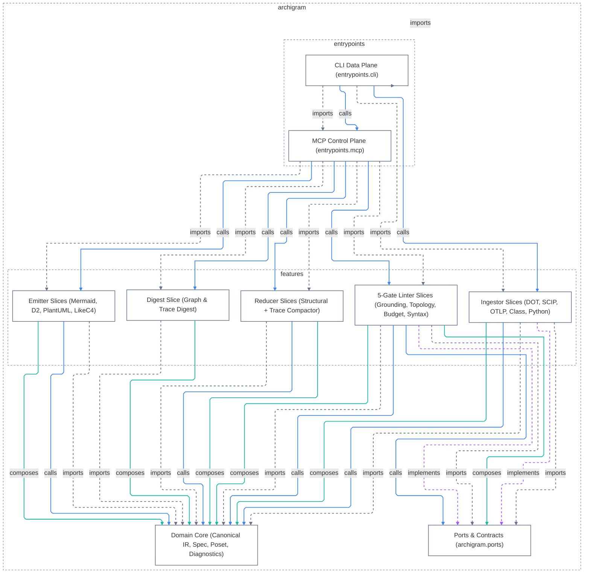
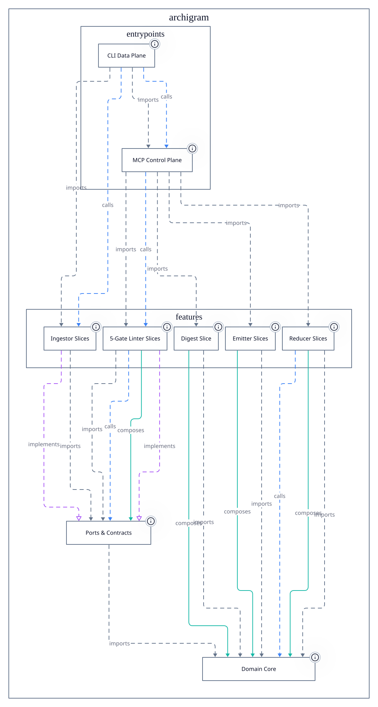

# L0: System Overview & Hexagonal Rings

**Best for:** New contributors, CLI/MCP integrators, and reviewers who want the full system mental model in under two minutes without wading into individual slices.

- **Zoom In:** [L1: Feature-Slice Map](L1-feature-slices.md) · [L2: Subsystem Guides](L2-subsystem-guides.md) · [L3: Runtime Traces](L3-runtime-traces.md) · [Styling & Full Multi-Target Gallery](diagram-styling-and-gallery.md)
- **Companion Renders:** [Mermaid](diagrams/l0_hexagonal_rings_mermaid.mmd) · [D2 (`.d2`)](diagrams/l0_hexagonal_rings_d2.d2) · [D2 SVG](diagrams/l0_hexagonal_rings_d2.d2.svg) · [PlantUML (`.puml`)](diagrams/l0_hexagonal_rings_puml.puml) · [LikeC4 (`.c4`)](diagrams/l0_hexagonal_rings_likec4.c4) · [DOT (`.dot`)](diagrams/l0_hexagonal_rings_dot.dot) · [DOT SVG](diagrams/l0_hexagonal_rings_dot.dot.svg)

---

## Hexagonal Dependency Rule

ArchiGram enforces a strict **inward-only** Hexagonal Architecture (`lint-imports` runs on every commit):

```text
archigram.entrypoints  ──▶  archigram.features  ──▶  archigram.ports  ──▶  archigram.domain
   (Driving Adapters)        (16 Vertical Slices)     (Protocol Contracts)   (Zero-I/O Core)
```

1. **`domain_core` (`src/archigram/domain/`)**: Pure Pydantic v2 models (`StructuralGraphIR`, `InteractionTraceIR`, `CurationSpecV1`, `LintReport`, `GraphDigest`), canonical dual-mode visual styling (`style.py`), and Series-Parallel poset math. Zero I/O, zero CLI/MCP/emitter imports.
2. **`ports_contracts` (`src/archigram/ports/`)**: Runtime-checkable Python `Protocol` contracts (`StructuralIngestorPort`, `TraceIngestorPort`, `StructuralReducerPort`, `TraceCompactorPort`, `LintGatePort`, `SyntaxValidatorPort`, `DiagramEmitterPort`, `DigestGeneratorPort`).
3. **Capability Groups (`src/archigram/features/*`)**: Five horizontal capability families implemented as **16 strictly independent vertical slices** (Ingestors, Reducers, 5-Gate Linters, Emitters, Digest). Slices never import each other.
4. **Driving Adapters (`src/archigram/entrypoints/`)**:
   - **Data Plane (`cli_dataplane`)**: Zero-LLM deterministic compiler (`apply`, `lint`, `diff`, `--sync-md`, `self_trace`) safe for CI pipelines and pre-commit hooks.
   - **Control Plane (`mcp_controlplane`)**: FastMCP server (`digest`, `lint`, `preview`) and bounded 3-turn self-healing `propose` loop for LLM-assisted spec authoring.

---

## Curated View — Mermaid Orthogonal Flowchart (`l0_hexagonal_rings_mermaid`)

Proven by Gate 3 invariants in [`diagram-views.yaml`](diagram-views.yaml):
- `forbid_new_cycles: true` (strict DAG across all Hexagonal rings)
- `preserve_reachability`: `entrypoints.cli.pipeline -> ports.contracts -> domain.ir`
- Styled with transparent node/subgraph backgrounds and semantic edge-only `linkStyle` strokes (`#3b82f6` calls, `#64748b` dashed imports, `#a855f7` dashed implements, `#14b8a6` composes):

<!-- archigram:start l0_hexagonal_rings_mermaid -->

<!-- archigram:end l0_hexagonal_rings_mermaid -->

---

## Curated View — Rendered D2 Architecture (`l0_hexagonal_rings_d2`)

Compiled from the identical 9-supernode reduction into D2 (`layout-engine: elk`, `theme-id: 0`, `dark-theme-id: 200`, `style.fill: transparent`):



---

## What Is Intentionally Abstracted Away at L0

- Individual ingestors, reducers, lint gates, and emitters are collapsed into their 5 capability groups (`feature_ingestors`, `feature_reducers`, `feature_linters`, `feature_emitters`, `feature_digest`).
- To see all **16 independent vertical slices** and their exact wiring to entrypoints, ports, and domain, step down to **[L1: Feature-Slice Map](L1-feature-slices.md)**.
- To inspect classes, functions, and runtime calls inside a single capability group, jump straight to **[L2: Subsystem Guides](L2-subsystem-guides.md)**, **[L3: Runtime Traces](L3-runtime-traces.md)**, or **[Styling & Full Multi-Target Gallery](diagram-styling-and-gallery.md)**.
