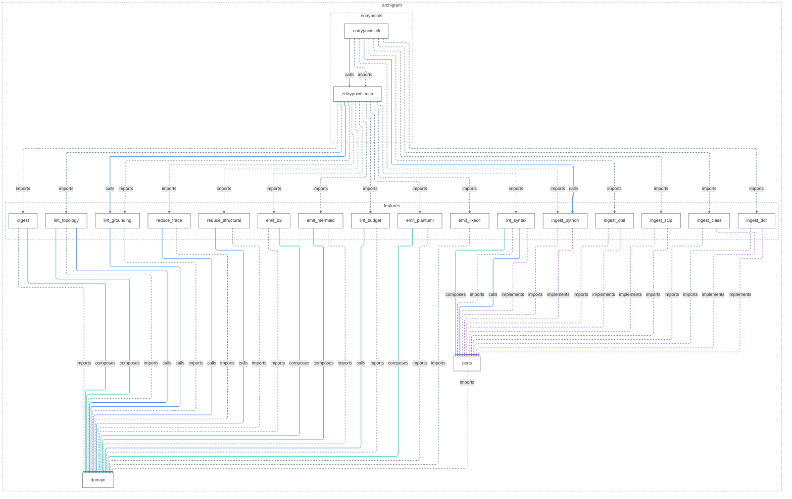
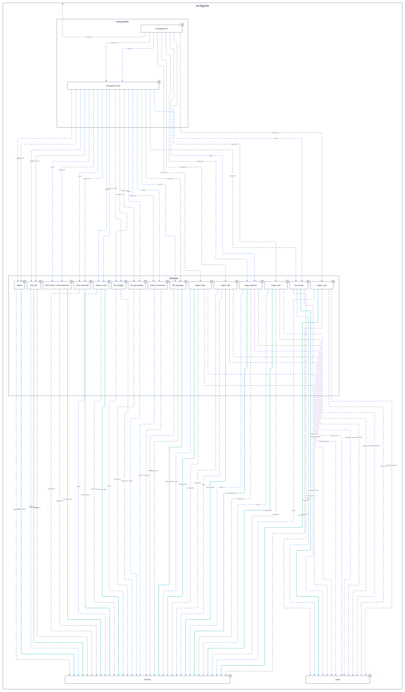

# L1: Feature-Slice Map & Independence Guarantee

**Best for:** Contributors adding a new ingestor, diagram emitter, or lint gate who want to know where every slice lives and verify what they are allowed to import.

- **Zoom Out / In:** [L0: System & Rings](L0-system-and-rings.md) · [L2: Subsystem Guides](L2-subsystem-guides.md) · [L3: Runtime Traces](L3-runtime-traces.md) · [Styling & Full Multi-Target Gallery](diagram-styling-and-gallery.md)
- **Companion Renders:** [Mermaid](diagrams/l1_feature_slices_mermaid.mmd) · [D2 (`.d2`)](diagrams/l1_feature_slices_d2.d2) · [D2 SVG](diagrams/l1_feature_slices_d2.d2.svg)

---

## Zero Cross-Slice Coupling (`import-linter` Contract)

Every directory under `src/archigram/features/<slice>/` is a **vertically isolated slice**. An `import-linter` `independence` contract enforces on every commit that:

- A feature slice may import **only** from `archigram.domain` and `archigram.ports` (plus standard library / declared third-party packages).
- A feature slice may **never** import from another feature slice or from `archigram.entrypoints`.
- Composition happens strictly in the outer driving adapters (`entrypoints.cli.pipeline` and `entrypoints.mcp`).

---

## The 16 Independent Vertical Slices

| Family | Slice | Primary Responsibility | Port Contract |
| --- | --- | --- | --- |
| **Ingestors (5)** | `ingest_dot` | Parse Graphviz `.dot` graphs into `StructuralGraphIR` | `StructuralIngestorPort` |
| | `ingest_scip` | Parse SCIP code-intelligence indexes into `StructuralGraphIR` | `StructuralIngestorPort` |
| | `ingest_otel` | Parse OpenTelemetry OTLP JSON spans into `InteractionTraceIR` | `TraceIngestorPort` |
| | `ingest_class` | Parse Python/TypeScript/Java/Go/Rust OOP class schemas | `StructuralIngestorPort` |
| | `ingest_python` | Extract Python AST graphs & live `sys.monitoring` traces | `StructuralIngestorPort` / `TraceIngestorPort` |
| **Reducers (2)** | `reduce_structural` | `k_hop`, `prune_leaves`, `bypass_vertices`, `collapse_partition`, SCC, TR | `StructuralReducerPort` |
| | `reduce_trace` | `R1–R6` trace compaction + Series-Parallel poset lowering | `TraceCompactorPort` |
| **Linters (4)** | `lint_grounding` | Gate 1 (closed-world symbol/glob grounding) & Gate 2 (leaf & protected survival) | `LintGatePort` |
| | `lint_topology` | Gate 3 (reachability witnesses, anti-cycle, cohesion, poset preservation) | `LintGatePort` |
| | `lint_budget` | Gate 4 (cognitive node/edge/participant/event budgets & orphan detection) | `LintGatePort` |
| | `lint_syntax` | Gate 5 (headless syntax verification for Mermaid, D2, PlantUML, LikeC4, DOT) | `SyntaxValidatorPort` |
| **Emitters (4)** | `emit_mermaid` | Deterministic Mermaid `flowchart` / `classDiagram` / `sequenceDiagram` | `DiagramEmitterPort` |
| | `emit_d2` | Deterministic D2 architecture, OOP `shape: class` & sequence diagrams | `DiagramEmitterPort` |
| | `emit_plantuml` | Deterministic PlantUML component, class & `teoz` sequence diagrams | `DiagramEmitterPort` |
| | `emit_likec4` | Deterministic LikeC4 `.c4` architecture & dynamic sequence views | `DiagramEmitterPort` |
| **Digest (1)** | `digest` | Token-efficient Louvain/PageRank/hotspot digests for MCP & `propose` | `DigestGeneratorPort` |

---

## Curated View — Mermaid Orthogonal Flowchart (`l1_feature_slices_mermaid`)

All 16 slices + 4 structural rings collapsed into 1 supernode each (within the `<= 25` cognitive node budget, `forbid_new_cycles: true`):

<!-- archigram:start l1_feature_slices_mermaid -->

<!-- archigram:end l1_feature_slices_mermaid -->

---

## Curated View — Rendered D2 Feature Slices (`l1_feature_slices_d2`)

---

## Checklist: Adding a 17th Vertical Slice Without Reading Sibling Slices

Because slices are mutually independent, adding a new emitter, ingestor, or lint gate requires touching **zero** sibling slices:

1. **Read only the contract & models:** Inspect [`src/archigram/ports/contracts.py`](../../src/archigram/ports/contracts.py) and [`src/archigram/domain/ir.py`](../../src/archigram/domain/ir.py) (or jump to [L2a](L2-subsystem-guides.md#l2a-domain-core--hexagonal-ports)).
2. **Create `src/archigram/features/<new_slice>/`:** Implement the corresponding `Protocol` using pure `archigram.domain` types.
3. **Wire it at the edge:** Register the new slice in `src/archigram/entrypoints/cli/pipeline.py` (and `src/archigram/entrypoints/mcp/` if exposed as an MCP tool).
4. **Add Hypothesis fuzz + `pytest-benchmark` tests:** Create `tests/fuzz/fuzz_<new_slice>.py` (`@given` / `RuleBasedStateMachine`) and `tests/perf/perf_<new_slice>.py` (`benchmark` fixture)—no static unit tests.
5. **Verify all 7 gates:** Run `./scripts/verify.sh` (`ruff`, strict `pyright`, `lint-imports`, `check-test-discipline.py`, fuzz, perf).
