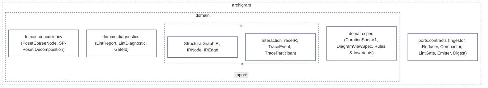
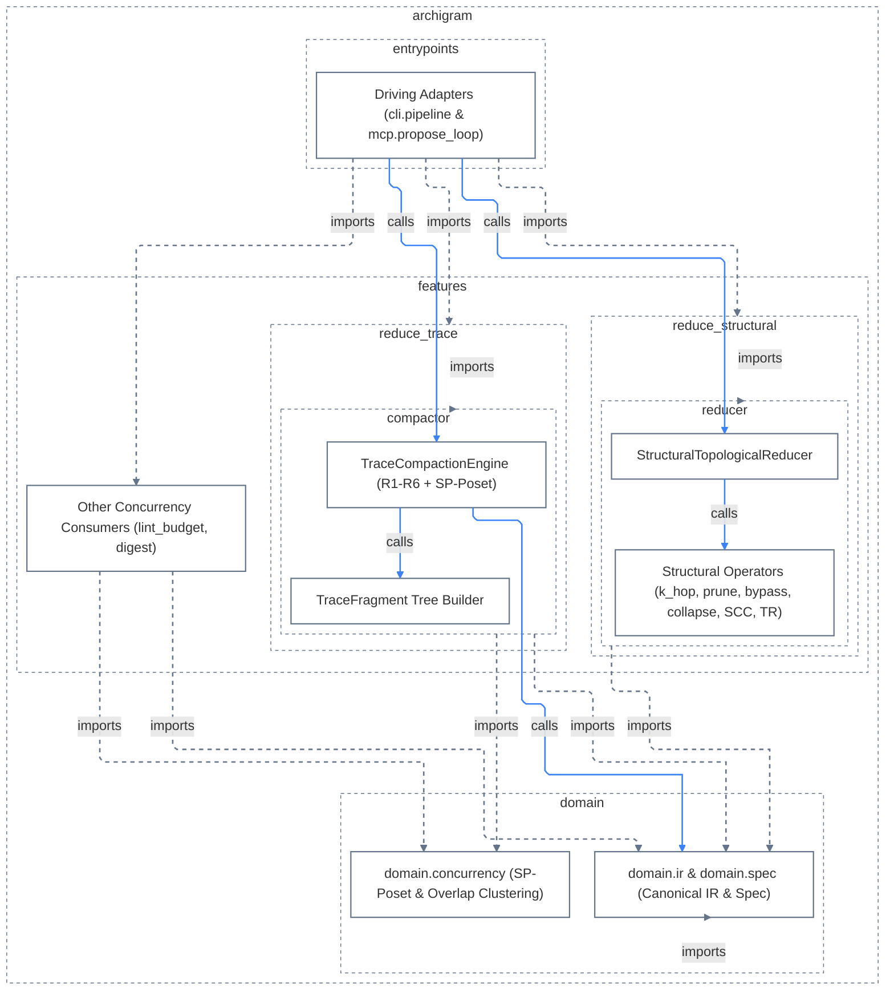
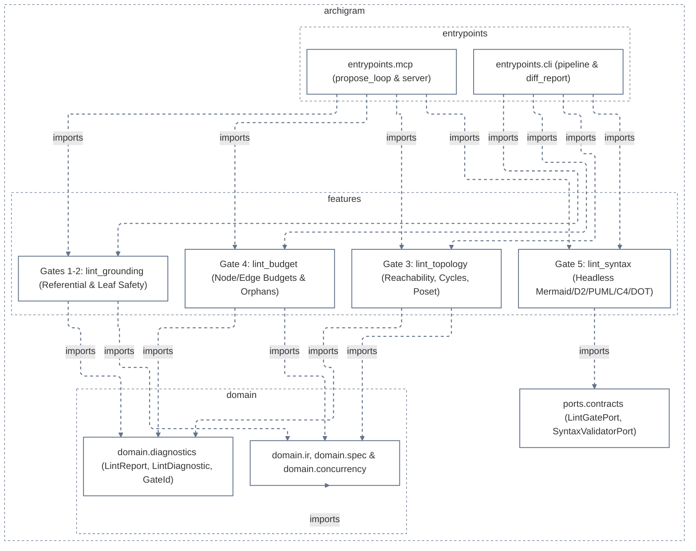
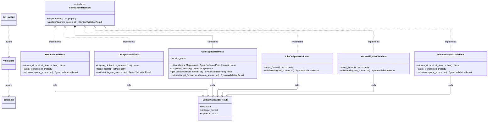
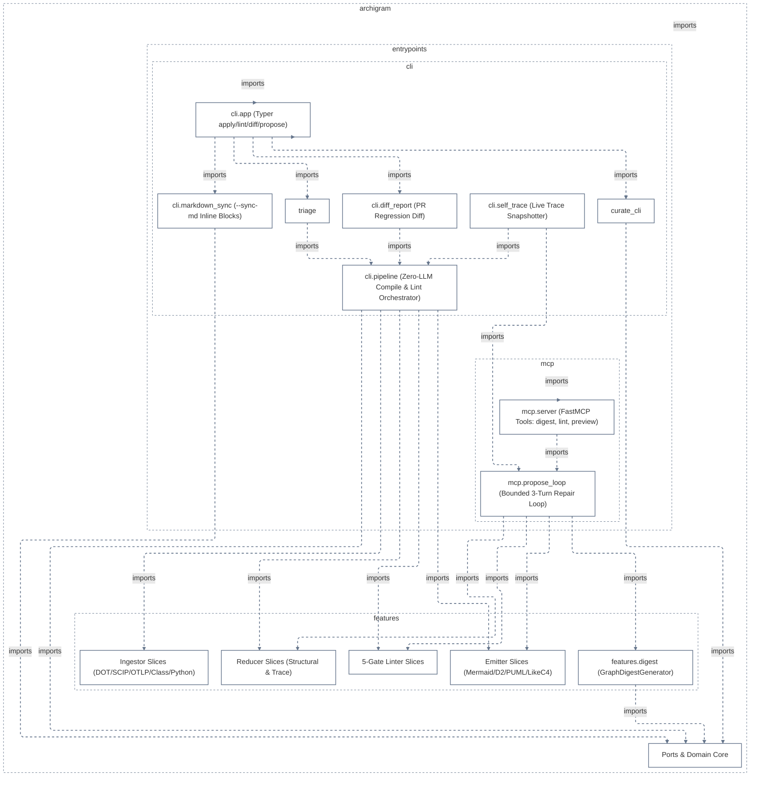

# L2: Focused Subsystem Guides (`k_hop_neighborhood` Zooms)

**Best for:** Contributors modifying a specific subsystem who want a deep, accurate dependency map of **only that neighborhood** without pulling in the rest of the repository.

Jump directly to your subsystem:
- [L2a: Domain Core & Hexagonal Ports](#l2a-domain-core--hexagonal-ports)
- [L2b: Reduction & Concurrency Compaction Engine](#l2b-reduction--concurrency-compaction-engine)
- [L2c: 5-Gate Semantic, Topological, Budget & Syntax Linter](#l2c-5-gate-semantic-topological-budget--syntax-linter)
- [L2d: CLI Data Plane & MCP Control Plane Adapters](#l2d-cli-data-plane--mcp-control-plane-adapters)
- [Canonical Styling Policy & 12-Mode Multi-Target Gallery](diagram-styling-and-gallery.md)

---

## L2a: Domain Core & Hexagonal Ports

- **Key Files:**
  - `src/archigram/domain/__init__.py` (`ProvenanceGrade`, `ProvenanceStamp`)
  - `src/archigram/domain/ir.py` (`StructuralGraphIR`, `IRNode`, `IREdge`, `InteractionTraceIR`, `TraceEvent`, `TraceParticipant`)
  - `src/archigram/domain/spec.py` (`CurationSpecV1`, `DiagramViewSpec`, `DiagramVariant`, reduction rules, invariants, YAML parser/dumper)
  - `src/archigram/domain/style.py` (`CANONICAL_EDGE_STYLES`, `EdgeVisualStyle`, `resolve_edge_visual_style`, dual-mode transparent target preambles)
  - `src/archigram/domain/diagnostics.py` (`GateId`, `DiagnosticSeverity`, `LintDiagnostic`, `LintReport`)
  - `src/archigram/domain/concurrency.py` (`PosetCotreeNode`, `decompose_series_parallel_poset`, `cluster_overlapping_intervals`)
  - `src/archigram/ports/contracts.py` (8 runtime-checkable `Protocol` interfaces)
- **Core Invariants:**
  - Zero I/O, zero network, zero framework or feature-slice imports inside `domain/` and `ports/`.
  - Every `IRNode`, `IREdge`, `TraceParticipant`, and `TraceEvent` carries an immutable `ProvenanceStamp` (`OBSERVED`, `DERIVED`, or `SYNTHETIC`).
  - `LintReport.passed` is strictly synchronized with `error_count == 0`.
- **What You Do NOT Need to Read:** Any emitter (`emit_*`), any ingestor (`ingest_*`), or CLI/MCP adapters.
- **Companion Renders:** [Mermaid](diagrams/l2a_domain_and_ports_mermaid.mmd) · [PlantUML (`.puml`)](diagrams/l2a_domain_and_ports_puml.puml)

<!-- archigram:start l2a_domain_and_ports_mermaid -->

<!-- archigram:end l2a_domain_and_ports_mermaid -->

---

## L2b: Reduction & Concurrency Compaction Engine

- **Key Files:**
  - `src/archigram/features/reduce_structural/reducer.py` (`StructuralTopologicalReducer`, `k_hop_neighborhood`, `prune_leaves`, `bypass_vertices`, `collapse_partition`, `condense_sccs`, `transitive_reduction`)
  - `src/archigram/features/reduce_trace/compactor.py` (`TraceCompactionEngine`, `TraceFragment`, `build_trace_fragment_tree`, `R1–R6` reduction pipeline)
  - `src/archigram/domain/concurrency.py` (interval overlap clustering & modular Series-Parallel cotree decomposition)
- **Core Invariants:**
  - **Execution Order (`StructuralTopologicalReducer.reduce`):** `global_abstractions` -> `k_hop_neighborhood` (with `retain_ancestors=True`) -> `view.rules` -> `condense_sccs` -> `transitive_reduction`.
  - **Determinism:** Output node/edge/event ordering is canonical and invariant to input dict/list permutations.
  - **Anti-Cycle Safety:** When `forbid_new_cycles=True`, `collapse_partition` raises `CycleInducedError` rather than introducing synthetic cycles between previously acyclic components.
  - **Poset Soundness (`reduce_trace`):** Compaction (`R1` self-call/noise drop, `R2` depth cap, `R3` span collapsing, `R4` contiguous loop folding, `R5` async/sync preservation, `R6` Series-Parallel `par`/`seq` lowering) preserves every causal happens-before relation.
- **What You Do NOT Need to Read:** Ingestors (`ingest_*`), syntax validators (`lint_syntax`), or diagram emitters (`emit_*`).
- **Companion Renders:** [Mermaid](diagrams/l2b_reduction_engine_mermaid.mmd) · [D2 (`.d2`)](diagrams/l2b_reduction_engine_d2.d2) · [D2 SVG](diagrams/l2b_reduction_engine_d2.d2.svg)

<!-- archigram:start l2b_reduction_engine_mermaid -->

<!-- archigram:end l2b_reduction_engine_mermaid -->

### Rendered D2 View (`l2b_reduction_engine_d2`)

---

## L2c: 5-Gate Semantic, Topological, Budget & Syntax Linter

- **Key Files:**
  - `src/archigram/features/lint_grounding/gates.py` — **Gate 1** (`UNKNOWN_SYMBOL_ID`, `ZERO_MATCH_GLOB`, `INVALID_EDGE_RELATION`) & **Gate 2** (`PRUNE_INTERNAL_BRIDGE`, `PROTECTED_NODE_DROPPED`)
  - `src/archigram/features/lint_topology/gate.py` — **Gate 3** (`REACHABILITY_BROKEN`, `CYCLE_INDUCED`, `DISCONNECTED_PARTITION_MERGE`, `POSET_ORDER_VIOLATION`)
  - `src/archigram/features/lint_budget/gate.py` — **Gate 4** (`NODE_BUDGET_EXCEEDED`, `EDGE_BUDGET_EXCEEDED`, `PARTICIPANT_BUDGET_EXCEEDED`, `EVENT_BUDGET_EXCEEDED`, `ORPHAN_NODE`)
  - `src/archigram/features/lint_syntax/validators.py` — **Gate 5** (`SYNTAX_VALIDATION_FAILED`, headless validation across Mermaid, D2, PlantUML, LikeC4, Graphviz DOT)
- **Core Invariants:**
  - Every `LintDiagnostic` emits an actionable `repair_hint` and `offending_symbols` (plus shortest witness paths in Gate 3) so both humans and the MCP `propose` loop can fix failures mechanically.
  - Gate 2 simulates survival in the exact same order as `StructuralTopologicalReducer.reduce` (`global_rules -> k_hop_neighborhood(retain_ancestors=True) -> view.rules`).
  - All 4 linter slices are mutually independent and depend only on `archigram.domain` and `archigram.ports`.
- **What You Do NOT Need to Read:** Ingestors (`ingest_*`) or diagram emitters (`emit_*`)—only the rendered text crosses into Gate 5.
- **Companion Renders:** [Mermaid Flowchart](diagrams/l2c_five_gate_linter_mermaid.mmd) · [Mermaid OOP Class](diagrams/l2c_oop_syntax_validators_mermaid.mmd) · [D2 OOP Class (`.d2`)](diagrams/l2c_oop_syntax_validators_d2.d2) · [D2 OOP Class SVG](diagrams/l2c_oop_syntax_validators_d2.d2.svg) · [PlantUML OOP Class (`.puml`)](diagrams/l2c_oop_syntax_validators_puml.puml)

<!-- archigram:start l2c_five_gate_linter_mermaid -->

<!-- archigram:end l2c_five_gate_linter_mermaid -->

### Gate 5 OOP Protocol & Concrete Validators (`diagram_variant: class`)

Zooming into `SyntaxValidatorPort`, `Gate5SyntaxHarness`, and the 5 concrete validators in **OOP Class mode** showcases UML `<<interface>>` realization (`<|..`), filled-diamond composition (`*--`), and method compartments in both Mermaid `classDiagram` and rendered D2 (`shape: class`):

<!-- archigram:start l2c_oop_syntax_validators_mermaid -->

<!-- archigram:end l2c_oop_syntax_validators_mermaid -->

---

## L2d: CLI Data Plane & MCP Control Plane Adapters

- **Key Files:**
  - `src/archigram/entrypoints/cli/app.py` — Typer CLI (`archigram apply`, `archigram lint`, `archigram diff`, `archigram propose`)
  - `src/archigram/entrypoints/cli/pipeline.py` — Zero-LLM orchestrator (`compile_and_lint_pipeline`, auto-detecting ingestors, reducers, Gates 1–5, and emitters)
  - `src/archigram/entrypoints/cli/markdown_sync.py` — Marker-based Markdown sync (`<!-- archigram:start <view_id> --> ... <!-- archigram:end <view_id> -->`) and `--check` drift enforcement
  - `src/archigram/entrypoints/cli/diff_report.py` — Structural/architectural PR regression diff reporter
  - `src/archigram/entrypoints/cli/self_trace.py` — Deterministic live `sys.monitoring` self-hosted trace snapshotter
  - `src/archigram/entrypoints/mcp/server.py` — FastMCP tools (`get_graph_digest`, `lint_curation_spec`, `preview_curated_view`, `propose_curation_spec`)
  - `src/archigram/entrypoints/mcp/propose_loop.py` — Bounded 3-turn self-healing proposal -> 5-Gate lint -> repair loop
  - `src/archigram/features/digest/generator.py` — Token-efficient Louvain/PageRank/hotspot Markdown digests for LLM context
- **Core Invariants:**
  - **Strict Plane Separation:** `cli.pipeline` executes deterministically with zero LLM calls; `mcp.propose_loop` is strictly bounded (`max_turns=3`) and can never emit unverified diagrams because every candidate spec is re-checked by all 5 Gates.
  - **Composition Root:** `entrypoints/` is the sole layer permitted to import and wire feature slices together.
- **What You Do NOT Need to Read:** Internal graph math inside `reduce_structural`, `reduce_trace`, or `domain.concurrency`.
- **Companion Renders:** [Mermaid](diagrams/l2d_cli_and_mcp_adapters_mermaid.mmd)

<!-- archigram:start l2d_cli_and_mcp_adapters_mermaid -->

<!-- archigram:end l2d_cli_and_mcp_adapters_mermaid -->
