# L3: Runtime Execution & Self-Healing Traces

**Best for:** Contributors debugging pipeline orchestration, tracing Gate 1–5 evaluation order, or understanding how the bounded 3-turn MCP `propose` repair loop turns lint diagnostics into passing specs.

- **Zoom Out:** [L0: System & Rings](L0-system-and-rings.md) · [L1: Feature Slices](L1-feature-slices.md) · [L2: Subsystem Guides](L2-subsystem-guides.md)
- **Source Spec & Snapshot:** [`trace-views.yaml`](trace-views.yaml) · [`traces/pipeline-and-repair.ir.json`](traces/pipeline-and-repair.ir.json)
- **Companion Renders:** [Mermaid](diagrams/l3_runtime_pipeline_mermaid.mmd) · [PlantUML (`.puml`)](diagrams/l3_runtime_pipeline_puml.puml)

---

## How the Live Runtime Trace Is Captured

Rather than hand-writing a sequence diagram that drifts out of date, ArchiGram executes itself under Python 3.12+ `sys.monitoring` via [`src/archigram/entrypoints/cli/self_trace.py`](../../src/archigram/entrypoints/cli/self_trace.py):

```bash
uv run python -m archigram.entrypoints.cli.self_trace
```

Inside a single `capture_python_trace(...)` session targeting `archigram.*`, the workload executes two real end-to-end flows:

1. **Multi-View Deterministic Pipeline (`compile_and_lint_pipeline`)**:
   - Reduces a real architectural graph across 3 views (`MermaidEmitter`, `D2Emitter`, `PlantUmlEmitter`).
   - Runs all 5 Gates in order: `GroundingAndBoundaryGate` (Gates 1–2) -> `TopologicalInvariantGate` (Gate 3) -> `CognitiveBudgetAndOrphanGate` (Gate 4) -> `Gate5SyntaxHarness` (Gate 5, folded `[loop x3]` across the 3 emitted views) -> `LintReport.from_diagnostics`.
2. **Bounded 3-Turn Self-Healing Repair Loop (`run_propose_loop`)**:
   - Generates a compact token-efficient digest via `GraphDigestGenerator.to_compact_markdown`.
   - **Turn 1 (Rejected):** Submits a flawed YAML candidate with a hallucinated symbol ID; Gates 1–3 fail and return structured diagnostics + repair hints.
   - **Turn 2 (Repaired -> Budget Warn/Refined):** Fixes grounding using observed symbols and exercises reduction + `MermaidEmitter.emit` + `Gate5SyntaxHarness.validate`, then dumps repaired YAML.
   - **Turn 3 (Passed):** Re-verifies the repaired `CurationSpecV1` across all 5 Gates with `0` errors and exits cleanly.

Wall-clock jitter is replaced with a deterministic monotonic 5 ms virtual clock grid while preserving exact live call topology, parent-child nesting, and repo-relative `OBSERVED` provenance stamps (`src/archigram/...`).

---

## Compaction Pipeline (`R1–R6` + Series-Parallel Poset Lowering)

Raw execution captures **161 observed events** across **14 participants**. Applying [`trace-views.yaml`](trace-views.yaml) (`max_call_depth: 2`, `fold_loops: true`, `decompose_series_parallel: true`, `event_budget_max: 60`) compacts that raw trace into **48 legible interactions** (`0` lint errors, `0` warnings across all 5 Gates):

- **Depth Capping (`R2`)**: Clips internal helper frames below depth 2 so module-level architectural handoffs stay front and center.
- **Contiguous Loop Folding (`R4`)**: Collapses repeated calls such as the 3 consecutive `Gate5SyntaxHarness.validate` invocations into a single annotated `[loop x3]` interaction.
- **Series-Parallel Poset Lowering (`R6`)**: Preserves causal happens-before order and lifts concurrent spans into structured `par` / `seq` blocks without losing backing event provenance.

---

## Curated View (`l3_runtime_pipeline_mermaid`)

```mermaid
sequenceDiagram
  participant p_0_archigram_domain_71c3aa as "diagnostics"
  participant p_1_archigram_domain_ae7fc5 as "ir"
  participant p_2_archigram_domain_498ecc as "spec"
  participant p_3_archigram_entryp_8024d0 as "pipeline"
  participant p_4_archigram_entryp_a3efe2 as "propose_loop"
  participant p_5_archigram_featur_603002 as "generator"
  participant p_6_archigram_featur_65f494 as "emit_d2.emitter"
  participant p_7_archigram_featur_4d345c as "emit_mermaid.emitter"
  participant p_8_archigram_featur_ddda4c as "emit_plantuml.emitter"
  participant p_9_archigram_featur_9a2480 as "lint_budget.gate"
  participant p_10_archigram_featur_d444ee as "gates"
  participant p_11_archigram_featur_d6e8be as "validators"
  participant p_12_archigram_featur_2a23e8 as "lint_topology.gate"
  participant p_13_archigram_featur_df5fa8 as "reducer"
  p_3_archigram_entryp_8024d0->>+p_3_archigram_entryp_8024d0: compile_and_lint_pipeline
  p_3_archigram_entryp_8024d0->>+p_13_archigram_featur_df5fa8: StructuralTopologicalReducer.reduce
  p_13_archigram_featur_df5fa8-->>-p_3_archigram_entryp_8024d0: return StructuralTopologicalReducer.reduce
  p_3_archigram_entryp_8024d0->>+p_7_archigram_featur_4d345c: MermaidEmitter.emit
  p_7_archigram_featur_4d345c-->>-p_3_archigram_entryp_8024d0: return MermaidEmitter.emit
  p_3_archigram_entryp_8024d0->>+p_13_archigram_featur_df5fa8: StructuralTopologicalReducer.reduce
  p_13_archigram_featur_df5fa8-->>-p_3_archigram_entryp_8024d0: return StructuralTopologicalReducer.reduce
  p_3_archigram_entryp_8024d0->>+p_6_archigram_featur_65f494: D2Emitter.emit
  p_6_archigram_featur_65f494-->>-p_3_archigram_entryp_8024d0: return D2Emitter.emit
  p_3_archigram_entryp_8024d0->>+p_13_archigram_featur_df5fa8: StructuralTopologicalReducer.reduce
  p_13_archigram_featur_df5fa8-->>-p_3_archigram_entryp_8024d0: return StructuralTopologicalReducer.reduce
  p_3_archigram_entryp_8024d0->>+p_8_archigram_featur_ddda4c: PlantUmlEmitter.emit
  p_8_archigram_featur_ddda4c-->>-p_3_archigram_entryp_8024d0: return PlantUmlEmitter.emit
  p_3_archigram_entryp_8024d0->>+p_10_archigram_featur_d444ee: GroundingAndBoundaryGate.__init__
  p_10_archigram_featur_d444ee-->>-p_3_archigram_entryp_8024d0: return GroundingAndBoundaryGate.__init__
  p_3_archigram_entryp_8024d0->>+p_10_archigram_featur_d444ee: GroundingAndBoundaryGate.check
  p_10_archigram_featur_d444ee-->>-p_3_archigram_entryp_8024d0: return GroundingAndBoundaryGate.check
  p_3_archigram_entryp_8024d0->>+p_12_archigram_featur_2a23e8: TopologicalInvariantGate.__init__
  p_12_archigram_featur_2a23e8-->>-p_3_archigram_entryp_8024d0: return TopologicalInvariantGate.__init__
  p_3_archigram_entryp_8024d0->>+p_12_archigram_featur_2a23e8: TopologicalInvariantGate.check
  p_12_archigram_featur_2a23e8-->>-p_3_archigram_entryp_8024d0: return TopologicalInvariantGate.check
  p_3_archigram_entryp_8024d0->>+p_9_archigram_featur_9a2480: CognitiveBudgetAndOrphanGate.check
  p_9_archigram_featur_9a2480-->>-p_3_archigram_entryp_8024d0: return CognitiveBudgetAndOrphanGate.check
  p_3_archigram_entryp_8024d0->>+p_11_archigram_featur_d6e8be: build_default_validators
  p_11_archigram_featur_d6e8be-->>-p_3_archigram_entryp_8024d0: return build_default_validators
  p_3_archigram_entryp_8024d0->>+p_11_archigram_featur_d6e8be: Gate5SyntaxHarness.__init__
  p_11_archigram_featur_d6e8be-->>-p_3_archigram_entryp_8024d0: return Gate5SyntaxHarness.__init__
  p_3_archigram_entryp_8024d0->>+p_11_archigram_featur_d6e8be: Gate5SyntaxHarness.validate #91;loop x3#93;
  p_11_archigram_featur_d6e8be-->>-p_3_archigram_entryp_8024d0: return Gate5SyntaxHarness.validate #91;loop x3#93;
  p_3_archigram_entryp_8024d0->>+p_0_archigram_domain_71c3aa: LintReport.from_diagnostics
  p_0_archigram_domain_71c3aa-->>-p_3_archigram_entryp_8024d0: return LintReport.from_diagnostics
  p_3_archigram_entryp_8024d0-->>-p_3_archigram_entryp_8024d0: return compile_and_lint_pipeline
  p_4_archigram_entryp_a3efe2->>+p_4_archigram_entryp_a3efe2: run_propose_loop
  p_4_archigram_entryp_a3efe2->>+p_5_archigram_featur_603002: GraphDigestGenerator.to_compact_markdown
  p_5_archigram_featur_603002-->>-p_4_archigram_entryp_a3efe2: return GraphDigestGenerator.to_compact_markdown
  p_4_archigram_entryp_a3efe2->>+p_2_archigram_domain_498ecc: parse_curation_spec_yaml
  p_2_archigram_domain_498ecc-->>-p_4_archigram_entryp_a3efe2: return parse_curation_spec_yaml
  p_4_archigram_entryp_a3efe2->>+p_10_archigram_featur_d444ee: GroundingAndBoundaryGate.check #91;loop x2#93;
  p_10_archigram_featur_d444ee-->>-p_4_archigram_entryp_a3efe2: return GroundingAndBoundaryGate.check #91;loop x2#93;
  p_4_archigram_entryp_a3efe2->>+p_12_archigram_featur_2a23e8: TopologicalInvariantGate.check
  p_12_archigram_featur_2a23e8-->>-p_4_archigram_entryp_a3efe2: return TopologicalInvariantGate.check
  p_4_archigram_entryp_a3efe2->>+p_0_archigram_domain_71c3aa: LintReport.from_diagnostics
  p_0_archigram_domain_71c3aa-->>-p_4_archigram_entryp_a3efe2: return LintReport.from_diagnostics
  p_4_archigram_entryp_a3efe2->>+p_0_archigram_domain_71c3aa: LintReport._validate_passed_invariant
  p_0_archigram_domain_71c3aa-->>-p_4_archigram_entryp_a3efe2: return LintReport._validate_passed_invariant
  p_4_archigram_entryp_a3efe2->>+p_2_archigram_domain_498ecc: parse_curation_spec_yaml
  p_2_archigram_domain_498ecc-->>-p_4_archigram_entryp_a3efe2: return parse_curation_spec_yaml
  p_4_archigram_entryp_a3efe2->>+p_10_archigram_featur_d444ee: collect_observed_symbols
  p_10_archigram_featur_d444ee-->>-p_4_archigram_entryp_a3efe2: return collect_observed_symbols
  p_4_archigram_entryp_a3efe2->>+p_2_archigram_domain_498ecc: DiagramViewSpec._validate_unique_view_rules
  p_2_archigram_domain_498ecc-->>-p_4_archigram_entryp_a3efe2: return DiagramViewSpec._validate_unique_view_rules
  p_4_archigram_entryp_a3efe2->>+p_2_archigram_domain_498ecc: CurationSpecV1._validate_spec_uniqueness
  p_2_archigram_domain_498ecc-->>-p_4_archigram_entryp_a3efe2: return CurationSpecV1._validate_spec_uniqueness
  p_4_archigram_entryp_a3efe2->>+p_10_archigram_featur_d444ee: GroundingAndBoundaryGate.check
  p_10_archigram_featur_d444ee-->>-p_4_archigram_entryp_a3efe2: return GroundingAndBoundaryGate.check
  p_4_archigram_entryp_a3efe2->>+p_13_archigram_featur_df5fa8: StructuralTopologicalReducer.reduce
  p_13_archigram_featur_df5fa8-->>-p_4_archigram_entryp_a3efe2: return StructuralTopologicalReducer.reduce
  p_4_archigram_entryp_a3efe2->>+p_10_archigram_featur_d444ee: GroundingAndBoundaryGate.check
  p_10_archigram_featur_d444ee-->>-p_4_archigram_entryp_a3efe2: return GroundingAndBoundaryGate.check
  p_4_archigram_entryp_a3efe2->>+p_12_archigram_featur_2a23e8: TopologicalInvariantGate.check
  p_12_archigram_featur_2a23e8-->>-p_4_archigram_entryp_a3efe2: return TopologicalInvariantGate.check
  p_4_archigram_entryp_a3efe2->>+p_9_archigram_featur_9a2480: CognitiveBudgetAndOrphanGate.check
  p_9_archigram_featur_9a2480-->>-p_4_archigram_entryp_a3efe2: return CognitiveBudgetAndOrphanGate.check
  p_4_archigram_entryp_a3efe2->>+p_7_archigram_featur_4d345c: MermaidEmitter.emit
  p_7_archigram_featur_4d345c-->>-p_4_archigram_entryp_a3efe2: return MermaidEmitter.emit
  p_4_archigram_entryp_a3efe2->>+p_11_archigram_featur_d6e8be: Gate5SyntaxHarness.validate
  p_11_archigram_featur_d6e8be-->>-p_4_archigram_entryp_a3efe2: return Gate5SyntaxHarness.validate
  p_4_archigram_entryp_a3efe2->>+p_0_archigram_domain_71c3aa: LintReport.from_diagnostics
  p_0_archigram_domain_71c3aa-->>-p_4_archigram_entryp_a3efe2: return LintReport.from_diagnostics
  p_4_archigram_entryp_a3efe2->>+p_0_archigram_domain_71c3aa: LintReport._validate_passed_invariant
  p_0_archigram_domain_71c3aa-->>-p_4_archigram_entryp_a3efe2: return LintReport._validate_passed_invariant
  p_4_archigram_entryp_a3efe2->>+p_2_archigram_domain_498ecc: dump_curation_spec_yaml
  p_2_archigram_domain_498ecc-->>-p_4_archigram_entryp_a3efe2: return dump_curation_spec_yaml
  p_4_archigram_entryp_a3efe2->>+p_2_archigram_domain_498ecc: parse_curation_spec_yaml
  p_2_archigram_domain_498ecc-->>-p_4_archigram_entryp_a3efe2: return parse_curation_spec_yaml
  p_4_archigram_entryp_a3efe2->>+p_10_archigram_featur_d444ee: GroundingAndBoundaryGate.check
  p_10_archigram_featur_d444ee-->>-p_4_archigram_entryp_a3efe2: return GroundingAndBoundaryGate.check
  p_4_archigram_entryp_a3efe2->>+p_13_archigram_featur_df5fa8: StructuralTopologicalReducer.reduce
  p_13_archigram_featur_df5fa8-->>-p_4_archigram_entryp_a3efe2: return StructuralTopologicalReducer.reduce
  p_4_archigram_entryp_a3efe2->>+p_10_archigram_featur_d444ee: GroundingAndBoundaryGate.check
  p_10_archigram_featur_d444ee-->>-p_4_archigram_entryp_a3efe2: return GroundingAndBoundaryGate.check
  p_4_archigram_entryp_a3efe2->>+p_12_archigram_featur_2a23e8: TopologicalInvariantGate.check
  p_12_archigram_featur_2a23e8-->>-p_4_archigram_entryp_a3efe2: return TopologicalInvariantGate.check
  p_4_archigram_entryp_a3efe2->>+p_9_archigram_featur_9a2480: CognitiveBudgetAndOrphanGate.check
  p_9_archigram_featur_9a2480-->>-p_4_archigram_entryp_a3efe2: return CognitiveBudgetAndOrphanGate.check
  p_4_archigram_entryp_a3efe2->>+p_7_archigram_featur_4d345c: MermaidEmitter.emit
  p_7_archigram_featur_4d345c-->>-p_4_archigram_entryp_a3efe2: return MermaidEmitter.emit
  p_4_archigram_entryp_a3efe2->>+p_11_archigram_featur_d6e8be: Gate5SyntaxHarness.validate
  p_11_archigram_featur_d6e8be-->>-p_4_archigram_entryp_a3efe2: return Gate5SyntaxHarness.validate
  p_4_archigram_entryp_a3efe2->>+p_0_archigram_domain_71c3aa: LintReport.from_diagnostics
  p_0_archigram_domain_71c3aa-->>-p_4_archigram_entryp_a3efe2: return LintReport.from_diagnostics
  p_4_archigram_entryp_a3efe2->>+p_0_archigram_domain_71c3aa: LintReport._validate_passed_invariant
  p_0_archigram_domain_71c3aa-->>-p_4_archigram_entryp_a3efe2: return LintReport._validate_passed_invariant
  p_4_archigram_entryp_a3efe2->>+p_2_archigram_domain_498ecc: dump_curation_spec_yaml
  p_2_archigram_domain_498ecc-->>-p_4_archigram_entryp_a3efe2: return dump_curation_spec_yaml
  p_4_archigram_entryp_a3efe2-->>-p_4_archigram_entryp_a3efe2: return run_propose_loop
```

<!-- archigram:start l3_runtime_pipeline_mermaid -->

<!-- archigram:end l3_runtime_pipeline_mermaid -->
