# Canonical Diagram Styling Policy & Complete Multi-Target Gallery

**Single Source of Truth:** [`src/archigram/domain/style.py`](../../src/archigram/domain/style.py) (`CANONICAL_EDGE_STYLES`, `EdgeVisualStyle`, `resolve_edge_visual_style`, and target preambles)

ArchiGram centralizes all visual defaults—element transparency, light/dark mode readiness, semantic edge-only colors, orthogonal 90-degree routing, and UML arrowheads—in one pure Domain module so every target renderer speaks a single visual language without cross-slice imports.

- **Zoom Guides:** [Architecture Index](README.md) · [L0: System & Rings](L0-system-and-rings.md) · [L1: Feature Slices](L1-feature-slices.md) · [L2: Subsystem Guides](L2-subsystem-guides.md) · [L3: Runtime Traces](L3-runtime-traces.md)

---

## 1. Visual Design Principles (`domain/style.py`)

1. **Always Ready for Light & Dark Mode:**
   - Canvas, node, class, participant, and cluster backgrounds are strictly **`transparent`** (`fill:transparent`, `bgcolor="transparent"`, `opacity 0%`, and `theme-id: 0` + `dark-theme-id: 200` in D2).
   - Element and container borders use a single neutral mid-luminance stroke (`#64748b`, Slate-500) that maintains clear contrast against both light (`#ffffff`) and dark (`#0f172a`) surfaces.
2. **Never Color Element Backgrounds — Color Only the Edges:**
   - Nodes and containers carry **zero background fill** so visual hierarchy comes from containment structure rather than competing pastel boxes.
   - Semantic color is applied **exclusively to edges** (`linkStyle` in Mermaid flowcharts, `style.stroke` in D2, `[#hex]` in PlantUML, `relationship` styles in LikeC4, and `color="#hex"` in Graphviz DOT). Every palette color is fuzz-tested (`tests/fuzz/fuzz_diagram_style.py`) to keep WCAG relative luminance within `[0.08, 0.65]`.
3. **Straight / 90-Degree Orthogonal Lines, UML Arrows & Gitea `< 5,000`-Char Compaction:**
   - **Mermaid (Gitea v10+ & GitHub v11/v12 Ready):** `flowchart: { defaultRenderer: elk, curve: linear }` + `layout: elk` activates orthogonal ELK routing on both Gitea (Mermaid v10) and Mermaid v11/v12; compact aliases (`n0`, `c0`, `p0`) and coalesced `linkStyle` directives keep all self-hosted views well under Gitea's `5,000`-character Mermaid limit (`1,413–3,866` chars); `classDiagram` emits clean `~T~` UML generics and `<|--`, `<|..`, `*--`, `o--`, `..>`, `-->` without semicolon entities; `sequenceDiagram` emits `->>+`, `-->>-`, and `-)`.
   - **D2:** `layout-engine: elk` routes edges orthogonally; OOP relationships emit UML hollow-triangle (`shape: triangle, style.filled: false`) and diamond (`shape: diamond`) arrowheads.
   - **PlantUML:** `!pragma layout elk` + `skinparam linetype ortho` enforces 90-degree routing across component and class diagrams; `!pragma teoz true` renders true parallel `par`/`else` spans in sequence traces.
   - **Graphviz DOT:** `splines="ortho"` + `xlabel` labels produce warning-free 90-degree right-angle channels.
4. **Semantic Motion — Flowing Runtime Edges vs. Calm Structural Lines + Multi-Step Playback:**
   - **Flowing Runtime Edges ("Marching Ants"):** Active runtime/data-flow relations (`calls`, `reads_data`, `writes_data`, `async_spawn`, `fork_join`) default to `animated=True` in [`domain/style.py`](../../src/archigram/domain/style.py), emitting pure-CSS `@keyframes` (`style.animated: true`) in **D2** `.d2.svg` diagrams (which render natively in Gitea/GitHub `` tags with zero JS parser dependencies)—while static compile-time/OOP relations stay calm (`animated=False`). Mermaid flowcharts stay Gitea/Mermaid-v10 safe by default and emit v11.4+ edge animation (`e0@-->` + `e0@{ animate: true }`) when explicitly opted in via `animate_edges: true`.
   - **Step-by-Step Animated Trace Playback (`diagram_variant: steps`):** Setting `diagram_variant: steps` on a D2 `interaction_trace` view emits ordered causal waves (`steps: { step_1: { ... } ... }`) compiled with `d2 --animate-interval 1200` into a self-playing multi-frame SVG.

5. **Centralized Mermaid Governance (`docs/architecture/mermaid-theme.yaml` → `docs/mermaid-theme.js`):**
   - Theme colors and routing defaults are maintained **once** per repository in [`docs/architecture/mermaid-theme.yaml`](mermaid-theme.yaml) (`MermaidThemeConfig`) and strictly forbidden inside AI curation specs (`CurationSpecV1` `extra="forbid"`).
   - Compiled `.mmd` files emit layout-only frontmatter (omitting `primaryColor: transparent` and `actorBkg: transparent` so GitHub and Gitea host themes never hit Mermaid's `khroma` dark-mode black-text bug), while standalone web pages consume [`docs/mermaid-theme.js`](../mermaid-theme.js) with WCAG AAA (`>= 7.0:1`) light and dark hex palettes.

---

## 2. Canonical Edge-Only Color, Animation & UML Arrowhead Reference

| `EdgeRelation` | Stroke Hex | LikeC4 Token | Line Pattern | Animated | UML Arrowhead | Usage Semantics |
| --- | --- | --- | --- | --- | --- | --- |
| `calls` | `#3b82f6` (Blue-500) | `blue` | `solid` (`dashed` when async, `bold` on fork-join) | **Yes** | Directed `-->` (`->>+` in traces) | Runtime synchronous or asynchronous invocation |
| `imports` | `#64748b` (Slate-500) | `slate` | `dashed` | No | Open dependency `..>` / `-.->` | Compile-time module or symbol import |
| `inherits` | `#8b5cf6` (Violet-500) | `indigo` | `solid` | No | Hollow triangle `<\|--` | OOP class generalization / subclassing |
| `implements` | `#a855f7` (Purple-500) | `indigo` | `dashed` | No | Hollow triangle `<\|..` | Protocol or interface realization |
| `composes` | `#14b8a6` (Teal-500) | `green` | `solid` | No | Filled diamond `*--` | Strong lifecycle ownership / value composition |
| `aggregates` | `#06b6d4` (Cyan-500) | `sky` | `solid` | No | Hollow diamond `o--` | Shared reference collection / non-owning aggregation |
| `associates` | `#6366f1` (Indigo-500) | `indigo` | `solid` | No | Directed `-->` | Structural field reference or peer association |
| `reads_data` | `#10b981` (Emerald-500) | `green` | `solid` | **Yes** | Directed `-->` | Read-only query or snapshot consumption |
| `writes_data` | `#f59e0b` (Amber-500) | `amber` | `solid` | **Yes** | Directed `-->` | State mutation, persistence write, or artifact emission |
| `async_spawn` | `#ec4899` (Pink-500) | `red` | `dashed` | **Yes** | Async open `-)` / `-.->` | Fire-and-forget task or background worker dispatch |
| `fork_join` | `#f97316` (Orange-500) | `amber` | `bold` | **Yes** | Heavy directed `==>` | Structured fan-out / fan-in concurrency barrier |

---

## 3. Complete Showcase of Every Implemented Diagram Kind & Variant (13 Modes)

Every diagram below is compiled directly from ArchiGram's own `src/archigram` AST or live `sys.monitoring` runtime trace, verified across all 5 Linter Gates, and kept zero-drift via `just docs-check` (`archigram apply --sync-md docs/architecture --check`).

---

### Part A — Structural Architecture Diagrams (All 5 Renderers on L0 Hexagonal Rings)

What was done on the L0 dataset: `PythonAstStructuralIngestor` extracts 87 modules/classes/functions from `src/archigram`; `StructuralTopologicalReducer` collapses them into 9 capability supernodes (`cli_dataplane`, `mcp_controlplane`, `feature_ingestors`, `feature_reducers`, `feature_linters`, `feature_emitters`, `feature_digest`, `ports_contracts`, `domain_core`), condenses SCCs, applies transitive reduction, and proves inward-only DAG flow (`forbid_new_cycles: true`).

#### 1. Mermaid Structural `flowchart TD` (`l0_hexagonal_rings_mermaid`)
Uses ELK layout, `curve: linear` straight/orthogonal segments, transparent `classDef` & dashed `#64748b` subgraph borders, and per-edge semantic `linkStyle` strokes:

<!-- archigram:start l0_hexagonal_rings_mermaid -->
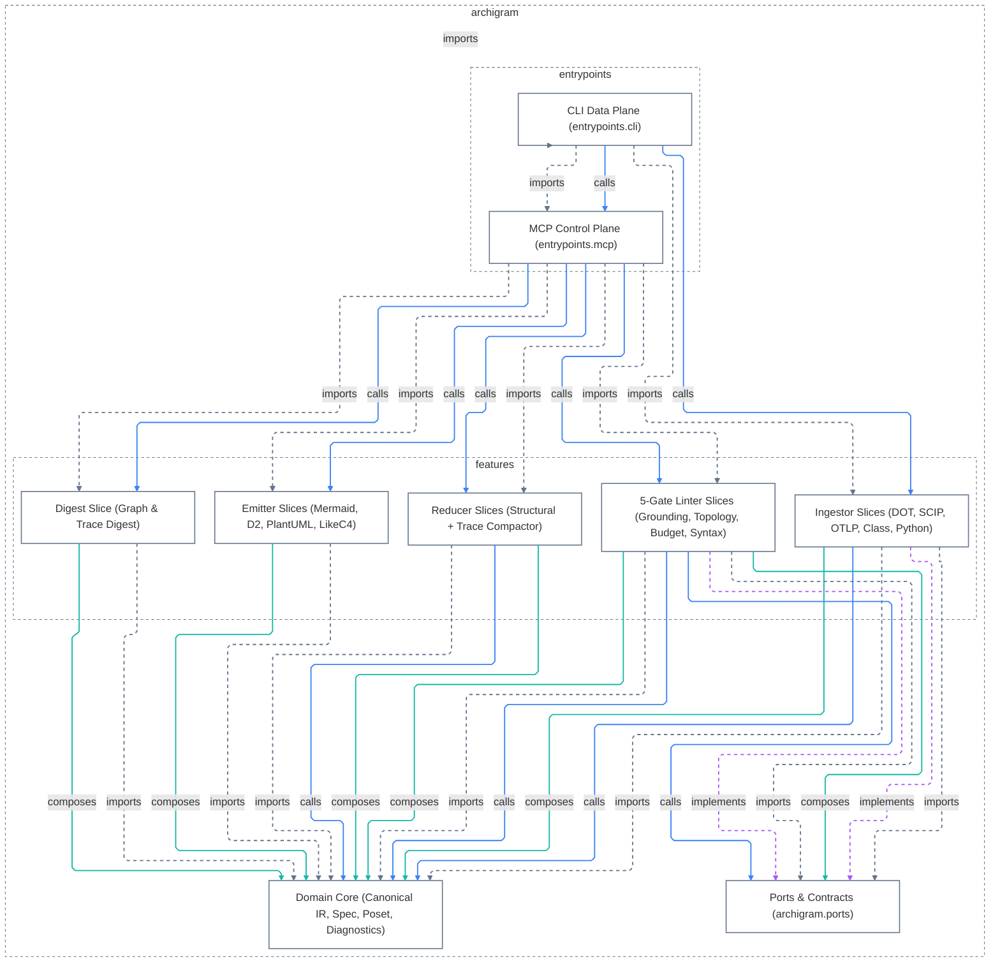
<!-- archigram:end l0_hexagonal_rings_mermaid -->

#### 2. D2 Structural ELK Container Diagram (`l0_hexagonal_rings_d2`)
Uses `layout-engine: elk`, dual light/dark theme IDs (`0` / `200`), `style.fill: transparent` on every container and node, and semantic edge strokes (`#3b82f6` calls, `#64748b` dashed imports, `#a855f7` dashed implements, `#14b8a6` diamond composes).

**Rendered D2 Diagram (`diagrams/l0_hexagonal_rings_d2.d2.svg`):**

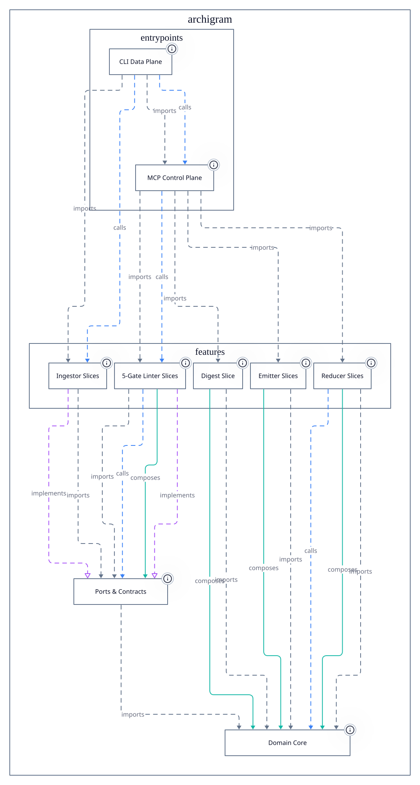

<details>
<summary>View synced D2 source (<code>l0_hexagonal_rings_d2</code>)</summary>

<!-- archigram:start l0_hexagonal_rings_d2 -->
```d2
vars: {
  d2-config: {
    layout-engine: elk
    theme-id: 0
    dark-theme-id: 200
  }
}
style.fill: transparent

archigram: "archigram" {
  style.fill: transparent
  style.stroke: "#64748b"
  "archigram.entrypoints": "entrypoints" {
    style.fill: transparent
    style.stroke: "#64748b"
    cli_dataplane: "CLI Data Plane" {
      style.fill: transparent
      style.stroke: "#64748b"
      tooltip: "Derived via l0_d2_cli_dataplane (85 backing nodes: archigram.entrypoints.cli, archigram.entrypoints.cli.app, archigram.entrypoints.cli.app.ApplyOptions, archigram.entrypoints.cli.app.DiffOptions, archigram.entrypoints.cli.app.LintOptions, ...)"
    }
    mcp_controlplane: "MCP Control Plane" {
      style.fill: transparent
      style.stroke: "#64748b"
      tooltip: "Derived via l0_d2_mcp_controlplane (21 backing nodes: archigram.entrypoints.mcp, archigram.entrypoints.mcp.propose_loop, archigram.entrypoints.mcp.propose_loop.CompiledViewPreview, archigram.entrypoints.mcp.propose_loop.CuratedViewsPreviewReport, archigram.entrypoints.mcp.propose_loop.DeterministicHeuristicProposer, ...)"
    }
  }
  "archigram.features": "features" {
    style.fill: transparent
    style.stroke: "#64748b"
    feature_digest: "Digest Slice" {
      style.fill: transparent
      style.stroke: "#64748b"
      tooltip: "Derived via l0_d2_feature_digest (15 backing nodes: archigram.features.digest, archigram.features.digest.generator, archigram.features.digest.generator.CandidateLeafSink, archigram.features.digest.generator.CandidateWrapperNode, archigram.features.digest.generator.CentralityHub, ...)"
    }
    feature_emitters: "Emitter Slices" {
      style.fill: transparent
      style.stroke: "#64748b"
      tooltip: "Derived via l0_d2_feature_emitters (54 backing nodes: archigram.features.emit_d2, archigram.features.emit_d2.emitter, archigram.features.emit_d2.emitter.D2Emitter, archigram.features.emit_d2.emitter._D2StructuralCtx, archigram.features.emit_d2.emitter._StepEdge, ...)"
    }
    feature_ingestors: "Ingestor Slices" {
      style.fill: transparent
      style.stroke: "#64748b"
      tooltip: "Derived via l0_d2_feature_ingestors (40 backing nodes: archigram.features.ingest_class, archigram.features.ingest_class.ingestor, archigram.features.ingest_class.ingestor.ClassHierarchyIngestor, archigram.features.ingest_class.ingestor._ActiveClassBlock, archigram.features.ingest_class.ingestor._ClassGraphBuilder, ...)"
    }
    feature_linters: "5-Gate Linter Slices" {
      style.fill: transparent
      style.stroke: "#64748b"
      tooltip: "Derived via l0_d2_feature_linters (36 backing nodes: archigram.features.lint_budget, archigram.features.lint_budget.gate, archigram.features.lint_budget.gate.CognitiveBudgetAndOrphanGate, archigram.features.lint_budget.gate.apply_spanning_tree_edge_fallback, archigram.features.lint_grounding, ...)"
    }
    feature_reducers: "Reducer Slices" {
      style.fill: transparent
      style.stroke: "#64748b"
      tooltip: "Derived via l0_d2_feature_reducers (21 backing nodes: archigram.features.reduce_structural, archigram.features.reduce_structural.reducer, archigram.features.reduce_structural.reducer.CycleInducedError, archigram.features.reduce_structural.reducer.StructuralTopologicalReducer, archigram.features.reduce_structural.reducer.apply_structural_rule, ...)"
    }
  }
  domain_core: "Domain Core" {
    style.fill: transparent
    style.stroke: "#64748b"
    tooltip: "Derived via l0_d2_domain_core (82 backing nodes: archigram.domain, archigram.domain.ProvenanceGrade, archigram.domain.ProvenanceStamp, archigram.domain.concurrency, archigram.domain.concurrency.CausalTraceEvent, ...)"
  }
  ports_contracts: "Ports & Contracts" {
    style.fill: transparent
    style.stroke: "#64748b"
    tooltip: "Derived via l0_d2_ports_contracts (12 backing nodes: archigram.ports, archigram.ports.SliceDescriptor, archigram.ports.contracts, archigram.ports.contracts.DiagramEmitterPort, archigram.ports.contracts.DigestGeneratorPort, ...)"
  }
}

archigram."archigram.entrypoints".cli_dataplane -> archigram: "imports" {
  style.stroke: "#64748b"
  style.stroke-dash: 5
}
archigram."archigram.entrypoints".cli_dataplane -> archigram."archigram.features".feature_ingestors: "calls" {
  style.stroke: "#3b82f6"
  style.animated: true
}
archigram."archigram.entrypoints".cli_dataplane -> archigram."archigram.features".feature_ingestors: "imports" {
  style.stroke: "#64748b"
  style.stroke-dash: 5
}
archigram."archigram.entrypoints".cli_dataplane -> archigram."archigram.entrypoints".mcp_controlplane: "calls" {
  style.stroke: "#3b82f6"
  style.animated: true
}
archigram."archigram.entrypoints".cli_dataplane -> archigram."archigram.entrypoints".mcp_controlplane: "imports" {
  style.stroke: "#64748b"
  style.stroke-dash: 5
}
archigram."archigram.features".feature_digest -> archigram.domain_core: "composes" {
  style.stroke: "#14b8a6"
  source-arrowhead: {
    shape: diamond
    style.filled: true
  }
}
archigram."archigram.features".feature_digest -> archigram.domain_core: "imports" {
  style.stroke: "#64748b"
  style.stroke-dash: 5
}
archigram."archigram.features".feature_emitters -> archigram.domain_core: "composes" {
  style.stroke: "#14b8a6"
  source-arrowhead: {
    shape: diamond
    style.filled: true
  }
}
archigram."archigram.features".feature_emitters -> archigram.domain_core: "imports" {
  style.stroke: "#64748b"
  style.stroke-dash: 5
}
archigram."archigram.features".feature_ingestors -> archigram.domain_core: "calls" {
  style.stroke: "#3b82f6"
  style.animated: true
}
archigram."archigram.features".feature_ingestors -> archigram.domain_core: "composes" {
  style.stroke: "#14b8a6"
  source-arrowhead: {
    shape: diamond
    style.filled: true
  }
}
archigram."archigram.features".feature_ingestors -> archigram.domain_core: "imports" {
  style.stroke: "#64748b"
  style.stroke-dash: 5
}
archigram."archigram.features".feature_ingestors -> archigram.ports_contracts: "implements" {
  style.stroke: "#a855f7"
  style.stroke-dash: 5
  target-arrowhead: {
    shape: triangle
    style.filled: false
  }
}
archigram."archigram.features".feature_ingestors -> archigram.ports_contracts: "imports" {
  style.stroke: "#64748b"
  style.stroke-dash: 5
}
archigram."archigram.features".feature_linters -> archigram.domain_core: "calls" {
  style.stroke: "#3b82f6"
  style.animated: true
}
archigram."archigram.features".feature_linters -> archigram.domain_core: "composes" {
  style.stroke: "#14b8a6"
  source-arrowhead: {
    shape: diamond
    style.filled: true
  }
}
archigram."archigram.features".feature_linters -> archigram.domain_core: "imports" {
  style.stroke: "#64748b"
  style.stroke-dash: 5
}
archigram."archigram.features".feature_linters -> archigram.ports_contracts: "calls" {
  style.stroke: "#3b82f6"
  style.animated: true
}
archigram."archigram.features".feature_linters -> archigram.ports_contracts: "composes" {
  style.stroke: "#14b8a6"
  source-arrowhead: {
    shape: diamond
    style.filled: true
  }
}
archigram."archigram.features".feature_linters -> archigram.ports_contracts: "implements" {
  style.stroke: "#a855f7"
  style.stroke-dash: 5
  target-arrowhead: {
    shape: triangle
    style.filled: false
  }
}
archigram."archigram.features".feature_linters -> archigram.ports_contracts: "imports" {
  style.stroke: "#64748b"
  style.stroke-dash: 5
}
archigram."archigram.features".feature_reducers -> archigram.domain_core: "calls" {
  style.stroke: "#3b82f6"
  style.animated: true
}
archigram."archigram.features".feature_reducers -> archigram.domain_core: "composes" {
  style.stroke: "#14b8a6"
  source-arrowhead: {
    shape: diamond
    style.filled: true
  }
}
archigram."archigram.features".feature_reducers -> archigram.domain_core: "imports" {
  style.stroke: "#64748b"
  style.stroke-dash: 5
}
archigram."archigram.entrypoints".mcp_controlplane -> archigram."archigram.features".feature_digest: "calls" {
  style.stroke: "#3b82f6"
  style.animated: true
}
archigram."archigram.entrypoints".mcp_controlplane -> archigram."archigram.features".feature_digest: "imports" {
  style.stroke: "#64748b"
  style.stroke-dash: 5
}
archigram."archigram.entrypoints".mcp_controlplane -> archigram."archigram.features".feature_emitters: "calls" {
  style.stroke: "#3b82f6"
  style.animated: true
}
archigram."archigram.entrypoints".mcp_controlplane -> archigram."archigram.features".feature_emitters: "imports" {
  style.stroke: "#64748b"
  style.stroke-dash: 5
}
archigram."archigram.entrypoints".mcp_controlplane -> archigram."archigram.features".feature_linters: "calls" {
  style.stroke: "#3b82f6"
  style.animated: true
}
archigram."archigram.entrypoints".mcp_controlplane -> archigram."archigram.features".feature_linters: "imports" {
  style.stroke: "#64748b"
  style.stroke-dash: 5
}
archigram."archigram.entrypoints".mcp_controlplane -> archigram."archigram.features".feature_reducers: "calls" {
  style.stroke: "#3b82f6"
  style.animated: true
}
archigram."archigram.entrypoints".mcp_controlplane -> archigram."archigram.features".feature_reducers: "imports" {
  style.stroke: "#64748b"
  style.stroke-dash: 5
}
```
<!-- archigram:end l0_hexagonal_rings_d2 -->

</details>

#### 3. PlantUML Mode C ELK Component Diagram (`l0_hexagonal_rings_puml`)
Uses `!pragma layout elk`, `skinparam linetype ortho`, `skinparam backgroundColor transparent`, transparent UML2 `package` / `component` containers, and inline `[#hex]` UML edge colors + arrowheads (`..>`, `<|..`, `*--`, `-->`):

<!-- archigram:start l0_hexagonal_rings_puml -->
```plantuml
@startuml
!pragma layout elk
skinparam backgroundColor transparent
skinparam linetype ortho
skinparam shadowing false
skinparam componentStyle uml2
skinparam ArrowColor #64748b
skinparam PackageBackgroundColor transparent
skinparam PackageBorderColor #64748b
skinparam ComponentBackgroundColor transparent
skinparam ComponentBorderColor #64748b
skinparam ClassBackgroundColor transparent
skinparam ClassBorderColor #64748b
skinparam ClassHeaderBackgroundColor transparent
skinparam RectangleBackgroundColor transparent
skinparam RectangleBorderColor #64748b
skinparam DatabaseBackgroundColor transparent
skinparam DatabaseBorderColor #64748b
skinparam QueueBackgroundColor transparent
skinparam QueueBorderColor #64748b
package "archigram" as n_0_archigram_983b03 {
  package "entrypoints" as n_1_archigram_entryp_6a8ce0 {
    component "CLI Data Plane" as n_3_cli_dataplane_493a5b
    component "MCP Control Plane" as n_10_mcp_controlplane_ff4d3b
  }
  package "features" as n_2_archigram_featur_e6f01e {
    component "Digest Slice" as n_5_feature_digest_52876d
    component "Emitter Slices" as n_6_feature_emitters_75a4c0
    component "Ingestor Slices" as n_7_feature_ingestor_73234e
    component "5-Gate Linter Slices" as n_8_feature_linters_57c819
    component "Reducer Slices" as n_9_feature_reducers_8a2858
  }
  component "Domain Core" as n_4_domain_core_f195b2
  component "Ports & Contracts" as n_11_ports_contracts_d0accd
}
n_3_cli_dataplane_493a5b ..>[#64748b] n_0_archigram_983b03 : imports
n_3_cli_dataplane_493a5b -->[#3b82f6] n_7_feature_ingestor_73234e : calls
n_3_cli_dataplane_493a5b ..>[#64748b] n_7_feature_ingestor_73234e : imports
n_3_cli_dataplane_493a5b -->[#3b82f6] n_10_mcp_controlplane_ff4d3b : calls
n_3_cli_dataplane_493a5b ..>[#64748b] n_10_mcp_controlplane_ff4d3b : imports
n_5_feature_digest_52876d *--[#14b8a6] n_4_domain_core_f195b2 : composes
n_5_feature_digest_52876d ..>[#64748b] n_4_domain_core_f195b2 : imports
n_6_feature_emitters_75a4c0 *--[#14b8a6] n_4_domain_core_f195b2 : composes
n_6_feature_emitters_75a4c0 ..>[#64748b] n_4_domain_core_f195b2 : imports
n_7_feature_ingestor_73234e -->[#3b82f6] n_4_domain_core_f195b2 : calls
n_7_feature_ingestor_73234e *--[#14b8a6] n_4_domain_core_f195b2 : composes
n_7_feature_ingestor_73234e ..>[#64748b] n_4_domain_core_f195b2 : imports
n_11_ports_contracts_d0accd <|..[#a855f7] n_7_feature_ingestor_73234e : implements
n_7_feature_ingestor_73234e ..>[#64748b] n_11_ports_contracts_d0accd : imports
n_8_feature_linters_57c819 -->[#3b82f6] n_4_domain_core_f195b2 : calls
n_8_feature_linters_57c819 *--[#14b8a6] n_4_domain_core_f195b2 : composes
n_8_feature_linters_57c819 ..>[#64748b] n_4_domain_core_f195b2 : imports
n_8_feature_linters_57c819 -->[#3b82f6] n_11_ports_contracts_d0accd : calls
n_8_feature_linters_57c819 *--[#14b8a6] n_11_ports_contracts_d0accd : composes
n_11_ports_contracts_d0accd <|..[#a855f7] n_8_feature_linters_57c819 : implements
n_8_feature_linters_57c819 ..>[#64748b] n_11_ports_contracts_d0accd : imports
n_9_feature_reducers_8a2858 -->[#3b82f6] n_4_domain_core_f195b2 : calls
n_9_feature_reducers_8a2858 *--[#14b8a6] n_4_domain_core_f195b2 : composes
n_9_feature_reducers_8a2858 ..>[#64748b] n_4_domain_core_f195b2 : imports
n_10_mcp_controlplane_ff4d3b -->[#3b82f6] n_5_feature_digest_52876d : calls
n_10_mcp_controlplane_ff4d3b ..>[#64748b] n_5_feature_digest_52876d : imports
n_10_mcp_controlplane_ff4d3b -->[#3b82f6] n_6_feature_emitters_75a4c0 : calls
n_10_mcp_controlplane_ff4d3b ..>[#64748b] n_6_feature_emitters_75a4c0 : imports
n_10_mcp_controlplane_ff4d3b -->[#3b82f6] n_8_feature_linters_57c819 : calls
n_10_mcp_controlplane_ff4d3b ..>[#64748b] n_8_feature_linters_57c819 : imports
n_10_mcp_controlplane_ff4d3b -->[#3b82f6] n_9_feature_reducers_8a2858 : calls
n_10_mcp_controlplane_ff4d3b ..>[#64748b] n_9_feature_reducers_8a2858 : imports
@enduml
```
<!-- archigram:end l0_hexagonal_rings_puml -->

#### 4. LikeC4 Structural Architecture Model & View (`l0_hexagonal_rings_likec4`)
Uses `opacity 0%` border-only `slate` element specifications so containers adapt to light and dark viewers while coloring typed relationships (`-[calls]->`, `-[imports]->`, `-[implements]->`, `-[composes]->`):

<!-- archigram:start l0_hexagonal_rings_likec4 -->
```likec4
specification {
  element class {
    style {
      color slate
      border solid
      opacity 0%
    }
  }
  element component {
    style {
      color slate
      border solid
      opacity 0%
    }
  }
  element container {
    style {
      color slate
      border solid
      opacity 0%
    }
  }
  element database {
    style {
      color slate
      border solid
      opacity 0%
    }
  }
  element enum {
    style {
      color slate
      border solid
      opacity 0%
    }
  }
  element external {
    style {
      color slate
      border solid
      opacity 0%
    }
  }
  element function {
    style {
      color slate
      border solid
      opacity 0%
    }
  }
  element interface {
    style {
      color slate
      border solid
      opacity 0%
    }
  }
  element module {
    style {
      color slate
      border solid
      opacity 0%
    }
  }
  element package {
    style {
      color slate
      border solid
      opacity 0%
    }
  }
  element queue {
    style {
      color slate
      border solid
      opacity 0%
    }
  }
  element service {
    style {
      color slate
      border solid
      opacity 0%
    }
  }
  element supernode {
    style {
      color slate
      border solid
      opacity 0%
    }
  }
  element table {
    style {
      color slate
      border solid
      opacity 0%
    }
  }
  relationship calls {
    color blue
    line solid
  }
  relationship composes {
    color green
    line solid
  }
  relationship implements {
    color indigo
    line dashed
  }
  relationship imports {
    color slate
    line dashed
  }
}

model {
  archigram = package 'archigram' {
    archigram_entrypoints = package 'entrypoints' {
      cli_dataplane = supernode 'CLI Data Plane'
      mcp_controlplane = supernode 'MCP Control Plane'
    }
    archigram_features = package 'features' {
      feature_digest = supernode 'Digest Slice'
      feature_emitters = supernode 'Emitter Slices'
      feature_ingestors = supernode 'Ingestor Slices'
      feature_linters = supernode '5-Gate Linter Slices'
      feature_reducers = supernode 'Reducer Slices'
    }
    domain_core = supernode 'Domain Core'
    ports_contracts = supernode 'Ports & Contracts'
  }

  archigram.archigram_entrypoints.cli_dataplane -[calls]-> archigram.archigram_entrypoints.mcp_controlplane 'calls'
  archigram.archigram_entrypoints.cli_dataplane -[imports]-> archigram.archigram_entrypoints.mcp_controlplane 'imports'
  archigram.archigram_entrypoints.cli_dataplane -[calls]-> archigram.archigram_features.feature_ingestors 'calls'
  archigram.archigram_entrypoints.cli_dataplane -[imports]-> archigram.archigram_features.feature_ingestors 'imports'
  archigram.archigram_entrypoints.mcp_controlplane -[calls]-> archigram.archigram_features.feature_digest 'calls'
  archigram.archigram_entrypoints.mcp_controlplane -[imports]-> archigram.archigram_features.feature_digest 'imports'
  archigram.archigram_entrypoints.mcp_controlplane -[calls]-> archigram.archigram_features.feature_emitters 'calls'
  archigram.archigram_entrypoints.mcp_controlplane -[imports]-> archigram.archigram_features.feature_emitters 'imports'
  archigram.archigram_entrypoints.mcp_controlplane -[calls]-> archigram.archigram_features.feature_linters 'calls'
  archigram.archigram_entrypoints.mcp_controlplane -[imports]-> archigram.archigram_features.feature_linters 'imports'
  archigram.archigram_entrypoints.mcp_controlplane -[calls]-> archigram.archigram_features.feature_reducers 'calls'
  archigram.archigram_entrypoints.mcp_controlplane -[imports]-> archigram.archigram_features.feature_reducers 'imports'
  archigram.archigram_features.feature_digest -[composes]-> archigram.domain_core 'composes'
  archigram.archigram_features.feature_digest -[imports]-> archigram.domain_core 'imports'
  archigram.archigram_features.feature_emitters -[composes]-> archigram.domain_core 'composes'
  archigram.archigram_features.feature_emitters -[imports]-> archigram.domain_core 'imports'
  archigram.archigram_features.feature_ingestors -[calls]-> archigram.domain_core 'calls'
  archigram.archigram_features.feature_ingestors -[composes]-> archigram.domain_core 'composes'
  archigram.archigram_features.feature_ingestors -[imports]-> archigram.domain_core 'imports'
  archigram.archigram_features.feature_ingestors -[implements]-> archigram.ports_contracts 'implements'
  archigram.archigram_features.feature_ingestors -[imports]-> archigram.ports_contracts 'imports'
  archigram.archigram_features.feature_linters -[calls]-> archigram.domain_core 'calls'
  archigram.archigram_features.feature_linters -[composes]-> archigram.domain_core 'composes'
  archigram.archigram_features.feature_linters -[imports]-> archigram.domain_core 'imports'
  archigram.archigram_features.feature_linters -[calls]-> archigram.ports_contracts 'calls'
  archigram.archigram_features.feature_linters -[composes]-> archigram.ports_contracts 'composes'
  archigram.archigram_features.feature_linters -[implements]-> archigram.ports_contracts 'implements'
  archigram.archigram_features.feature_linters -[imports]-> archigram.ports_contracts 'imports'
  archigram.archigram_features.feature_reducers -[calls]-> archigram.domain_core 'calls'
  archigram.archigram_features.feature_reducers -[composes]-> archigram.domain_core 'composes'
  archigram.archigram_features.feature_reducers -[imports]-> archigram.domain_core 'imports'
}

views {
  view index {
    include *
  }
}
```
<!-- archigram:end l0_hexagonal_rings_likec4 -->

#### 5. Graphviz DOT Orthogonal Cluster Graph (`l0_hexagonal_rings_dot`)
Uses `bgcolor="transparent"`, `splines="ortho"`, rounded `#64748b` cluster/node outlines, `xlabel` edge annotations, semantic hex strokes, and UML arrowheads (`normal`, `vee`, `onormal`), while preserving lossless round-trip `_kind` / `_rel_kind` metadata for `DotStructuralIngestor`.

**Rendered Graphviz DOT Diagram (`diagrams/l0_hexagonal_rings_dot.dot.svg`):**

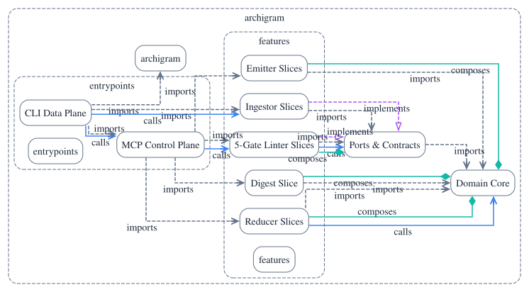

<details>
<summary>View synced Graphviz DOT source (<code>l0_hexagonal_rings_dot</code>)</summary>

<!-- archigram:start l0_hexagonal_rings_dot -->
```dot
digraph "archigram" {
  rankdir="LR";
  bgcolor="transparent";
  splines="ortho";
  node [shape="box", style="rounded", color="#64748b", fontcolor="#64748b"];
  edge [penwidth="1.5", fontcolor="#64748b"];
  subgraph "cluster_archigram" {
    label="archigram";
    bgcolor="transparent";
    style="rounded,dashed";
    color="#64748b";
    fontcolor="#64748b";
    "archigram" [label="archigram", kind="package", _kind="package"];
    subgraph "cluster_archigram.entrypoints" {
      label="entrypoints";
      bgcolor="transparent";
      style="rounded,dashed";
      color="#64748b";
      fontcolor="#64748b";
      "archigram.entrypoints" [label="entrypoints", kind="package", _kind="package"];
      "cli_dataplane" [label="CLI Data Plane", kind="supernode", _kind="supernode"];
      "mcp_controlplane" [label="MCP Control Plane", kind="supernode", _kind="supernode"];
    }
    subgraph "cluster_archigram.features" {
      label="features";
      bgcolor="transparent";
      style="rounded,dashed";
      color="#64748b";
      fontcolor="#64748b";
      "archigram.features" [label="features", kind="package", _kind="package"];
      "feature_digest" [label="Digest Slice", kind="supernode", _kind="supernode"];
      "feature_emitters" [label="Emitter Slices", kind="supernode", _kind="supernode"];
      "feature_ingestors" [label="Ingestor Slices", kind="supernode", _kind="supernode"];
      "feature_linters" [label="5-Gate Linter Slices", kind="supernode", _kind="supernode"];
      "feature_reducers" [label="Reducer Slices", kind="supernode", _kind="supernode"];
    }
    "domain_core" [label="Domain Core", kind="supernode", _kind="supernode"];
    "ports_contracts" [label="Ports & Contracts", kind="supernode", _kind="supernode"];
  }
  "cli_dataplane" -> "archigram" [xlabel="imports", _rel_kind="imports", _sync_kind="sync", style="dashed", color="#64748b", arrowhead="vee"];
  "cli_dataplane" -> "feature_ingestors" [xlabel="calls", _rel_kind="calls", _sync_kind="sync", style="solid", color="#3b82f6", arrowhead="vee"];
  "cli_dataplane" -> "feature_ingestors" [xlabel="imports", _rel_kind="imports", _sync_kind="sync", style="dashed", color="#64748b", arrowhead="vee"];
  "cli_dataplane" -> "mcp_controlplane" [xlabel="calls", _rel_kind="calls", _sync_kind="sync", style="solid", color="#3b82f6", arrowhead="vee"];
  "cli_dataplane" -> "mcp_controlplane" [xlabel="imports", _rel_kind="imports", _sync_kind="sync", style="dashed", color="#64748b", arrowhead="vee"];
  "feature_digest" -> "domain_core" [xlabel="composes", _rel_kind="composes", _sync_kind="sync", style="solid", color="#14b8a6", arrowhead="diamond"];
  "feature_digest" -> "domain_core" [xlabel="imports", _rel_kind="imports", _sync_kind="sync", style="dashed", color="#64748b", arrowhead="vee"];
  "feature_emitters" -> "domain_core" [xlabel="composes", _rel_kind="composes", _sync_kind="sync", style="solid", color="#14b8a6", arrowhead="diamond"];
  "feature_emitters" -> "domain_core" [xlabel="imports", _rel_kind="imports", _sync_kind="sync", style="dashed", color="#64748b", arrowhead="vee"];
  "feature_ingestors" -> "domain_core" [xlabel="calls", _rel_kind="calls", _sync_kind="sync", style="solid", color="#3b82f6", arrowhead="vee"];
  "feature_ingestors" -> "domain_core" [xlabel="composes", _rel_kind="composes", _sync_kind="sync", style="solid", color="#14b8a6", arrowhead="diamond"];
  "feature_ingestors" -> "domain_core" [xlabel="imports", _rel_kind="imports", _sync_kind="sync", style="dashed", color="#64748b", arrowhead="vee"];
  "feature_ingestors" -> "ports_contracts" [xlabel="implements", _rel_kind="implements", _sync_kind="sync", style="dashed", color="#a855f7", arrowhead="empty"];
  "feature_ingestors" -> "ports_contracts" [xlabel="imports", _rel_kind="imports", _sync_kind="sync", style="dashed", color="#64748b", arrowhead="vee"];
  "feature_linters" -> "domain_core" [xlabel="calls", _rel_kind="calls", _sync_kind="sync", style="solid", color="#3b82f6", arrowhead="vee"];
  "feature_linters" -> "domain_core" [xlabel="composes", _rel_kind="composes", _sync_kind="sync", style="solid", color="#14b8a6", arrowhead="diamond"];
  "feature_linters" -> "domain_core" [xlabel="imports", _rel_kind="imports", _sync_kind="sync", style="dashed", color="#64748b", arrowhead="vee"];
  "feature_linters" -> "ports_contracts" [xlabel="calls", _rel_kind="calls", _sync_kind="sync", style="solid", color="#3b82f6", arrowhead="vee"];
  "feature_linters" -> "ports_contracts" [xlabel="composes", _rel_kind="composes", _sync_kind="sync", style="solid", color="#14b8a6", arrowhead="diamond"];
  "feature_linters" -> "ports_contracts" [xlabel="implements", _rel_kind="implements", _sync_kind="sync", style="dashed", color="#a855f7", arrowhead="empty"];
  "feature_linters" -> "ports_contracts" [xlabel="imports", _rel_kind="imports", _sync_kind="sync", style="dashed", color="#64748b", arrowhead="vee"];
  "feature_reducers" -> "domain_core" [xlabel="calls", _rel_kind="calls", _sync_kind="sync", style="solid", color="#3b82f6", arrowhead="vee"];
  "feature_reducers" -> "domain_core" [xlabel="composes", _rel_kind="composes", _sync_kind="sync", style="solid", color="#14b8a6", arrowhead="diamond"];
  "feature_reducers" -> "domain_core" [xlabel="imports", _rel_kind="imports", _sync_kind="sync", style="dashed", color="#64748b", arrowhead="vee"];
  "mcp_controlplane" -> "feature_digest" [xlabel="calls", _rel_kind="calls", _sync_kind="sync", style="solid", color="#3b82f6", arrowhead="vee"];
  "mcp_controlplane" -> "feature_digest" [xlabel="imports", _rel_kind="imports", _sync_kind="sync", style="dashed", color="#64748b", arrowhead="vee"];
  "mcp_controlplane" -> "feature_emitters" [xlabel="calls", _rel_kind="calls", _sync_kind="sync", style="solid", color="#3b82f6", arrowhead="vee"];
  "mcp_controlplane" -> "feature_emitters" [xlabel="imports", _rel_kind="imports", _sync_kind="sync", style="dashed", color="#64748b", arrowhead="vee"];
  "mcp_controlplane" -> "feature_linters" [xlabel="calls", _rel_kind="calls", _sync_kind="sync", style="solid", color="#3b82f6", arrowhead="vee"];
  "mcp_controlplane" -> "feature_linters" [xlabel="imports", _rel_kind="imports", _sync_kind="sync", style="dashed", color="#64748b", arrowhead="vee"];
  "mcp_controlplane" -> "feature_reducers" [xlabel="calls", _rel_kind="calls", _sync_kind="sync", style="solid", color="#3b82f6", arrowhead="vee"];
  "mcp_controlplane" -> "feature_reducers" [xlabel="imports", _rel_kind="imports", _sync_kind="sync", style="dashed", color="#64748b", arrowhead="vee"];
}
```
<!-- archigram:end l0_hexagonal_rings_dot -->

</details>

---

### Part B — OOP Class & Protocol Diagrams (All 3 Class Renderers on Gate 5 `SyntaxValidatorPort`)

What was done on the L2c OOP dataset: Using `diagram_variant: class` and `k_hop_neighborhood` (`depth=0`) around `SyntaxValidatorPort`, `SyntaxValidationResult`, `Gate5SyntaxHarness`, and the 5 concrete syntax validators (`MermaidSyntaxValidator`, `D2SyntaxValidator`, `PlantUmlSyntaxValidator`, `LikeC4SyntaxValidator`, `DotSyntaxValidator`), ArchiGram projects real Python `Protocol` interfaces, typed method signatures, UML realization (`<|..`), composition (`*--`), and return-type construction (`-->`).

#### 6. Mermaid OOP `classDiagram` (`l2c_oop_syntax_validators_mermaid`)
Emits `<<interface>>` stereotypes, visibility-prefixed field/method compartments, and standard UML hollow-triangle realization (`<|..`), filled-diamond composition (`*--`), and directed association (`-->`) arrows:

<!-- archigram:start l2c_oop_syntax_validators_mermaid -->
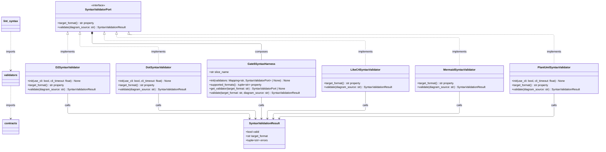
<!-- archigram:end l2c_oop_syntax_validators_mermaid -->

#### 7. D2 OOP `shape: class` Diagram (`l2c_oop_syntax_validators_d2`)
Nests `shape: class` tables inside transparent `ports.contracts` and `features.lint_syntax` package boundaries, rendering purple dashed hollow-triangle `implements` edges (`#a855f7`), teal filled-diamond `composes` edges (`#14b8a6`), and blue `calls` edges (`#3b82f6`).

**Rendered D2 OOP Class Diagram (`diagrams/l2c_oop_syntax_validators_d2.d2.svg`):**

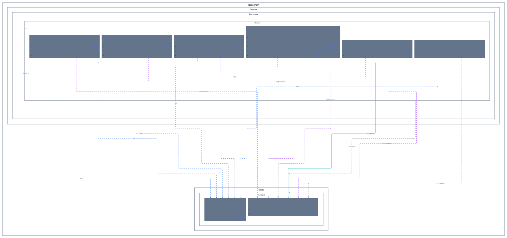

<details>
<summary>View synced D2 OOP class source (<code>l2c_oop_syntax_validators_d2</code>)</summary>

<!-- archigram:start l2c_oop_syntax_validators_d2 -->
```d2
vars: {
  d2-config: {
    layout-engine: elk
    theme-id: 0
    dark-theme-id: 200
  }
}
style.fill: transparent

archigram: "archigram" {
  style.fill: transparent
  style.stroke: "#64748b"
  "archigram.features": "features" {
    style.fill: transparent
    style.stroke: "#64748b"
    "archigram.features.lint_syntax": "lint_syntax" {
      style.fill: transparent
      style.stroke: "#64748b"
      "archigram.features.lint_syntax.validators": "validators" {
        style.fill: transparent
        style.stroke: "#64748b"
        "archigram.features.lint_syntax.validators.D2SyntaxValidator": "D2SyntaxValidator" {
          shape: class
          "+__init__(use_cli: bool, cli_timeout: float)": "None"
          "+property target_format()": "str"
          "+validate(diagram_source: str)": "SyntaxValidationResult"
        }
        "archigram.features.lint_syntax.validators.DotSyntaxValidator": "DotSyntaxValidator" {
          shape: class
          "+__init__(use_cli: bool, cli_timeout: float)": "None"
          "+property target_format()": "str"
          "+validate(diagram_source: str)": "SyntaxValidationResult"
        }
        "archigram.features.lint_syntax.validators.Gate5SyntaxHarness": "Gate5SyntaxHarness" {
          shape: class
          "+slice_name": "str"
          "+__init__(validators: Mapping[str, SyntaxValidatorPort] | None)": "None"
          "+property supported_formats()": "tuple[str, ...]"
          "+get_validator(target_format: str)": "SyntaxValidatorPort | None"
          "+validate(target_format: str, diagram_source: str)": "SyntaxValidationResult"
        }
        "archigram.features.lint_syntax.validators.LikeC4SyntaxValidator": "LikeC4SyntaxValidator" {
          shape: class
          "+property target_format()": "str"
          "+validate(diagram_source: str)": "SyntaxValidationResult"
        }
        "archigram.features.lint_syntax.validators.MermaidSyntaxValidator": "MermaidSyntaxValidator" {
          shape: class
          "+property target_format()": "str"
          "+validate(diagram_source: str)": "SyntaxValidationResult"
        }
        "archigram.features.lint_syntax.validators.PlantUmlSyntaxValidator": "PlantUmlSyntaxValidator" {
          shape: class
          "+__init__(use_cli: bool, cli_timeout: float)": "None"
          "+property target_format()": "str"
          "+validate(diagram_source: str)": "SyntaxValidationResult"
        }
      }
    }
  }
  "archigram.ports": "ports" {
    style.fill: transparent
    style.stroke: "#64748b"
    "archigram.ports.contracts": "contracts" {
      style.fill: transparent
      style.stroke: "#64748b"
      "archigram.ports.contracts.SyntaxValidationResult": "SyntaxValidationResult" {
        shape: class
        "+valid": "bool"
        "+target_format": "str"
        "+errors": "tuple[str, ...]"
      }
      "archigram.ports.contracts.SyntaxValidatorPort": "SyntaxValidatorPort" {
        shape: class
        "+property target_format()": "str"
        "+validate(diagram_source: str)": "SyntaxValidationResult"
      }
    }
  }
}

archigram."archigram.features"."archigram.features.lint_syntax" -> archigram."archigram.features"."archigram.features.lint_syntax"."archigram.features.lint_syntax.validators": "imports" {
  style.stroke: "#64748b"
  style.stroke-dash: 5
}
archigram."archigram.features"."archigram.features.lint_syntax"."archigram.features.lint_syntax.validators" -> archigram."archigram.ports"."archigram.ports.contracts": "imports" {
  style.stroke: "#64748b"
  style.stroke-dash: 5
}
archigram."archigram.features"."archigram.features.lint_syntax"."archigram.features.lint_syntax.validators"."archigram.features.lint_syntax.validators.D2SyntaxValidator" -> archigram."archigram.ports"."archigram.ports.contracts"."archigram.ports.contracts.SyntaxValidationResult": "calls" {
  style.stroke: "#3b82f6"
  style.animated: true
}
archigram."archigram.features"."archigram.features.lint_syntax"."archigram.features.lint_syntax.validators"."archigram.features.lint_syntax.validators.D2SyntaxValidator" -> archigram."archigram.ports"."archigram.ports.contracts"."archigram.ports.contracts.SyntaxValidatorPort": "implements" {
  style.stroke: "#a855f7"
  style.stroke-dash: 5
  target-arrowhead: {
    shape: triangle
    style.filled: false
  }
}
archigram."archigram.features"."archigram.features.lint_syntax"."archigram.features.lint_syntax.validators"."archigram.features.lint_syntax.validators.DotSyntaxValidator" -> archigram."archigram.ports"."archigram.ports.contracts"."archigram.ports.contracts.SyntaxValidationResult": "calls" {
  style.stroke: "#3b82f6"
  style.animated: true
}
archigram."archigram.features"."archigram.features.lint_syntax"."archigram.features.lint_syntax.validators"."archigram.features.lint_syntax.validators.DotSyntaxValidator" -> archigram."archigram.ports"."archigram.ports.contracts"."archigram.ports.contracts.SyntaxValidatorPort": "implements" {
  style.stroke: "#a855f7"
  style.stroke-dash: 5
  target-arrowhead: {
    shape: triangle
    style.filled: false
  }
}
archigram."archigram.features"."archigram.features.lint_syntax"."archigram.features.lint_syntax.validators"."archigram.features.lint_syntax.validators.Gate5SyntaxHarness" -> archigram."archigram.ports"."archigram.ports.contracts"."archigram.ports.contracts.SyntaxValidationResult": "calls" {
  style.stroke: "#3b82f6"
  style.animated: true
}
archigram."archigram.features"."archigram.features.lint_syntax"."archigram.features.lint_syntax.validators"."archigram.features.lint_syntax.validators.Gate5SyntaxHarness" -> archigram."archigram.ports"."archigram.ports.contracts"."archigram.ports.contracts.SyntaxValidatorPort": "composes" {
  style.stroke: "#14b8a6"
  source-arrowhead: {
    shape: diamond
    style.filled: true
  }
}
archigram."archigram.features"."archigram.features.lint_syntax"."archigram.features.lint_syntax.validators"."archigram.features.lint_syntax.validators.LikeC4SyntaxValidator" -> archigram."archigram.ports"."archigram.ports.contracts"."archigram.ports.contracts.SyntaxValidationResult": "calls" {
  style.stroke: "#3b82f6"
  style.animated: true
}
archigram."archigram.features"."archigram.features.lint_syntax"."archigram.features.lint_syntax.validators"."archigram.features.lint_syntax.validators.LikeC4SyntaxValidator" -> archigram."archigram.ports"."archigram.ports.contracts"."archigram.ports.contracts.SyntaxValidatorPort": "implements" {
  style.stroke: "#a855f7"
  style.stroke-dash: 5
  target-arrowhead: {
    shape: triangle
    style.filled: false
  }
}
archigram."archigram.features"."archigram.features.lint_syntax"."archigram.features.lint_syntax.validators"."archigram.features.lint_syntax.validators.MermaidSyntaxValidator" -> archigram."archigram.ports"."archigram.ports.contracts"."archigram.ports.contracts.SyntaxValidationResult": "calls" {
  style.stroke: "#3b82f6"
  style.animated: true
}
archigram."archigram.features"."archigram.features.lint_syntax"."archigram.features.lint_syntax.validators"."archigram.features.lint_syntax.validators.MermaidSyntaxValidator" -> archigram."archigram.ports"."archigram.ports.contracts"."archigram.ports.contracts.SyntaxValidatorPort": "implements" {
  style.stroke: "#a855f7"
  style.stroke-dash: 5
  target-arrowhead: {
    shape: triangle
    style.filled: false
  }
}
archigram."archigram.features"."archigram.features.lint_syntax"."archigram.features.lint_syntax.validators"."archigram.features.lint_syntax.validators.PlantUmlSyntaxValidator" -> archigram."archigram.ports"."archigram.ports.contracts"."archigram.ports.contracts.SyntaxValidationResult": "calls" {
  style.stroke: "#3b82f6"
  style.animated: true
}
archigram."archigram.features"."archigram.features.lint_syntax"."archigram.features.lint_syntax.validators"."archigram.features.lint_syntax.validators.PlantUmlSyntaxValidator" -> archigram."archigram.ports"."archigram.ports.contracts"."archigram.ports.contracts.SyntaxValidatorPort": "implements" {
  style.stroke: "#a855f7"
  style.stroke-dash: 5
  target-arrowhead: {
    shape: triangle
    style.filled: false
  }
}
```
<!-- archigram:end l2c_oop_syntax_validators_d2 -->

</details>

#### 8. PlantUML Mode B OOP Class & Interface Diagram (`l2c_oop_syntax_validators_puml`)
Emits native PlantUML `interface` and `class` compartments inside nested packages under `!pragma layout elk` and `skinparam linetype ortho`:

<!-- archigram:start l2c_oop_syntax_validators_puml -->
```plantuml
@startuml
!pragma layout elk
skinparam backgroundColor transparent
skinparam linetype ortho
skinparam shadowing false
skinparam componentStyle uml2
skinparam ArrowColor #64748b
skinparam PackageBackgroundColor transparent
skinparam PackageBorderColor #64748b
skinparam ComponentBackgroundColor transparent
skinparam ComponentBorderColor #64748b
skinparam ClassBackgroundColor transparent
skinparam ClassBorderColor #64748b
skinparam ClassHeaderBackgroundColor transparent
skinparam RectangleBackgroundColor transparent
skinparam RectangleBorderColor #64748b
skinparam DatabaseBackgroundColor transparent
skinparam DatabaseBorderColor #64748b
skinparam QueueBackgroundColor transparent
skinparam QueueBorderColor #64748b
package "archigram" as c_0_archigram_983b03 {
  package "features" as c_1_archigram_featur_e6f01e {
    package "lint_syntax" as c_2_archigram_featur_ba3738 {
      package "validators" as c_3_archigram_featur_d6e8be {
        class "D2SyntaxValidator" as c_4_archigram_featur_bb531f {
          +init(use_cli: bool, cli_timeout: float) : None
          +property target_format() : str
          +validate(diagram_source: str) : SyntaxValidationResult
        }
        class "DotSyntaxValidator" as c_5_archigram_featur_86114b {
          +init(use_cli: bool, cli_timeout: float) : None
          +property target_format() : str
          +validate(diagram_source: str) : SyntaxValidationResult
        }
        class "Gate5SyntaxHarness" as c_6_archigram_featur_4106c5 {
          +slice_name : str
          +init(validators: Mapping[str, SyntaxValidatorPort] | None) : None
          +property supported_formats() : tuple[str, ...]
          +get_validator(target_format: str) : SyntaxValidatorPort | None
          +validate(target_format: str, diagram_source: str) : SyntaxValidationResult
        }
        class "LikeC4SyntaxValidator" as c_7_archigram_featur_c2d69d {
          +property target_format() : str
          +validate(diagram_source: str) : SyntaxValidationResult
        }
        class "MermaidSyntaxValidator" as c_8_archigram_featur_086112 {
          +property target_format() : str
          +validate(diagram_source: str) : SyntaxValidationResult
        }
        class "PlantUmlSyntaxValidator" as c_9_archigram_featur_46a958 {
          +init(use_cli: bool, cli_timeout: float) : None
          +property target_format() : str
          +validate(diagram_source: str) : SyntaxValidationResult
        }
      }
    }
  }
  package "ports" as c_10_archigram_ports_384a04 {
    package "contracts" as c_11_archigram_ports__7ed230 {
      class "SyntaxValidationResult" as c_12_archigram_ports__58ed33 {
        +valid : bool
        +target_format : str
        +errors : tuple[str, ...]
      }
      interface "SyntaxValidatorPort" as c_13_archigram_ports__993eea {
        +property target_format() : str
        +validate(diagram_source: str) : SyntaxValidationResult
      }
    }
  }
}
c_2_archigram_featur_ba3738 ..>[#64748b] c_3_archigram_featur_d6e8be : imports
c_3_archigram_featur_d6e8be ..>[#64748b] c_11_archigram_ports__7ed230 : imports
c_4_archigram_featur_bb531f -->[#3b82f6] c_12_archigram_ports__58ed33 : calls
c_13_archigram_ports__993eea <|..[#a855f7] c_4_archigram_featur_bb531f : implements
c_5_archigram_featur_86114b -->[#3b82f6] c_12_archigram_ports__58ed33 : calls
c_13_archigram_ports__993eea <|..[#a855f7] c_5_archigram_featur_86114b : implements
c_6_archigram_featur_4106c5 -->[#3b82f6] c_12_archigram_ports__58ed33 : calls
c_6_archigram_featur_4106c5 *--[#14b8a6] c_13_archigram_ports__993eea : composes
c_7_archigram_featur_c2d69d -->[#3b82f6] c_12_archigram_ports__58ed33 : calls
c_13_archigram_ports__993eea <|..[#a855f7] c_7_archigram_featur_c2d69d : implements
c_8_archigram_featur_086112 -->[#3b82f6] c_12_archigram_ports__58ed33 : calls
c_13_archigram_ports__993eea <|..[#a855f7] c_8_archigram_featur_086112 : implements
c_9_archigram_featur_46a958 -->[#3b82f6] c_12_archigram_ports__58ed33 : calls
c_13_archigram_ports__993eea <|..[#a855f7] c_9_archigram_featur_46a958 : implements
@enduml
```
<!-- archigram:end l2c_oop_syntax_validators_puml -->

---

### Part C — Runtime Execution Trace Diagrams (All 5 Renderers on Live L3 Trace)

What was done on the L3 trace dataset: `self_trace.py` records 180 live Python 3.12+ `sys.monitoring` call/return spans across 15 modules while running `compile_and_lint_pipeline` and the 3-turn self-healing `run_propose_loop`. `TraceCompactionEngine` (`R1–R6` + Series-Parallel poset decomposition) folds contiguous loops (`[loop x3]`, `[loop x2]`), caps helper depth at `2`, and verifies causal partial-order preservation (`preserve_partial_order: true`).

#### 9. Mermaid `sequenceDiagram` (`l3_runtime_pipeline_mermaid`)
Uses transparent actor/note/loop theme variables and UML synchronous call/return activations (`->>+` / `-->>-`):

<!-- archigram:start l3_runtime_pipeline_mermaid -->
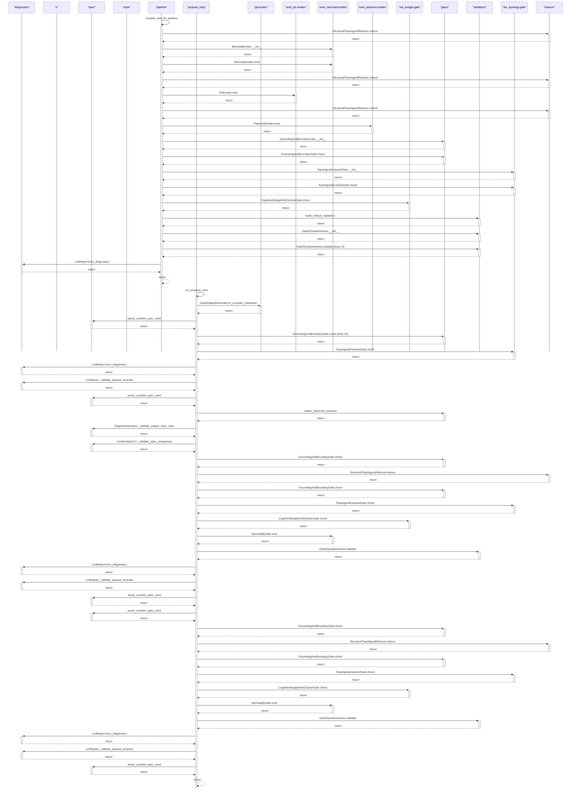
<!-- archigram:end l3_runtime_pipeline_mermaid -->

#### 10. D2 `shape: sequence_diagram` (`l3_runtime_pipeline_d2`)
Emits D2's native `shape: sequence_diagram` timeline with transparent participant headers and `#3b82f6` semantic call strokes.

**Rendered D2 Sequence Diagram (`diagrams/l3_runtime_pipeline_d2.d2.svg`):**

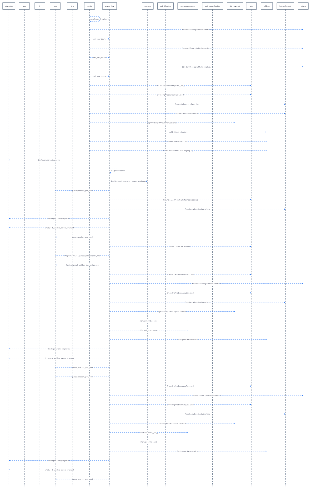

<details>
<summary>View synced D2 sequence source (<code>l3_runtime_pipeline_d2</code>)</summary>

<!-- archigram:start l3_runtime_pipeline_d2 -->
```d2
vars: {
  d2-config: {
    layout-engine: elk
    theme-id: 0
    dark-theme-id: 200
  }
}
style.fill: transparent

shape: sequence_diagram

"archigram.domain.diagnostics": "diagnostics" {
  style.fill: transparent
  style.stroke: "#64748b"
}
"archigram.domain.ir": "ir" {
  style.fill: transparent
  style.stroke: "#64748b"
}
"archigram.domain.spec": "spec" {
  style.fill: transparent
  style.stroke: "#64748b"
}
"archigram.domain.style": "style" {
  style.fill: transparent
  style.stroke: "#64748b"
}
"archigram.entrypoints.cli.pipeline": "pipeline" {
  style.fill: transparent
  style.stroke: "#64748b"
}
"archigram.entrypoints.mcp.propose_loop": "propose_loop" {
  style.fill: transparent
  style.stroke: "#64748b"
}
"archigram.features.digest.generator": "generator" {
  style.fill: transparent
  style.stroke: "#64748b"
}
"archigram.features.emit_d2.emitter": "emit_d2.emitter" {
  style.fill: transparent
  style.stroke: "#64748b"
}
"archigram.features.emit_mermaid.emitter": "emit_mermaid.emitter" {
  style.fill: transparent
  style.stroke: "#64748b"
}
"archigram.features.emit_plantuml.emitter": "emit_plantuml.emitter" {
  style.fill: transparent
  style.stroke: "#64748b"
}
"archigram.features.lint_budget.gate": "lint_budget.gate" {
  style.fill: transparent
  style.stroke: "#64748b"
}
"archigram.features.lint_grounding.gates": "gates" {
  style.fill: transparent
  style.stroke: "#64748b"
}
"archigram.features.lint_syntax.validators": "validators" {
  style.fill: transparent
  style.stroke: "#64748b"
}
"archigram.features.lint_topology.gate": "lint_topology.gate" {
  style.fill: transparent
  style.stroke: "#64748b"
}
"archigram.features.reduce_structural.reducer": "reducer" {
  style.fill: transparent
  style.stroke: "#64748b"
}

"archigram.entrypoints.cli.pipeline" -> "archigram.entrypoints.cli.pipeline": "compile_and_lint_pipeline" {
  style.stroke: "#3b82f6"
  style.animated: true
}
"archigram.entrypoints.cli.pipeline" -> "archigram.features.reduce_structural.reducer": "StructuralTopologicalReducer.reduce" {
  style.stroke: "#3b82f6"
  style.animated: true
}
"archigram.entrypoints.cli.pipeline" -> "archigram.features.emit_mermaid.emitter": "MermaidEmitter.__init__" {
  style.stroke: "#3b82f6"
  style.animated: true
}
"archigram.entrypoints.cli.pipeline" -> "archigram.features.emit_mermaid.emitter": "MermaidEmitter.emit" {
  style.stroke: "#3b82f6"
  style.animated: true
}
"archigram.entrypoints.cli.pipeline" -> "archigram.features.reduce_structural.reducer": "StructuralTopologicalReducer.reduce" {
  style.stroke: "#3b82f6"
  style.animated: true
}
"archigram.entrypoints.cli.pipeline" -> "archigram.features.emit_d2.emitter": "D2Emitter.emit" {
  style.stroke: "#3b82f6"
  style.animated: true
}
"archigram.entrypoints.cli.pipeline" -> "archigram.features.reduce_structural.reducer": "StructuralTopologicalReducer.reduce" {
  style.stroke: "#3b82f6"
  style.animated: true
}
"archigram.entrypoints.cli.pipeline" -> "archigram.features.emit_plantuml.emitter": "PlantUmlEmitter.emit" {
  style.stroke: "#3b82f6"
  style.animated: true
}
"archigram.entrypoints.cli.pipeline" -> "archigram.features.lint_grounding.gates": "GroundingAndBoundaryGate.__init__" {
  style.stroke: "#3b82f6"
  style.animated: true
}
"archigram.entrypoints.cli.pipeline" -> "archigram.features.lint_grounding.gates": "GroundingAndBoundaryGate.check" {
  style.stroke: "#3b82f6"
  style.animated: true
}
"archigram.entrypoints.cli.pipeline" -> "archigram.features.lint_topology.gate": "TopologicalInvariantGate.__init__" {
  style.stroke: "#3b82f6"
  style.animated: true
}
"archigram.entrypoints.cli.pipeline" -> "archigram.features.lint_topology.gate": "TopologicalInvariantGate.check" {
  style.stroke: "#3b82f6"
  style.animated: true
}
"archigram.entrypoints.cli.pipeline" -> "archigram.features.lint_budget.gate": "CognitiveBudgetAndOrphanGate.check" {
  style.stroke: "#3b82f6"
  style.animated: true
}
"archigram.entrypoints.cli.pipeline" -> "archigram.features.lint_syntax.validators": "build_default_validators" {
  style.stroke: "#3b82f6"
  style.animated: true
}
"archigram.entrypoints.cli.pipeline" -> "archigram.features.lint_syntax.validators": "Gate5SyntaxHarness.__init__" {
  style.stroke: "#3b82f6"
  style.animated: true
}
"archigram.entrypoints.cli.pipeline" -> "archigram.features.lint_syntax.validators": "Gate5SyntaxHarness.validate [loop x3]" {
  style.stroke: "#3b82f6"
  style.animated: true
}
"archigram.entrypoints.cli.pipeline" -> "archigram.domain.diagnostics": "LintReport.from_diagnostics" {
  style.stroke: "#3b82f6"
  style.animated: true
}
"archigram.entrypoints.mcp.propose_loop" -> "archigram.entrypoints.mcp.propose_loop": "run_propose_loop" {
  style.stroke: "#3b82f6"
  style.animated: true
}
"archigram.entrypoints.mcp.propose_loop" -> "archigram.features.digest.generator": "GraphDigestGenerator.to_compact_markdown" {
  style.stroke: "#3b82f6"
  style.animated: true
}
"archigram.entrypoints.mcp.propose_loop" -> "archigram.domain.spec": "parse_curation_spec_yaml" {
  style.stroke: "#3b82f6"
  style.animated: true
}
"archigram.entrypoints.mcp.propose_loop" -> "archigram.features.lint_grounding.gates": "GroundingAndBoundaryGate.check [loop x2]" {
  style.stroke: "#3b82f6"
  style.animated: true
}
"archigram.entrypoints.mcp.propose_loop" -> "archigram.features.lint_topology.gate": "TopologicalInvariantGate.check" {
  style.stroke: "#3b82f6"
  style.animated: true
}
"archigram.entrypoints.mcp.propose_loop" -> "archigram.domain.diagnostics": "LintReport.from_diagnostics" {
  style.stroke: "#3b82f6"
  style.animated: true
}
"archigram.entrypoints.mcp.propose_loop" -> "archigram.domain.diagnostics": "LintReport._validate_passed_invariant" {
  style.stroke: "#3b82f6"
  style.animated: true
}
"archigram.entrypoints.mcp.propose_loop" -> "archigram.domain.spec": "parse_curation_spec_yaml" {
  style.stroke: "#3b82f6"
  style.animated: true
}
"archigram.entrypoints.mcp.propose_loop" -> "archigram.features.lint_grounding.gates": "collect_observed_symbols" {
  style.stroke: "#3b82f6"
  style.animated: true
}
"archigram.entrypoints.mcp.propose_loop" -> "archigram.domain.spec": "DiagramViewSpec._validate_unique_view_rules" {
  style.stroke: "#3b82f6"
  style.animated: true
}
"archigram.entrypoints.mcp.propose_loop" -> "archigram.domain.spec": "CurationSpecV1._validate_spec_uniqueness" {
  style.stroke: "#3b82f6"
  style.animated: true
}
"archigram.entrypoints.mcp.propose_loop" -> "archigram.features.lint_grounding.gates": "GroundingAndBoundaryGate.check" {
  style.stroke: "#3b82f6"
  style.animated: true
}
"archigram.entrypoints.mcp.propose_loop" -> "archigram.features.reduce_structural.reducer": "StructuralTopologicalReducer.reduce" {
  style.stroke: "#3b82f6"
  style.animated: true
}
"archigram.entrypoints.mcp.propose_loop" -> "archigram.features.lint_grounding.gates": "GroundingAndBoundaryGate.check" {
  style.stroke: "#3b82f6"
  style.animated: true
}
"archigram.entrypoints.mcp.propose_loop" -> "archigram.features.lint_topology.gate": "TopologicalInvariantGate.check" {
  style.stroke: "#3b82f6"
  style.animated: true
}
"archigram.entrypoints.mcp.propose_loop" -> "archigram.features.lint_budget.gate": "CognitiveBudgetAndOrphanGate.check" {
  style.stroke: "#3b82f6"
  style.animated: true
}
"archigram.entrypoints.mcp.propose_loop" -> "archigram.features.emit_mermaid.emitter": "MermaidEmitter.emit" {
  style.stroke: "#3b82f6"
  style.animated: true
}
"archigram.entrypoints.mcp.propose_loop" -> "archigram.features.lint_syntax.validators": "Gate5SyntaxHarness.validate" {
  style.stroke: "#3b82f6"
  style.animated: true
}
"archigram.entrypoints.mcp.propose_loop" -> "archigram.domain.diagnostics": "LintReport.from_diagnostics" {
  style.stroke: "#3b82f6"
  style.animated: true
}
"archigram.entrypoints.mcp.propose_loop" -> "archigram.domain.diagnostics": "LintReport._validate_passed_invariant" {
  style.stroke: "#3b82f6"
  style.animated: true
}
"archigram.entrypoints.mcp.propose_loop" -> "archigram.domain.spec": "dump_curation_spec_yaml" {
  style.stroke: "#3b82f6"
  style.animated: true
}
"archigram.entrypoints.mcp.propose_loop" -> "archigram.domain.spec": "parse_curation_spec_yaml" {
  style.stroke: "#3b82f6"
  style.animated: true
}
"archigram.entrypoints.mcp.propose_loop" -> "archigram.features.lint_grounding.gates": "GroundingAndBoundaryGate.check" {
  style.stroke: "#3b82f6"
  style.animated: true
}
"archigram.entrypoints.mcp.propose_loop" -> "archigram.features.reduce_structural.reducer": "StructuralTopologicalReducer.reduce" {
  style.stroke: "#3b82f6"
  style.animated: true
}
"archigram.entrypoints.mcp.propose_loop" -> "archigram.features.lint_grounding.gates": "GroundingAndBoundaryGate.check" {
  style.stroke: "#3b82f6"
  style.animated: true
}
"archigram.entrypoints.mcp.propose_loop" -> "archigram.features.lint_topology.gate": "TopologicalInvariantGate.check" {
  style.stroke: "#3b82f6"
  style.animated: true
}
"archigram.entrypoints.mcp.propose_loop" -> "archigram.features.lint_budget.gate": "CognitiveBudgetAndOrphanGate.check" {
  style.stroke: "#3b82f6"
  style.animated: true
}
"archigram.entrypoints.mcp.propose_loop" -> "archigram.features.emit_mermaid.emitter": "MermaidEmitter.emit" {
  style.stroke: "#3b82f6"
  style.animated: true
}
"archigram.entrypoints.mcp.propose_loop" -> "archigram.features.lint_syntax.validators": "Gate5SyntaxHarness.validate" {
  style.stroke: "#3b82f6"
  style.animated: true
}
"archigram.entrypoints.mcp.propose_loop" -> "archigram.domain.diagnostics": "LintReport.from_diagnostics" {
  style.stroke: "#3b82f6"
  style.animated: true
}
"archigram.entrypoints.mcp.propose_loop" -> "archigram.domain.diagnostics": "LintReport._validate_passed_invariant" {
  style.stroke: "#3b82f6"
  style.animated: true
}
"archigram.entrypoints.mcp.propose_loop" -> "archigram.domain.spec": "dump_curation_spec_yaml" {
  style.stroke: "#3b82f6"
  style.animated: true
}
```
<!-- archigram:end l3_runtime_pipeline_d2 -->

</details>

#### 11. PlantUML Mode A Concurrent `teoz` Sequence Diagram (`l3_runtime_pipeline_puml`)
Uses `!pragma teoz true` with transparent lifeline headers and `#3b82f6` / `#ec4899` / `#f97316` semantic call arrows:

<!-- archigram:start l3_runtime_pipeline_puml -->
```plantuml
@startuml
!pragma teoz true
skinparam backgroundColor transparent
skinparam shadowing false
skinparam SequenceArrowColor #3b82f6
skinparam SequenceParticipantBackgroundColor transparent
skinparam SequenceParticipantBorderColor #64748b
skinparam SequenceLifeLineBorderColor #64748b
skinparam SequenceGroupBackgroundColor transparent
skinparam SequenceGroupBodyBackgroundColor transparent
skinparam SequenceGroupBorderColor #64748b
participant "diagnostics" as p_0_archigram_domain_71c3aa
participant "ir" as p_1_archigram_domain_ae7fc5
participant "spec" as p_2_archigram_domain_498ecc
participant "style" as p_3_archigram_domain_baf783
participant "pipeline" as p_4_archigram_entryp_8024d0
participant "propose_loop" as p_5_archigram_entryp_a3efe2
participant "generator" as p_6_archigram_featur_603002
participant "emit_d2.emitter" as p_7_archigram_featur_65f494
participant "emit_mermaid.emitter" as p_8_archigram_featur_4d345c
participant "emit_plantuml.emitter" as p_9_archigram_featur_ddda4c
participant "lint_budget.gate" as p_10_archigram_featur_9a2480
participant "gates" as p_11_archigram_featur_d444ee
participant "validators" as p_12_archigram_featur_d6e8be
participant "lint_topology.gate" as p_13_archigram_featur_2a23e8
participant "reducer" as p_14_archigram_featur_df5fa8
p_4_archigram_entryp_8024d0 -> p_4_archigram_entryp_8024d0 : compile_and_lint_pipeline
p_4_archigram_entryp_8024d0 -> p_14_archigram_featur_df5fa8 : StructuralTopologicalReducer.reduce
p_14_archigram_featur_df5fa8 --> p_4_archigram_entryp_8024d0 : return StructuralTopologicalReducer.reduce
p_4_archigram_entryp_8024d0 -> p_8_archigram_featur_4d345c : MermaidEmitter.__init__
p_8_archigram_featur_4d345c --> p_4_archigram_entryp_8024d0 : return MermaidEmitter.__init__
p_4_archigram_entryp_8024d0 -> p_8_archigram_featur_4d345c : MermaidEmitter.emit
p_8_archigram_featur_4d345c --> p_4_archigram_entryp_8024d0 : return MermaidEmitter.emit
p_4_archigram_entryp_8024d0 -> p_14_archigram_featur_df5fa8 : StructuralTopologicalReducer.reduce
p_14_archigram_featur_df5fa8 --> p_4_archigram_entryp_8024d0 : return StructuralTopologicalReducer.reduce
p_4_archigram_entryp_8024d0 -> p_7_archigram_featur_65f494 : D2Emitter.emit
p_7_archigram_featur_65f494 --> p_4_archigram_entryp_8024d0 : return D2Emitter.emit
p_4_archigram_entryp_8024d0 -> p_14_archigram_featur_df5fa8 : StructuralTopologicalReducer.reduce
p_14_archigram_featur_df5fa8 --> p_4_archigram_entryp_8024d0 : return StructuralTopologicalReducer.reduce
p_4_archigram_entryp_8024d0 -> p_9_archigram_featur_ddda4c : PlantUmlEmitter.emit
p_9_archigram_featur_ddda4c --> p_4_archigram_entryp_8024d0 : return PlantUmlEmitter.emit
p_4_archigram_entryp_8024d0 -> p_11_archigram_featur_d444ee : GroundingAndBoundaryGate.__init__
p_11_archigram_featur_d444ee --> p_4_archigram_entryp_8024d0 : return GroundingAndBoundaryGate.__init__
p_4_archigram_entryp_8024d0 -> p_11_archigram_featur_d444ee : GroundingAndBoundaryGate.check
p_11_archigram_featur_d444ee --> p_4_archigram_entryp_8024d0 : return GroundingAndBoundaryGate.check
p_4_archigram_entryp_8024d0 -> p_13_archigram_featur_2a23e8 : TopologicalInvariantGate.__init__
p_13_archigram_featur_2a23e8 --> p_4_archigram_entryp_8024d0 : return TopologicalInvariantGate.__init__
p_4_archigram_entryp_8024d0 -> p_13_archigram_featur_2a23e8 : TopologicalInvariantGate.check
p_13_archigram_featur_2a23e8 --> p_4_archigram_entryp_8024d0 : return TopologicalInvariantGate.check
p_4_archigram_entryp_8024d0 -> p_10_archigram_featur_9a2480 : CognitiveBudgetAndOrphanGate.check
p_10_archigram_featur_9a2480 --> p_4_archigram_entryp_8024d0 : return CognitiveBudgetAndOrphanGate.check
p_4_archigram_entryp_8024d0 -> p_12_archigram_featur_d6e8be : build_default_validators
p_12_archigram_featur_d6e8be --> p_4_archigram_entryp_8024d0 : return build_default_validators
p_4_archigram_entryp_8024d0 -> p_12_archigram_featur_d6e8be : Gate5SyntaxHarness.__init__
p_12_archigram_featur_d6e8be --> p_4_archigram_entryp_8024d0 : return Gate5SyntaxHarness.__init__
p_4_archigram_entryp_8024d0 -> p_12_archigram_featur_d6e8be : Gate5SyntaxHarness.validate [loop x3]
p_12_archigram_featur_d6e8be --> p_4_archigram_entryp_8024d0 : return Gate5SyntaxHarness.validate [loop x3]
p_4_archigram_entryp_8024d0 -> p_0_archigram_domain_71c3aa : LintReport.from_diagnostics
p_0_archigram_domain_71c3aa --> p_4_archigram_entryp_8024d0 : return LintReport.from_diagnostics
p_4_archigram_entryp_8024d0 --> p_4_archigram_entryp_8024d0 : return compile_and_lint_pipeline
p_5_archigram_entryp_a3efe2 -> p_5_archigram_entryp_a3efe2 : run_propose_loop
p_5_archigram_entryp_a3efe2 -> p_6_archigram_featur_603002 : GraphDigestGenerator.to_compact_markdown
p_6_archigram_featur_603002 --> p_5_archigram_entryp_a3efe2 : return GraphDigestGenerator.to_compact_markdown
p_5_archigram_entryp_a3efe2 -> p_2_archigram_domain_498ecc : parse_curation_spec_yaml
p_2_archigram_domain_498ecc --> p_5_archigram_entryp_a3efe2 : return parse_curation_spec_yaml
p_5_archigram_entryp_a3efe2 -> p_11_archigram_featur_d444ee : GroundingAndBoundaryGate.check [loop x2]
p_11_archigram_featur_d444ee --> p_5_archigram_entryp_a3efe2 : return GroundingAndBoundaryGate.check [loop x2]
p_5_archigram_entryp_a3efe2 -> p_13_archigram_featur_2a23e8 : TopologicalInvariantGate.check
p_13_archigram_featur_2a23e8 --> p_5_archigram_entryp_a3efe2 : return TopologicalInvariantGate.check
p_5_archigram_entryp_a3efe2 -> p_0_archigram_domain_71c3aa : LintReport.from_diagnostics
p_0_archigram_domain_71c3aa --> p_5_archigram_entryp_a3efe2 : return LintReport.from_diagnostics
p_5_archigram_entryp_a3efe2 -> p_0_archigram_domain_71c3aa : LintReport._validate_passed_invariant
p_0_archigram_domain_71c3aa --> p_5_archigram_entryp_a3efe2 : return LintReport._validate_passed_invariant
p_5_archigram_entryp_a3efe2 -> p_2_archigram_domain_498ecc : parse_curation_spec_yaml
p_2_archigram_domain_498ecc --> p_5_archigram_entryp_a3efe2 : return parse_curation_spec_yaml
p_5_archigram_entryp_a3efe2 -> p_11_archigram_featur_d444ee : collect_observed_symbols
p_11_archigram_featur_d444ee --> p_5_archigram_entryp_a3efe2 : return collect_observed_symbols
p_5_archigram_entryp_a3efe2 -> p_2_archigram_domain_498ecc : DiagramViewSpec._validate_unique_view_rules
p_2_archigram_domain_498ecc --> p_5_archigram_entryp_a3efe2 : return DiagramViewSpec._validate_unique_view_rules
p_5_archigram_entryp_a3efe2 -> p_2_archigram_domain_498ecc : CurationSpecV1._validate_spec_uniqueness
p_2_archigram_domain_498ecc --> p_5_archigram_entryp_a3efe2 : return CurationSpecV1._validate_spec_uniqueness
p_5_archigram_entryp_a3efe2 -> p_11_archigram_featur_d444ee : GroundingAndBoundaryGate.check
p_11_archigram_featur_d444ee --> p_5_archigram_entryp_a3efe2 : return GroundingAndBoundaryGate.check
p_5_archigram_entryp_a3efe2 -> p_14_archigram_featur_df5fa8 : StructuralTopologicalReducer.reduce
p_14_archigram_featur_df5fa8 --> p_5_archigram_entryp_a3efe2 : return StructuralTopologicalReducer.reduce
p_5_archigram_entryp_a3efe2 -> p_11_archigram_featur_d444ee : GroundingAndBoundaryGate.check
p_11_archigram_featur_d444ee --> p_5_archigram_entryp_a3efe2 : return GroundingAndBoundaryGate.check
p_5_archigram_entryp_a3efe2 -> p_13_archigram_featur_2a23e8 : TopologicalInvariantGate.check
p_13_archigram_featur_2a23e8 --> p_5_archigram_entryp_a3efe2 : return TopologicalInvariantGate.check
p_5_archigram_entryp_a3efe2 -> p_10_archigram_featur_9a2480 : CognitiveBudgetAndOrphanGate.check
p_10_archigram_featur_9a2480 --> p_5_archigram_entryp_a3efe2 : return CognitiveBudgetAndOrphanGate.check
p_5_archigram_entryp_a3efe2 -> p_8_archigram_featur_4d345c : MermaidEmitter.emit
p_8_archigram_featur_4d345c --> p_5_archigram_entryp_a3efe2 : return MermaidEmitter.emit
p_5_archigram_entryp_a3efe2 -> p_12_archigram_featur_d6e8be : Gate5SyntaxHarness.validate
p_12_archigram_featur_d6e8be --> p_5_archigram_entryp_a3efe2 : return Gate5SyntaxHarness.validate
p_5_archigram_entryp_a3efe2 -> p_0_archigram_domain_71c3aa : LintReport.from_diagnostics
p_0_archigram_domain_71c3aa --> p_5_archigram_entryp_a3efe2 : return LintReport.from_diagnostics
p_5_archigram_entryp_a3efe2 -> p_0_archigram_domain_71c3aa : LintReport._validate_passed_invariant
p_0_archigram_domain_71c3aa --> p_5_archigram_entryp_a3efe2 : return LintReport._validate_passed_invariant
p_5_archigram_entryp_a3efe2 -> p_2_archigram_domain_498ecc : dump_curation_spec_yaml
p_2_archigram_domain_498ecc --> p_5_archigram_entryp_a3efe2 : return dump_curation_spec_yaml
p_5_archigram_entryp_a3efe2 -> p_2_archigram_domain_498ecc : parse_curation_spec_yaml
p_2_archigram_domain_498ecc --> p_5_archigram_entryp_a3efe2 : return parse_curation_spec_yaml
p_5_archigram_entryp_a3efe2 -> p_11_archigram_featur_d444ee : GroundingAndBoundaryGate.check
p_11_archigram_featur_d444ee --> p_5_archigram_entryp_a3efe2 : return GroundingAndBoundaryGate.check
p_5_archigram_entryp_a3efe2 -> p_14_archigram_featur_df5fa8 : StructuralTopologicalReducer.reduce
p_14_archigram_featur_df5fa8 --> p_5_archigram_entryp_a3efe2 : return StructuralTopologicalReducer.reduce
p_5_archigram_entryp_a3efe2 -> p_11_archigram_featur_d444ee : GroundingAndBoundaryGate.check
p_11_archigram_featur_d444ee --> p_5_archigram_entryp_a3efe2 : return GroundingAndBoundaryGate.check
p_5_archigram_entryp_a3efe2 -> p_13_archigram_featur_2a23e8 : TopologicalInvariantGate.check
p_13_archigram_featur_2a23e8 --> p_5_archigram_entryp_a3efe2 : return TopologicalInvariantGate.check
p_5_archigram_entryp_a3efe2 -> p_10_archigram_featur_9a2480 : CognitiveBudgetAndOrphanGate.check
p_10_archigram_featur_9a2480 --> p_5_archigram_entryp_a3efe2 : return CognitiveBudgetAndOrphanGate.check
p_5_archigram_entryp_a3efe2 -> p_8_archigram_featur_4d345c : MermaidEmitter.emit
p_8_archigram_featur_4d345c --> p_5_archigram_entryp_a3efe2 : return MermaidEmitter.emit
p_5_archigram_entryp_a3efe2 -> p_12_archigram_featur_d6e8be : Gate5SyntaxHarness.validate
p_12_archigram_featur_d6e8be --> p_5_archigram_entryp_a3efe2 : return Gate5SyntaxHarness.validate
p_5_archigram_entryp_a3efe2 -> p_0_archigram_domain_71c3aa : LintReport.from_diagnostics
p_0_archigram_domain_71c3aa --> p_5_archigram_entryp_a3efe2 : return LintReport.from_diagnostics
p_5_archigram_entryp_a3efe2 -> p_0_archigram_domain_71c3aa : LintReport._validate_passed_invariant
p_0_archigram_domain_71c3aa --> p_5_archigram_entryp_a3efe2 : return LintReport._validate_passed_invariant
p_5_archigram_entryp_a3efe2 -> p_2_archigram_domain_498ecc : dump_curation_spec_yaml
p_2_archigram_domain_498ecc --> p_5_archigram_entryp_a3efe2 : return dump_curation_spec_yaml
p_5_archigram_entryp_a3efe2 --> p_5_archigram_entryp_a3efe2 : return run_propose_loop
@enduml
```
<!-- archigram:end l3_runtime_pipeline_puml -->

#### 12. LikeC4 Dynamic Sequence View (`l3_runtime_pipeline_likec4`) & Graphviz DOT Trace Graph (`l3_runtime_pipeline_dot`)
LikeC4 renders temporal traces via `dynamic view ... { variant sequence }`, while Graphviz DOT projects the compacted trace into an orthogonal participant interaction graph (`l3_runtime_pipeline_dot.dot.svg`).

**Rendered Graphviz DOT Trace Graph (`diagrams/l3_runtime_pipeline_dot.dot.svg`):**

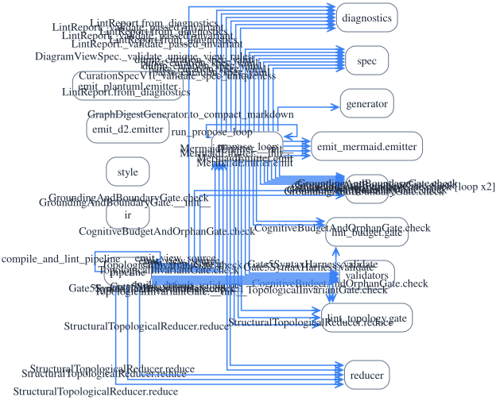

<details>
<summary>View synced LikeC4 dynamic view & Graphviz DOT trace sources</summary>

<!-- archigram:start l3_runtime_pipeline_likec4 -->
```likec4
specification {
  element class {
    style {
      color slate
      border solid
      opacity 0%
    }
  }
  element component {
    style {
      color slate
      border solid
      opacity 0%
    }
  }
  element container {
    style {
      color slate
      border solid
      opacity 0%
    }
  }
  element database {
    style {
      color slate
      border solid
      opacity 0%
    }
  }
  element enum {
    style {
      color slate
      border solid
      opacity 0%
    }
  }
  element external {
    style {
      color slate
      border solid
      opacity 0%
    }
  }
  element function {
    style {
      color slate
      border solid
      opacity 0%
    }
  }
  element interface {
    style {
      color slate
      border solid
      opacity 0%
    }
  }
  element module {
    style {
      color slate
      border solid
      opacity 0%
    }
  }
  element package {
    style {
      color slate
      border solid
      opacity 0%
    }
  }
  element queue {
    style {
      color slate
      border solid
      opacity 0%
    }
  }
  element service {
    style {
      color slate
      border solid
      opacity 0%
    }
  }
  element supernode {
    style {
      color slate
      border solid
      opacity 0%
    }
  }
  element table {
    style {
      color slate
      border solid
      opacity 0%
    }
  }
}

model {
  archigram_domain_diagnostics = module 'diagnostics'
  archigram_domain_ir = module 'ir'
  archigram_domain_spec = module 'spec'
  archigram_domain_style = module 'style'
  archigram_entrypoints_cli_pipeline = module 'pipeline'
  archigram_entrypoints_mcp_propose_loop = module 'propose_loop'
  archigram_features_digest_generator = module 'generator'
  archigram_features_emit_d2_emitter = module 'emit_d2.emitter'
  archigram_features_emit_mermaid_emitter = module 'emit_mermaid.emitter'
  archigram_features_emit_plantuml_emitter = module 'emit_plantuml.emitter'
  archigram_features_lint_budget_gate = module 'lint_budget.gate'
  archigram_features_lint_grounding_gates = module 'gates'
  archigram_features_lint_syntax_validators = module 'validators'
  archigram_features_lint_topology_gate = module 'lint_topology.gate'
  archigram_features_reduce_structural_reducer = module 'reducer'
}

views {
  dynamic view trace_archigram_pipeline_and_repair_v1 {
    variant sequence

    archigram_entrypoints_cli_pipeline -> archigram_entrypoints_cli_pipeline 'compile_and_lint_pipeline'
    archigram_entrypoints_cli_pipeline -> archigram_features_reduce_structural_reducer 'StructuralTopologicalReducer.reduce'
    archigram_entrypoints_cli_pipeline -> archigram_features_emit_mermaid_emitter 'MermaidEmitter.__init__'
    archigram_entrypoints_cli_pipeline -> archigram_features_emit_mermaid_emitter 'MermaidEmitter.emit'
    archigram_entrypoints_cli_pipeline -> archigram_features_reduce_structural_reducer 'StructuralTopologicalReducer.reduce'
    archigram_entrypoints_cli_pipeline -> archigram_features_emit_d2_emitter 'D2Emitter.emit'
    archigram_entrypoints_cli_pipeline -> archigram_features_reduce_structural_reducer 'StructuralTopologicalReducer.reduce'
    archigram_entrypoints_cli_pipeline -> archigram_features_emit_plantuml_emitter 'PlantUmlEmitter.emit'
    archigram_entrypoints_cli_pipeline -> archigram_features_lint_grounding_gates 'GroundingAndBoundaryGate.__init__'
    archigram_entrypoints_cli_pipeline -> archigram_features_lint_grounding_gates 'GroundingAndBoundaryGate.check'
    archigram_entrypoints_cli_pipeline -> archigram_features_lint_topology_gate 'TopologicalInvariantGate.__init__'
    archigram_entrypoints_cli_pipeline -> archigram_features_lint_topology_gate 'TopologicalInvariantGate.check'
    archigram_entrypoints_cli_pipeline -> archigram_features_lint_budget_gate 'CognitiveBudgetAndOrphanGate.check'
    archigram_entrypoints_cli_pipeline -> archigram_features_lint_syntax_validators 'build_default_validators'
    archigram_entrypoints_cli_pipeline -> archigram_features_lint_syntax_validators 'Gate5SyntaxHarness.__init__'
    archigram_entrypoints_cli_pipeline -> archigram_features_lint_syntax_validators 'Gate5SyntaxHarness.validate [loop x3]'
    archigram_entrypoints_cli_pipeline -> archigram_domain_diagnostics 'LintReport.from_diagnostics'
    archigram_entrypoints_mcp_propose_loop -> archigram_entrypoints_mcp_propose_loop 'run_propose_loop'
    archigram_entrypoints_mcp_propose_loop -> archigram_features_digest_generator 'GraphDigestGenerator.to_compact_markdown'
    archigram_entrypoints_mcp_propose_loop -> archigram_domain_spec 'parse_curation_spec_yaml'
    archigram_entrypoints_mcp_propose_loop -> archigram_features_lint_grounding_gates 'GroundingAndBoundaryGate.check [loop x2]'
    archigram_entrypoints_mcp_propose_loop -> archigram_features_lint_topology_gate 'TopologicalInvariantGate.check'
    archigram_entrypoints_mcp_propose_loop -> archigram_domain_diagnostics 'LintReport.from_diagnostics'
    archigram_entrypoints_mcp_propose_loop -> archigram_domain_diagnostics 'LintReport._validate_passed_invariant'
    archigram_entrypoints_mcp_propose_loop -> archigram_domain_spec 'parse_curation_spec_yaml'
    archigram_entrypoints_mcp_propose_loop -> archigram_features_lint_grounding_gates 'collect_observed_symbols'
    archigram_entrypoints_mcp_propose_loop -> archigram_domain_spec 'DiagramViewSpec._validate_unique_view_rules'
    archigram_entrypoints_mcp_propose_loop -> archigram_domain_spec 'CurationSpecV1._validate_spec_uniqueness'
    archigram_entrypoints_mcp_propose_loop -> archigram_features_lint_grounding_gates 'GroundingAndBoundaryGate.check'
    archigram_entrypoints_mcp_propose_loop -> archigram_features_reduce_structural_reducer 'StructuralTopologicalReducer.reduce'
    archigram_entrypoints_mcp_propose_loop -> archigram_features_lint_grounding_gates 'GroundingAndBoundaryGate.check'
    archigram_entrypoints_mcp_propose_loop -> archigram_features_lint_topology_gate 'TopologicalInvariantGate.check'
    archigram_entrypoints_mcp_propose_loop -> archigram_features_lint_budget_gate 'CognitiveBudgetAndOrphanGate.check'
    archigram_entrypoints_mcp_propose_loop -> archigram_features_emit_mermaid_emitter 'MermaidEmitter.emit'
    archigram_entrypoints_mcp_propose_loop -> archigram_features_lint_syntax_validators 'Gate5SyntaxHarness.validate'
    archigram_entrypoints_mcp_propose_loop -> archigram_domain_diagnostics 'LintReport.from_diagnostics'
    archigram_entrypoints_mcp_propose_loop -> archigram_domain_diagnostics 'LintReport._validate_passed_invariant'
    archigram_entrypoints_mcp_propose_loop -> archigram_domain_spec 'dump_curation_spec_yaml'
    archigram_entrypoints_mcp_propose_loop -> archigram_domain_spec 'parse_curation_spec_yaml'
    archigram_entrypoints_mcp_propose_loop -> archigram_features_lint_grounding_gates 'GroundingAndBoundaryGate.check'
    archigram_entrypoints_mcp_propose_loop -> archigram_features_reduce_structural_reducer 'StructuralTopologicalReducer.reduce'
    archigram_entrypoints_mcp_propose_loop -> archigram_features_lint_grounding_gates 'GroundingAndBoundaryGate.check'
    archigram_entrypoints_mcp_propose_loop -> archigram_features_lint_topology_gate 'TopologicalInvariantGate.check'
    archigram_entrypoints_mcp_propose_loop -> archigram_features_lint_budget_gate 'CognitiveBudgetAndOrphanGate.check'
    archigram_entrypoints_mcp_propose_loop -> archigram_features_emit_mermaid_emitter 'MermaidEmitter.emit'
    archigram_entrypoints_mcp_propose_loop -> archigram_features_lint_syntax_validators 'Gate5SyntaxHarness.validate'
    archigram_entrypoints_mcp_propose_loop -> archigram_domain_diagnostics 'LintReport.from_diagnostics'
    archigram_entrypoints_mcp_propose_loop -> archigram_domain_diagnostics 'LintReport._validate_passed_invariant'
    archigram_entrypoints_mcp_propose_loop -> archigram_domain_spec 'dump_curation_spec_yaml'
  }
}
```
<!-- archigram:end l3_runtime_pipeline_likec4 -->

<!-- archigram:start l3_runtime_pipeline_dot -->
```dot
digraph "archigram_pipeline_and_repair_v1" {
  rankdir="LR";
  bgcolor="transparent";
  splines="ortho";
  node [shape="box", style="rounded", color="#64748b", fontcolor="#64748b"];
  edge [penwidth="1.5", fontcolor="#64748b"];
  "archigram.domain.diagnostics" [label="diagnostics", kind="module", _kind="module"];
  "archigram.domain.ir" [label="ir", kind="module", _kind="module"];
  "archigram.domain.spec" [label="spec", kind="module", _kind="module"];
  "archigram.domain.style" [label="style", kind="module", _kind="module"];
  "archigram.entrypoints.cli.pipeline" [label="pipeline", kind="module", _kind="module"];
  "archigram.entrypoints.mcp.propose_loop" [label="propose_loop", kind="module", _kind="module"];
  "archigram.features.digest.generator" [label="generator", kind="module", _kind="module"];
  "archigram.features.emit_d2.emitter" [label="emit_d2.emitter", kind="module", _kind="module"];
  "archigram.features.emit_mermaid.emitter" [label="emit_mermaid.emitter", kind="module", _kind="module"];
  "archigram.features.emit_plantuml.emitter" [label="emit_plantuml.emitter", kind="module", _kind="module"];
  "archigram.features.lint_budget.gate" [label="lint_budget.gate", kind="module", _kind="module"];
  "archigram.features.lint_grounding.gates" [label="gates", kind="module", _kind="module"];
  "archigram.features.lint_syntax.validators" [label="validators", kind="module", _kind="module"];
  "archigram.features.lint_topology.gate" [label="lint_topology.gate", kind="module", _kind="module"];
  "archigram.features.reduce_structural.reducer" [label="reducer", kind="module", _kind="module"];
  "archigram.entrypoints.cli.pipeline" -> "archigram.entrypoints.cli.pipeline" [xlabel="compile_and_lint_pipeline", style="solid", color="#3b82f6", arrowhead="vee"];
  "archigram.entrypoints.cli.pipeline" -> "archigram.features.reduce_structural.reducer" [xlabel="StructuralTopologicalReducer.reduce", style="solid", color="#3b82f6", arrowhead="vee"];
  "archigram.entrypoints.cli.pipeline" -> "archigram.features.emit_mermaid.emitter" [xlabel="MermaidEmitter.__init__", style="solid", color="#3b82f6", arrowhead="vee"];
  "archigram.entrypoints.cli.pipeline" -> "archigram.features.emit_mermaid.emitter" [xlabel="MermaidEmitter.emit", style="solid", color="#3b82f6", arrowhead="vee"];
  "archigram.entrypoints.cli.pipeline" -> "archigram.features.reduce_structural.reducer" [xlabel="StructuralTopologicalReducer.reduce", style="solid", color="#3b82f6", arrowhead="vee"];
  "archigram.entrypoints.cli.pipeline" -> "archigram.features.emit_d2.emitter" [xlabel="D2Emitter.emit", style="solid", color="#3b82f6", arrowhead="vee"];
  "archigram.entrypoints.cli.pipeline" -> "archigram.features.reduce_structural.reducer" [xlabel="StructuralTopologicalReducer.reduce", style="solid", color="#3b82f6", arrowhead="vee"];
  "archigram.entrypoints.cli.pipeline" -> "archigram.features.emit_plantuml.emitter" [xlabel="PlantUmlEmitter.emit", style="solid", color="#3b82f6", arrowhead="vee"];
  "archigram.entrypoints.cli.pipeline" -> "archigram.features.lint_grounding.gates" [xlabel="GroundingAndBoundaryGate.__init__", style="solid", color="#3b82f6", arrowhead="vee"];
  "archigram.entrypoints.cli.pipeline" -> "archigram.features.lint_grounding.gates" [xlabel="GroundingAndBoundaryGate.check", style="solid", color="#3b82f6", arrowhead="vee"];
  "archigram.entrypoints.cli.pipeline" -> "archigram.features.lint_topology.gate" [xlabel="TopologicalInvariantGate.__init__", style="solid", color="#3b82f6", arrowhead="vee"];
  "archigram.entrypoints.cli.pipeline" -> "archigram.features.lint_topology.gate" [xlabel="TopologicalInvariantGate.check", style="solid", color="#3b82f6", arrowhead="vee"];
  "archigram.entrypoints.cli.pipeline" -> "archigram.features.lint_budget.gate" [xlabel="CognitiveBudgetAndOrphanGate.check", style="solid", color="#3b82f6", arrowhead="vee"];
  "archigram.entrypoints.cli.pipeline" -> "archigram.features.lint_syntax.validators" [xlabel="build_default_validators", style="solid", color="#3b82f6", arrowhead="vee"];
  "archigram.entrypoints.cli.pipeline" -> "archigram.features.lint_syntax.validators" [xlabel="Gate5SyntaxHarness.__init__", style="solid", color="#3b82f6", arrowhead="vee"];
  "archigram.entrypoints.cli.pipeline" -> "archigram.features.lint_syntax.validators" [xlabel="Gate5SyntaxHarness.validate [loop x3]", style="solid", color="#3b82f6", arrowhead="vee"];
  "archigram.entrypoints.cli.pipeline" -> "archigram.domain.diagnostics" [xlabel="LintReport.from_diagnostics", style="solid", color="#3b82f6", arrowhead="vee"];
  "archigram.entrypoints.mcp.propose_loop" -> "archigram.entrypoints.mcp.propose_loop" [xlabel="run_propose_loop", style="solid", color="#3b82f6", arrowhead="vee"];
  "archigram.entrypoints.mcp.propose_loop" -> "archigram.features.digest.generator" [xlabel="GraphDigestGenerator.to_compact_markdown", style="solid", color="#3b82f6", arrowhead="vee"];
  "archigram.entrypoints.mcp.propose_loop" -> "archigram.domain.spec" [xlabel="parse_curation_spec_yaml", style="solid", color="#3b82f6", arrowhead="vee"];
  "archigram.entrypoints.mcp.propose_loop" -> "archigram.features.lint_grounding.gates" [xlabel="GroundingAndBoundaryGate.check [loop x2]", style="solid", color="#3b82f6", arrowhead="vee"];
  "archigram.entrypoints.mcp.propose_loop" -> "archigram.features.lint_topology.gate" [xlabel="TopologicalInvariantGate.check", style="solid", color="#3b82f6", arrowhead="vee"];
  "archigram.entrypoints.mcp.propose_loop" -> "archigram.domain.diagnostics" [xlabel="LintReport.from_diagnostics", style="solid", color="#3b82f6", arrowhead="vee"];
  "archigram.entrypoints.mcp.propose_loop" -> "archigram.domain.diagnostics" [xlabel="LintReport._validate_passed_invariant", style="solid", color="#3b82f6", arrowhead="vee"];
  "archigram.entrypoints.mcp.propose_loop" -> "archigram.domain.spec" [xlabel="parse_curation_spec_yaml", style="solid", color="#3b82f6", arrowhead="vee"];
  "archigram.entrypoints.mcp.propose_loop" -> "archigram.features.lint_grounding.gates" [xlabel="collect_observed_symbols", style="solid", color="#3b82f6", arrowhead="vee"];
  "archigram.entrypoints.mcp.propose_loop" -> "archigram.domain.spec" [xlabel="DiagramViewSpec._validate_unique_view_rules", style="solid", color="#3b82f6", arrowhead="vee"];
  "archigram.entrypoints.mcp.propose_loop" -> "archigram.domain.spec" [xlabel="CurationSpecV1._validate_spec_uniqueness", style="solid", color="#3b82f6", arrowhead="vee"];
  "archigram.entrypoints.mcp.propose_loop" -> "archigram.features.lint_grounding.gates" [xlabel="GroundingAndBoundaryGate.check", style="solid", color="#3b82f6", arrowhead="vee"];
  "archigram.entrypoints.mcp.propose_loop" -> "archigram.features.reduce_structural.reducer" [xlabel="StructuralTopologicalReducer.reduce", style="solid", color="#3b82f6", arrowhead="vee"];
  "archigram.entrypoints.mcp.propose_loop" -> "archigram.features.lint_grounding.gates" [xlabel="GroundingAndBoundaryGate.check", style="solid", color="#3b82f6", arrowhead="vee"];
  "archigram.entrypoints.mcp.propose_loop" -> "archigram.features.lint_topology.gate" [xlabel="TopologicalInvariantGate.check", style="solid", color="#3b82f6", arrowhead="vee"];
  "archigram.entrypoints.mcp.propose_loop" -> "archigram.features.lint_budget.gate" [xlabel="CognitiveBudgetAndOrphanGate.check", style="solid", color="#3b82f6", arrowhead="vee"];
  "archigram.entrypoints.mcp.propose_loop" -> "archigram.features.emit_mermaid.emitter" [xlabel="MermaidEmitter.emit", style="solid", color="#3b82f6", arrowhead="vee"];
  "archigram.entrypoints.mcp.propose_loop" -> "archigram.features.lint_syntax.validators" [xlabel="Gate5SyntaxHarness.validate", style="solid", color="#3b82f6", arrowhead="vee"];
  "archigram.entrypoints.mcp.propose_loop" -> "archigram.domain.diagnostics" [xlabel="LintReport.from_diagnostics", style="solid", color="#3b82f6", arrowhead="vee"];
  "archigram.entrypoints.mcp.propose_loop" -> "archigram.domain.diagnostics" [xlabel="LintReport._validate_passed_invariant", style="solid", color="#3b82f6", arrowhead="vee"];
  "archigram.entrypoints.mcp.propose_loop" -> "archigram.domain.spec" [xlabel="dump_curation_spec_yaml", style="solid", color="#3b82f6", arrowhead="vee"];
  "archigram.entrypoints.mcp.propose_loop" -> "archigram.domain.spec" [xlabel="parse_curation_spec_yaml", style="solid", color="#3b82f6", arrowhead="vee"];
  "archigram.entrypoints.mcp.propose_loop" -> "archigram.features.lint_grounding.gates" [xlabel="GroundingAndBoundaryGate.check", style="solid", color="#3b82f6", arrowhead="vee"];
  "archigram.entrypoints.mcp.propose_loop" -> "archigram.features.reduce_structural.reducer" [xlabel="StructuralTopologicalReducer.reduce", style="solid", color="#3b82f6", arrowhead="vee"];
  "archigram.entrypoints.mcp.propose_loop" -> "archigram.features.lint_grounding.gates" [xlabel="GroundingAndBoundaryGate.check", style="solid", color="#3b82f6", arrowhead="vee"];
  "archigram.entrypoints.mcp.propose_loop" -> "archigram.features.lint_topology.gate" [xlabel="TopologicalInvariantGate.check", style="solid", color="#3b82f6", arrowhead="vee"];
  "archigram.entrypoints.mcp.propose_loop" -> "archigram.features.lint_budget.gate" [xlabel="CognitiveBudgetAndOrphanGate.check", style="solid", color="#3b82f6", arrowhead="vee"];
  "archigram.entrypoints.mcp.propose_loop" -> "archigram.features.emit_mermaid.emitter" [xlabel="MermaidEmitter.emit", style="solid", color="#3b82f6", arrowhead="vee"];
  "archigram.entrypoints.mcp.propose_loop" -> "archigram.features.lint_syntax.validators" [xlabel="Gate5SyntaxHarness.validate", style="solid", color="#3b82f6", arrowhead="vee"];
  "archigram.entrypoints.mcp.propose_loop" -> "archigram.domain.diagnostics" [xlabel="LintReport.from_diagnostics", style="solid", color="#3b82f6", arrowhead="vee"];
  "archigram.entrypoints.mcp.propose_loop" -> "archigram.domain.diagnostics" [xlabel="LintReport._validate_passed_invariant", style="solid", color="#3b82f6", arrowhead="vee"];
  "archigram.entrypoints.mcp.propose_loop" -> "archigram.domain.spec" [xlabel="dump_curation_spec_yaml", style="solid", color="#3b82f6", arrowhead="vee"];
}
```
<!-- archigram:end l3_runtime_pipeline_dot -->

</details>

#### 13. D2 Multiboard Step-by-Step Animated Trace (`l3_runtime_pipeline_steps_d2`)
Emits participant components plus ordered causal activation waves (`steps: { step_1: { ... } ... }`) with multiplicity counts (`(xN)`) and `style.animated: true`, compiled via `d2 --animate-interval 1200 --pad 24` into a looping multi-frame SVG:

**Rendered Animated D2 Steps Diagram (`diagrams/l3_runtime_pipeline_steps_d2.d2.svg`):**


<details>
<summary>View synced D2 steps source (<code>l3_runtime_pipeline_steps_d2</code>)</summary>

<!-- archigram:start l3_runtime_pipeline_steps_d2 -->
```d2
vars: {
  d2-config: {
    layout-engine: elk
    theme-id: 0
    dark-theme-id: 200
  }
}
style.fill: transparent

direction: right

"archigram.domain.diagnostics": "diagnostics" {
  style.fill: transparent
  style.stroke: "#64748b"
}
"archigram.domain.ir": "ir" {
  style.fill: transparent
  style.stroke: "#64748b"
}
"archigram.domain.spec": "spec" {
  style.fill: transparent
  style.stroke: "#64748b"
}
"archigram.domain.style": "style" {
  style.fill: transparent
  style.stroke: "#64748b"
}
"archigram.entrypoints.cli.pipeline": "pipeline" {
  style.fill: transparent
  style.stroke: "#64748b"
}
"archigram.entrypoints.mcp.propose_loop": "propose_loop" {
  style.fill: transparent
  style.stroke: "#64748b"
}
"archigram.features.digest.generator": "generator" {
  style.fill: transparent
  style.stroke: "#64748b"
}
"archigram.features.emit_d2.emitter": "emit_d2.emitter" {
  style.fill: transparent
  style.stroke: "#64748b"
}
"archigram.features.emit_mermaid.emitter": "emit_mermaid.emitter" {
  style.fill: transparent
  style.stroke: "#64748b"
}
"archigram.features.emit_plantuml.emitter": "emit_plantuml.emitter" {
  style.fill: transparent
  style.stroke: "#64748b"
}
"archigram.features.lint_budget.gate": "lint_budget.gate" {
  style.fill: transparent
  style.stroke: "#64748b"
}
"archigram.features.lint_grounding.gates": "gates" {
  style.fill: transparent
  style.stroke: "#64748b"
}
"archigram.features.lint_syntax.validators": "validators" {
  style.fill: transparent
  style.stroke: "#64748b"
}
"archigram.features.lint_topology.gate": "lint_topology.gate" {
  style.fill: transparent
  style.stroke: "#64748b"
}
"archigram.features.reduce_structural.reducer": "reducer" {
  style.fill: transparent
  style.stroke: "#64748b"
}

steps: {
  step_1: {
    "archigram.entrypoints.cli.pipeline" -> "archigram.features.reduce_structural.reducer": "StructuralTopologicalReducer.reduce (x3)" {
      style.stroke: "#3b82f6"
      style.animated: true
    }
  }
  step_2: {
    "archigram.entrypoints.cli.pipeline" -> "archigram.features.emit_mermaid.emitter": "MermaidEmitter.__init__ (x2)" {
      style.stroke: "#3b82f6"
      style.animated: true
    }
    "archigram.entrypoints.cli.pipeline" -> "archigram.features.emit_d2.emitter": "D2Emitter.emit" {
      style.stroke: "#3b82f6"
      style.animated: true
    }
  }
  step_3: {
    "archigram.entrypoints.cli.pipeline" -> "archigram.features.emit_plantuml.emitter": "PlantUmlEmitter.emit" {
      style.stroke: "#3b82f6"
      style.animated: true
    }
  }
  step_4: {
    "archigram.entrypoints.cli.pipeline" -> "archigram.features.lint_grounding.gates": "GroundingAndBoundaryGate.__init__ (x2)" {
      style.stroke: "#3b82f6"
      style.animated: true
    }
    "archigram.entrypoints.cli.pipeline" -> "archigram.features.lint_topology.gate": "TopologicalInvariantGate.__init__ (x2)" {
      style.stroke: "#3b82f6"
      style.animated: true
    }
  }
  step_5: {
    "archigram.entrypoints.cli.pipeline" -> "archigram.features.lint_budget.gate": "CognitiveBudgetAndOrphanGate.check" {
      style.stroke: "#3b82f6"
      style.animated: true
    }
  }
  step_6: {
    "archigram.entrypoints.cli.pipeline" -> "archigram.features.lint_syntax.validators": "build_default_validators (x3)" {
      style.stroke: "#3b82f6"
      style.animated: true
    }
    "archigram.entrypoints.cli.pipeline" -> "archigram.domain.diagnostics": "LintReport.from_diagnostics" {
      style.stroke: "#3b82f6"
      style.animated: true
    }
  }
  step_7: {
    "archigram.entrypoints.mcp.propose_loop" -> "archigram.features.digest.generator": "GraphDigestGenerator.to_compact_markdown" {
      style.stroke: "#3b82f6"
      style.animated: true
    }
  }
  step_8: {
    "archigram.entrypoints.mcp.propose_loop" -> "archigram.domain.spec": "parse_curation_spec_yaml (x7)" {
      style.stroke: "#3b82f6"
      style.animated: true
    }
    "archigram.entrypoints.mcp.propose_loop" -> "archigram.features.lint_grounding.gates": "GroundingAndBoundaryGate.check [loop x2] (x6)" {
      style.stroke: "#3b82f6"
      style.animated: true
    }
  }
  step_9: {
    "archigram.entrypoints.mcp.propose_loop" -> "archigram.features.lint_topology.gate": "TopologicalInvariantGate.check (x3)" {
      style.stroke: "#3b82f6"
      style.animated: true
    }
  }
  step_10: {
    "archigram.entrypoints.mcp.propose_loop" -> "archigram.domain.diagnostics": "LintReport.from_diagnostics (x6)" {
      style.stroke: "#3b82f6"
      style.animated: true
    }
    "archigram.entrypoints.mcp.propose_loop" -> "archigram.features.reduce_structural.reducer": "StructuralTopologicalReducer.reduce (x2)" {
      style.stroke: "#3b82f6"
      style.animated: true
    }
  }
  step_11: {
    "archigram.entrypoints.mcp.propose_loop" -> "archigram.features.lint_budget.gate": "CognitiveBudgetAndOrphanGate.check (x2)" {
      style.stroke: "#3b82f6"
      style.animated: true
    }
  }
  step_12: {
    "archigram.entrypoints.mcp.propose_loop" -> "archigram.features.emit_mermaid.emitter": "MermaidEmitter.emit (x2)" {
      style.stroke: "#3b82f6"
      style.animated: true
    }
    "archigram.entrypoints.mcp.propose_loop" -> "archigram.features.lint_syntax.validators": "Gate5SyntaxHarness.validate (x2)" {
      style.stroke: "#3b82f6"
      style.animated: true
    }
  }
}
```
<!-- archigram:end l3_runtime_pipeline_steps_d2 -->

</details>
