# Program-First CLI Curation (3-Stage SVG Triage) & UML 2.5 Diagram Showcase

> **Core Guardrail Demonstrated on This Page:** Every diagram below begins as an **untouched program extraction**—either AST static analysis (`PythonAstStructuralIngestor` over `src/archigram`) or live Python 3.12 `sys.monitoring` execution tracing (`self_trace.py`). An LLM agent is **never allowed to hand-edit diagram source or YAML**; it may only invoke deterministic `archigram curate` CLI commands to delete unnecessary branches (`scope-khop`, `prune-leaves`), splice pass-through barrels (`bypass`), or fold cohesive subsystems (`collapse`, `trace-config`), verified at every step by the **5 ArchiGram Linter Gates**.

- **Navigation:** [Architecture Index](README.md) · [L0: System & Rings](L0-system-and-rings.md) · [L1: Feature Slices](L1-feature-slices.md) · [L2: Subsystem Guides](L2-subsystem-guides.md) · [L3: Runtime Traces](L3-runtime-traces.md) · [Styling Policy & Gallery](diagram-styling-and-gallery.md)
- **CLI-Authored Specs:** [`showcase-structural-views.yaml`](showcase-structural-views.yaml) · [`showcase-trace-views.yaml`](showcase-trace-views.yaml)

---

## 1. Program-First, CLI-Only Curation & 3-Stage Visual Comparison

When a deterministic extractor inspects a real repository or live runtime trace, the raw output routinely exceeds Gitea's **`5,000`-character Mermaid client limit** (`MERMAID_GITEA_MAX_SOURCE_CHARS = 5000` in [`src/archigram/domain/style.py`](../../src/archigram/domain/style.py)):

| Showcase Dataset | Program Extractor | Raw Program Output | Raw Mermaid Size | Curated Output | Curated Mermaid Size |
| --- | --- | --- | --- | --- | --- |
| **Structural AST (`showcase_cli_triage`)** | `PythonAstStructuralIngestor` (`src/archigram`) | `334` symbols, `484` edges | **`50,186` chars** (`10.0×` over Gitea cap) | `17` nodes, `12` edges | **`1,887` chars** (`96.2%` reduction) |
| **Runtime Trace (`showcase_trace_triage`)** | `self_trace.py` (`sys.monitoring`) | `15` participants, `183` spans | **`9,460` chars** (`1.9×` over Gitea cap) | `15` participants, `48` spans | **`3,866` chars** (`59.1%` reduction) |

Because raw Stage 1 (`50,186` and `9,460` chars) and annotated Stage 2 exceed `5,000` characters, `archigram triage` renders **dual-mode transparent D2 SVGs** (`1_original.d2.svg` -> `2_triage.d2.svg` -> `3_curated.d2.svg`) so reviewers can visually inspect **1. Original**, **2. Original + What Will Be Removed**, and **3. Final Curated Result** side by side—and then emits the `< 5,000`-character native Gitea Mermaid block at Stage 3.

### Reproducible CLI-Only Transcript (Zero Hand-Editing)

```bash
# 1. Initialize view and delete out-of-neighborhood slices + degree-0 namespace stubs
uv run archigram curate docs/architecture/showcase-structural-views.yaml \
  -v showcase_cli_triage -t "Showcase: CLI-Curated Compilation Pipeline (d2)" \
  -r d2 --variant architecture
uv run archigram curate scope-khop docs/architecture/showcase-structural-views.yaml \
  -v showcase_cli_triage -f archigram.entrypoints.cli.pipeline --upstream 1 --downstream 1
uv run archigram curate prune-leaves docs/architecture/showcase-structural-views.yaml \
  -v showcase_cli_triage --id prune_ns_stubs \
  -g archigram -g archigram.entrypoints -g archigram.entrypoints.cli -g archigram.features

# 2. Splice pass-through re-export barrels & fold cohesive internal partitions
uv run archigram curate bypass docs/architecture/showcase-structural-views.yaml \
  -v showcase_cli_triage --id splice_reexport_barrels \
  -g archigram.ports -g archigram.ports.contracts -g archigram.domain \
  -g archigram.features.emit_mermaid -g archigram.features.emit_d2 \
  -g archigram.features.emit_plantuml -g archigram.features.emit_likec4 --max-fanout 250
uv run archigram curate collapse docs/architecture/showcase-structural-views.yaml \
  -v showcase_cli_triage --id fold_domain_core --target domain_core \
  --label "Domain Core (Canonical IR, Spec, Diagnostics)" \
  -g "archigram.domain.ir*" -g "archigram.domain.spec*" -g "archigram.domain.diagnostics*"
uv run archigram curate budget docs/architecture/showcase-structural-views.yaml \
  -v showcase_cli_triage --min-nodes 5 --max-nodes 18 --max-edges 40

# 3. Compile 3-stage comparison SVGs (1_original -> 2_triage -> 3_curated) + 5-Gate verification
uv run archigram triage src/archigram \
  --spec docs/architecture/showcase-structural-views.yaml \
  --view showcase_cli_triage \
  --out-dir docs/architecture/diagrams
```

> [!NOTE]
> **How the 5-Gate Linter Policed the LLM During CLI Curation:** When constructing these views via `archigram curate`, **Gate 1 (`ZERO_MATCH_GLOB`)** immediately rejected a guessed `archigram.entrypoints.cli.diff_engine` glob (the real module is `archigram.entrypoints.cli.diff`), **Gate 3 (`DISCONNECTED_PARTITION_MERGE`)** warned when `domain.style` was grouped with disconnected `domain.ir` symbols, and **Gate 4 (`NODE_BUDGET_EXCEEDED`)** guided sub-symbol collapsing from `24` down to `17` nodes (`0` errors, `0` warnings).

---

### Case Study A — Structural AST Curation (`50,186` Raw Mermaid Chars -> `1,887` Chars)

#### Stage 1: Untouched Program Output (`334` Symbols, `484` Dependency Edges)
Extracted directly from `src/archigram` by `PythonAstStructuralIngestor` (`50,186` Mermaid characters—unrenderable in Gitea Mermaid, rendered via SVG):


#### Stage 2: Original + Triage Disposition Overlay (`What Will Be Removed / Spliced / Collapsed`)
Every raw symbol and edge in the untouched `334`-node AST is classified by `archigram triage` with dual-mode transparent borders:
- **Emerald Solid (`#10b981`, `[KEEP]`):** `11` focal symbols retained directly in the curated view.
- **Crimson Dashed (`#ef4444`, `[REMOVE]`):** `302` out-of-neighborhood symbols and degree-0 namespace stubs deleted by `scope-khop` and `prune-leaves`.
- **Amber Dashed (`#f59e0b`, `[BYPASS]`):** `1` pass-through contract barrel spliced out while preserving transitive reachability.
- **Violet Dashed (`#8b5cf6`, `[COLLAPSE -> ...]`):** `20` slice internals merged into cohesive supernodes.


#### Stage 3: Final 5-Gate-Verified Result (`17` Nodes, `12` Edges, `1,887` Mermaid Chars)
Companion D2 SVG ([`showcase_cli_triage.3_curated.d2`](diagrams/showcase_cli_triage.3_curated.d2)):

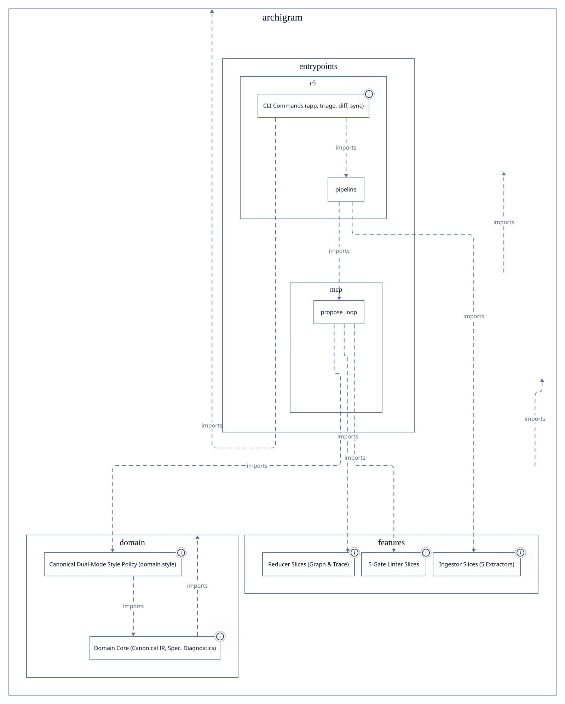

Native Gitea-ready Mermaid (`1,887` chars < `5,000` limit, synced via `archigram apply --sync-md`):

<!-- archigram:start showcase_cli_triage_mermaid -->
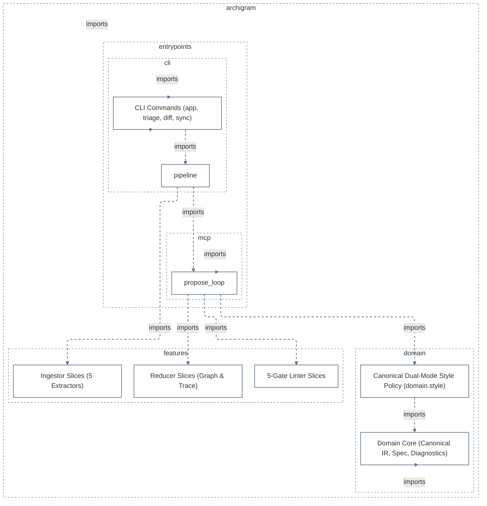
<!-- archigram:end showcase_cli_triage_mermaid -->

---

### Case Study B — Live `sys.monitoring` Trace Curation (`9,460` Raw Mermaid Chars -> `3,866` Chars)

#### Stage 1: Untouched Runtime Call Topology (`15` Participants, `183` Raw Spans)
Captured by running ArchiGram's own compiler and 3-turn repair loop under Python 3.12 `sys.monitoring` (`self_trace.py`). Raw sequence emission produces `9,460` Mermaid chars (`1.9×` over Gitea's `5,000`-char cap):

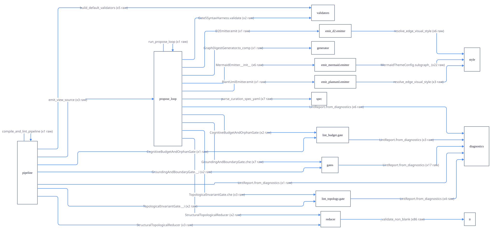

#### Stage 2: Original + Trace Compaction Triage (`[KEEP]` vs `[FOLD 183 -> 48 Spans]`)
Applying `archigram curate trace-config --max-depth 2 --fold-loops --fold-parallel` compacts `135` repetitive loop/deep spans (`[FOLD]`, violet dashed `#8b5cf6`) while preserving `48` causal root/repair spans (`[KEEP]`, emerald solid `#10b981`) and happens-before partial order (Gate 3):

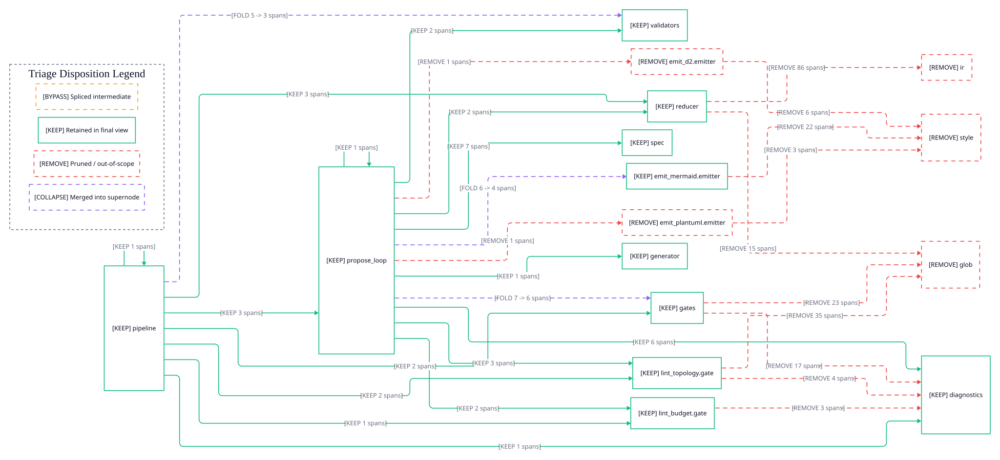

#### Stage 3: Final Curated Sequence Diagram (`15` Participants, `48` Spans, `3,866` Mermaid Chars)
Companion D2 Sequence SVG with flowing CSS call edges ([`showcase_trace_triage.3_curated.d2`](diagrams/showcase_trace_triage.3_curated.d2)):

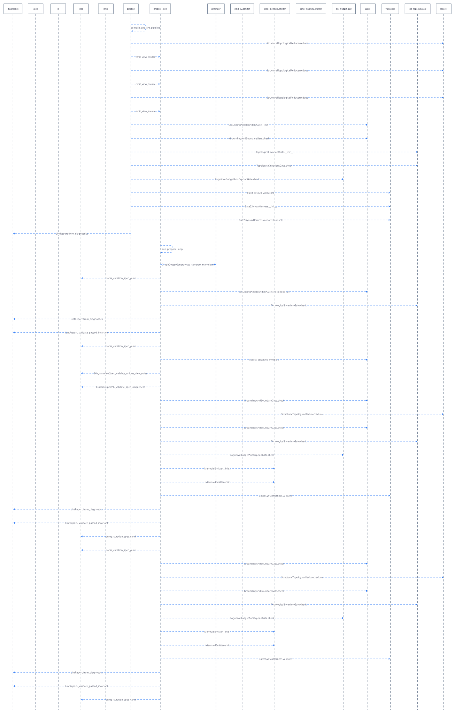

Native Gitea-ready Mermaid `sequenceDiagram` (`3,866` chars < `5,000` limit):

<!-- archigram:start showcase_trace_triage_mermaid -->
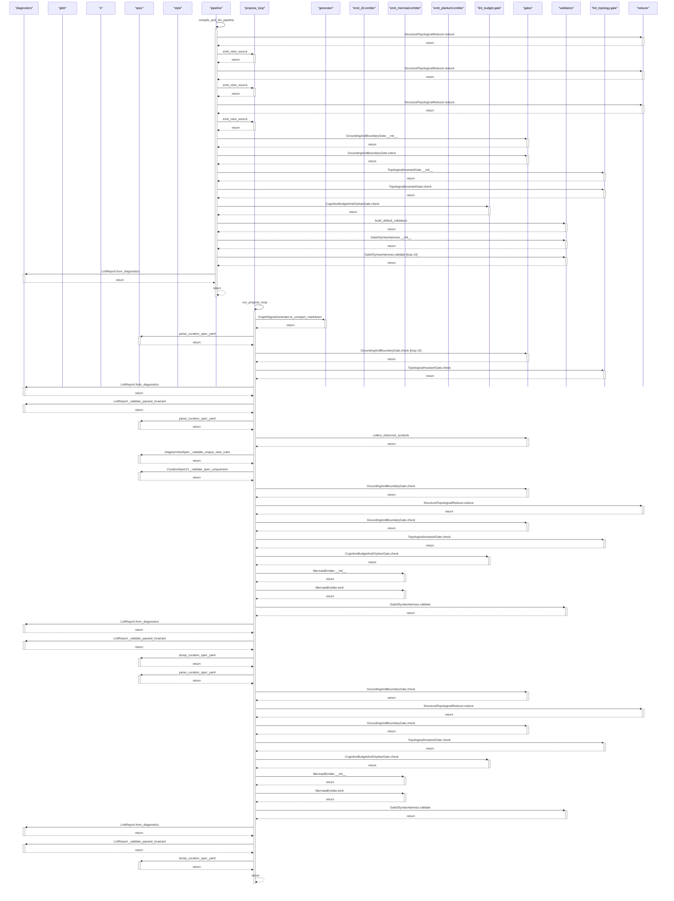
<!-- archigram:end showcase_trace_triage_mermaid -->

---

## 2. UML 2.5 Diagram Taxonomy Coverage (14-Type Reference Mapping)

Inspired by the standard [14 UML 2.5 Diagram Types taxonomy](https://creately.com/blog/diagrams/uml-diagram-types-examples/), ArchiGram compiles both **Structural** and **Behavioral** UML projections deterministically from its two Canonical IR profiles (`StructuralGraphIR` and `InteractionTraceIR`)—without adding speculative IR noise or hand-written layout code:

| Category | UML 2.5 Diagram Type | ArchiGram Support & `diagram_variant` | Canonical IR Source | Live Self-Hosted Example |
| --- | --- | --- | --- | --- |
| **Structural** | **1. Class Diagram** | Native (`auto` OOP / `class`) across Mermaid, D2, PlantUML | `StructuralGraphIR` (`CLASS`, `INTERFACE`, `ENUM`) | [L2c OOP Validator Class Diagrams](diagram-styling-and-gallery.md#part-b--oop-uml-class-diagrams-all-3-oop-renderers-on-l2c-validators) |
| **Structural** | **2. Component Diagram** | Native (`architecture`) across Mermaid, D2, PlantUML, LikeC4, DOT | `StructuralGraphIR` (`SERVICE`, `MODULE`, `COMPONENT`) | [L0 Hexagonal Component Views](L0-system-and-rings.md) |
| **Structural** | **3. Package Diagram** | **`diagram_variant: package`** (`<<package>>` + dashed `<<import>>`) | `StructuralGraphIR` | [Section 3.1 below](#31-uml-package-diagram-diagram_variant-package) |
| **Structural** | **4. Deployment Diagram** | **`diagram_variant: deployment`** (`<<executionEnv>>` 3D nodes + `<<artifact>>`) | `StructuralGraphIR` | [Section 3.2 below](#32-uml-deployment-diagram-diagram_variant-deployment) |
| **Structural** | **5. Composite Structure** | Hierarchical nested ELK port/container boundaries (`architecture`) | `StructuralGraphIR` (`parent_id` containment forest) | [L1 Feature-Slice Containment Map](L1-feature-slices.md) |
| **Structural** | **6. Object Diagram** | Concrete runtime participant instance topology (`Stage 1` snapshot / `communication`) | `InteractionTraceIR` / `StructuralGraphIR` | [Stage 1 Instance Topology above](#stage-1-untouched-runtime-call-topology-15-participants-183-raw-spans) |
| **Structural** | **7. Profile Diagram** | Stereotype mapping via `<<interface>>`, `<<package>>`, `<<executionEnv>>`, `<<actor>>` | `IRNode.kind` & `attributes` | Applied across Sections 3.1–3.3 |
| **Behavioral** | **8. Use Case Diagram** | **`diagram_variant: use_case`** (`<<actor>>` outside `System Subject Boundary` + ovals) | `StructuralGraphIR` (driving roots -> system capabilities) | [Section 3.3 below](#33-uml-use-case-diagram-diagram_variant-use_case) |
| **Behavioral** | **9. Sequence Diagram** | Native (`auto` on `interaction_trace`) across all 5 renderers | `InteractionTraceIR` (`R1–R6` + SP-Poset) | [L3 Runtime Sequence Views](L3-runtime-traces.md) |
| **Behavioral** | **10. Communication Diagram** | **`diagram_variant: communication`** (numbered `1`, `1.1`, `2 [xN]` channels) | `InteractionTraceIR` | [Section 3.4 below](#34-uml-communication-diagram-diagram_variant-communication) |
| **Behavioral** | **11. Activity Diagram** | **`diagram_variant: activity`** (start/stop bullseyes, loop diamonds, fork/join bars) | `InteractionTraceIR` / `StructuralGraphIR` | [Section 3.5 below](#35-uml-activity-diagram-diagram_variant-activity) |
| **Behavioral** | **12. State Machine Diagram** | **`diagram_variant: state`** (`[*] -> State` lifecycle transitions & self-healing loops) | `InteractionTraceIR` / `StructuralGraphIR` | [Section 3.6 below](#36-uml-state-machine-diagram-diagram_variant-state) |
| **Behavioral** | **13. Interaction Overview** | Multi-wave causal step frames (`diagram_variant: steps` animated D2 multiboard) | `InteractionTraceIR` | [L3 Animated Steps SVG](L3-runtime-traces.md) |
| **Behavioral** | **14. Timing Diagram** | Nanosecond `start_ns` / `end_ns` / `clock_domain_id` span annotations in compacted traces | `InteractionTraceIR` (`clock_domain_id`) | [L3 Trace Poset Diagnostics](L3-runtime-traces.md) |

---

## 3. Live Self-Hosted UML 2.5 Showcase (Compiled from ArchiGram IR)

Every diagram below is compiled from live `src/archigram` AST or `traces/pipeline-and-repair.ir.json` with **transparent dual-mode fills**, **orthogonal routing**, and **`< 5,000`-char Gitea-verified Mermaid**. Companion PlantUML sources are also emitted in [`docs/architecture/diagrams/`](diagrams/).

---

### 3.1 UML Package Diagram (`diagram_variant: package`)

Projects ArchiGram's 9 hexagonal capability groups as explicit `<<package>>` folders with dashed `<<import>>` / `<<access>>` dependency arrows ([`showcase_uml_package_d2.d2`](diagrams/showcase_uml_package_d2.d2) · [`showcase_uml_package_plantuml.puml`](diagrams/showcase_uml_package_plantuml.puml)):

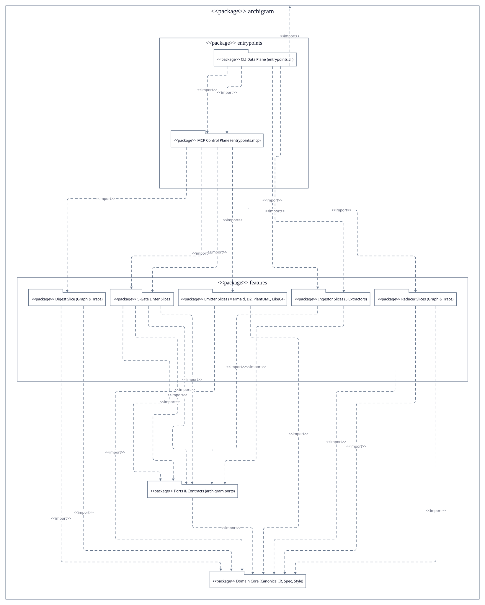

<!-- archigram:start showcase_uml_package_mermaid -->
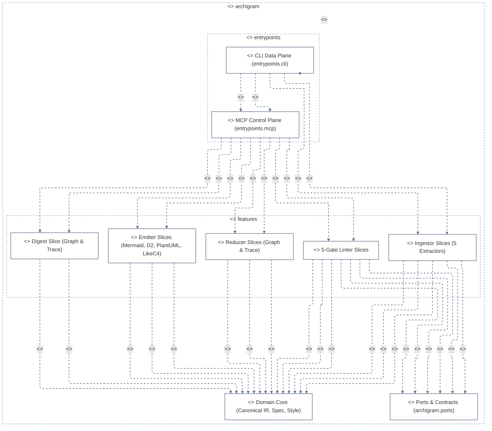
<!-- archigram:end showcase_uml_package_mermaid -->

---

### 3.2 UML Deployment Diagram (`diagram_variant: deployment`)

Maps driving runtime environments (`CLI Data Plane`, `MCP Control Plane`) as 3D `<<executionEnv>>` nodes hosting deployed `<<artifact>>` slices ([`showcase_uml_deployment_d2.d2`](diagrams/showcase_uml_deployment_d2.d2) · [`showcase_uml_deployment_plantuml.puml`](diagrams/showcase_uml_deployment_plantuml.puml)):

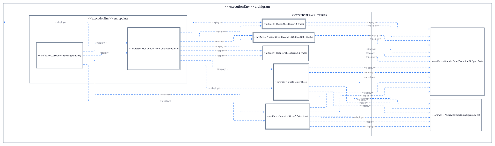

<!-- archigram:start showcase_uml_deployment_mermaid -->
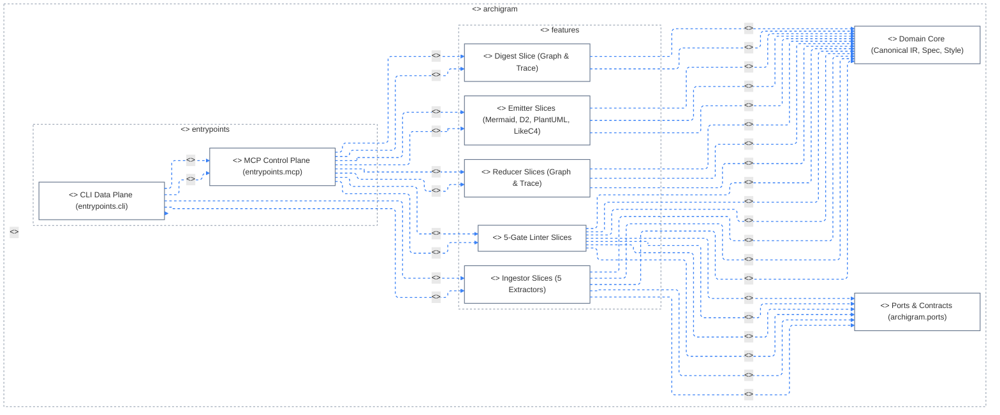
<!-- archigram:end showcase_uml_deployment_mermaid -->

---

### 3.3 UML Use Case Diagram (`diagram_variant: use_case`)

Separates zero-indegree driving actors (`CLI Developer / CI Hook`, `LLM Agent Client (MCP)`) outside the **`System Subject Boundary`** from stadium-oval system use cases inside the boundary ([`showcase_uml_use_case_d2.d2`](diagrams/showcase_uml_use_case_d2.d2) · [`showcase_uml_use_case_plantuml.puml`](diagrams/showcase_uml_use_case_plantuml.puml)):

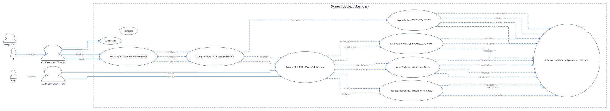

<!-- archigram:start showcase_uml_use_case_mermaid -->
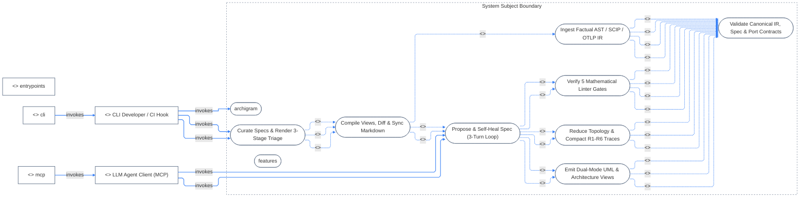
<!-- archigram:end showcase_uml_use_case_mermaid -->

---

### 3.4 UML Communication Diagram (`diagram_variant: communication`)

Collapses timeline lifelines from `pipeline-and-repair.ir.json` into an orthogonal structural network annotated with hierarchical UML sequence numbers (`1`, `1.1`, `2: validate()`) ([`showcase_uml_communication_d2.d2`](diagrams/showcase_uml_communication_d2.d2) · [`showcase_uml_communication_plantuml.puml`](diagrams/showcase_uml_communication_plantuml.puml)):

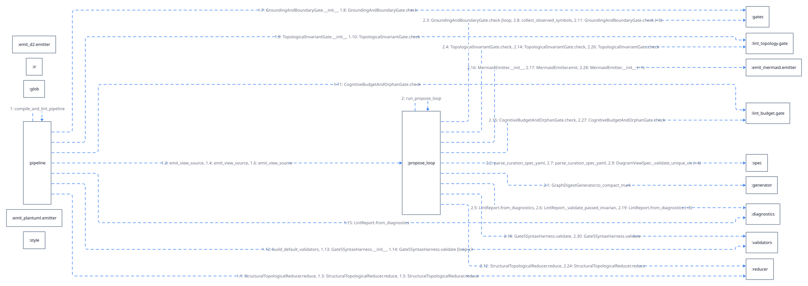

<!-- archigram:start showcase_uml_communication_mermaid -->
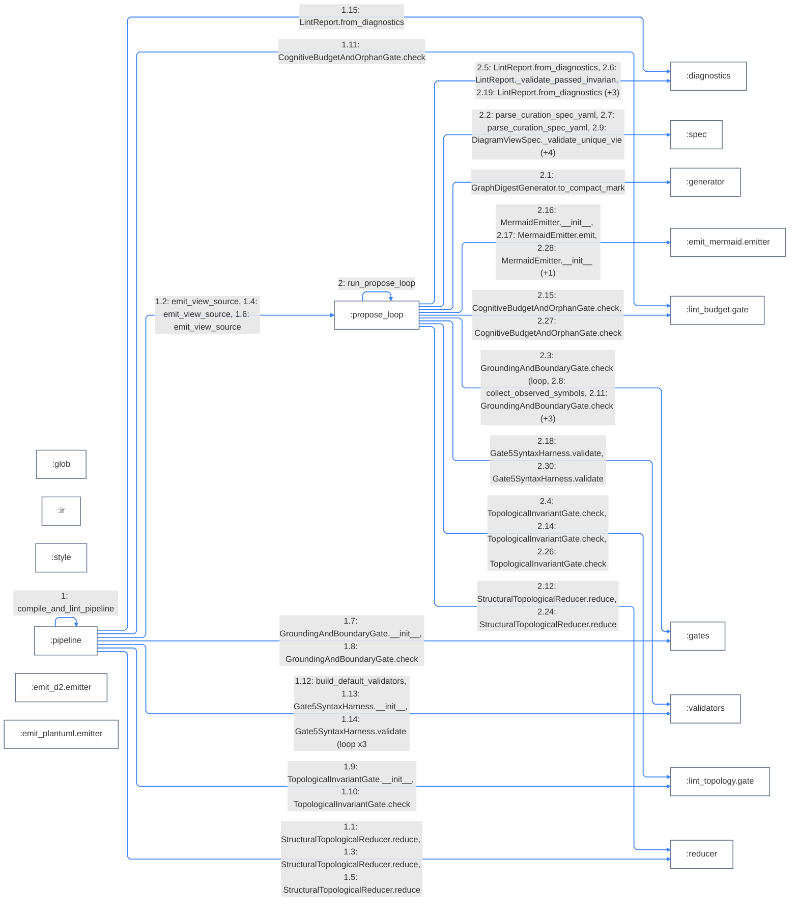
<!-- archigram:end showcase_uml_communication_mermaid -->

---

### 3.5 UML Activity Diagram (`diagram_variant: activity`)

Lowers compacted runtime trace events into an action-flow graph with initial (`●`) and final (`◉`) nodes, diamond loop guards (`loop xN`), and parallel fork/join synchronization bars ([`showcase_uml_activity_d2.d2`](diagrams/showcase_uml_activity_d2.d2) · [`showcase_uml_activity_plantuml.puml`](diagrams/showcase_uml_activity_plantuml.puml)):

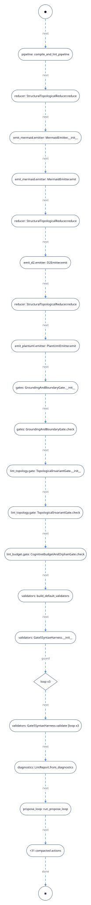

<!-- archigram:start showcase_uml_activity_mermaid -->
```mermaid
---
config:
  layout: elk
  elk:
    mergeEdges: false
    nodePlacementStrategy: BRANDES_KOEPF
  flowchart:
    defaultRenderer: elk
    curve: linear
---
flowchart TD
  classDef default fill:transparent,stroke:#64748b,stroke-width:1.5px
  act_start((" "))
  a0("pipeline: compile_and_lint_pipeline")
  a1("reducer: StructuralTopologicalReducer.reduce")
  a2("propose_loop: emit_view_source")
  a3("reducer: StructuralTopologicalReducer.reduce")
  a4("propose_loop: emit_view_source")
  a5("reducer: StructuralTopologicalReducer.reduce")
  a6("propose_loop: emit_view_source")
  a7("gates: GroundingAndBoundaryGate.__init__")
  a8("gates: GroundingAndBoundaryGate.check")
  a9("lint_topology.gate: TopologicalInvariantGate.__init__")
  a10("lint_topology.gate: TopologicalInvariantGate.check")
  a11("lint_budget.gate: CognitiveBudgetAndOrphanGate.check")
  a12("validators: build_default_validators")
  a13("validators: Gate5SyntaxHarness.__init__")
  g14{"loop x3"}
  a14("validators: Gate5SyntaxHarness.validate (loop x3")
  a15("diagnostics: LintReport.from_diagnostics")
  a16("propose_loop: run_propose_loop")
  a17("generator: GraphDigestGenerator.to_compact_mark")
  a_more("+32 compacted actions")
  act_stop(((" ")))
  act_start --> a0
  a0 --> a1
  a1 --> a2
  a2 --> a3
  a3 --> a4
  a4 --> a5
  a5 --> a6
  a6 --> a7
  a7 --> a8
  a8 --> a9
  a9 --> a10
  a10 --> a11
  a11 --> a12
  a12 --> a13
  a13 --> g14
  g14 --> a14
  a14 --> a15
  a15 --> a16
  a16 --> a17
  a17 --> a_more
  a_more --> act_stop
  linkStyle 0,1,2,3,4,5,6,7,8,9,10,11,12,13,14,15,16,17,18,19,20 stroke:#3b82f6,stroke-width:1.75px
```
<!-- archigram:end showcase_uml_activity_mermaid -->

---

### 3.6 UML State Machine Diagram (`diagram_variant: state`)

Projects active control-flow transfers across participants as a deterministic `stateDiagram-v2` / rounded state machine (`[*] --> ActiveComponent` transitions triggered by runtime calls and self-healing repair turns) ([`showcase_uml_state_d2.d2`](diagrams/showcase_uml_state_d2.d2) · [`showcase_uml_state_plantuml.puml`](diagrams/showcase_uml_state_plantuml.puml)):

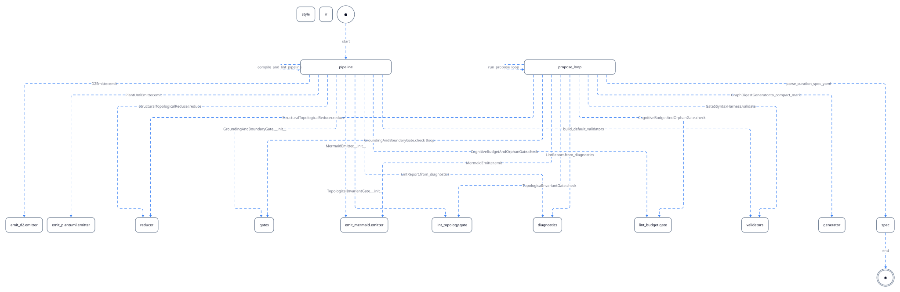

<!-- archigram:start showcase_uml_state_mermaid -->
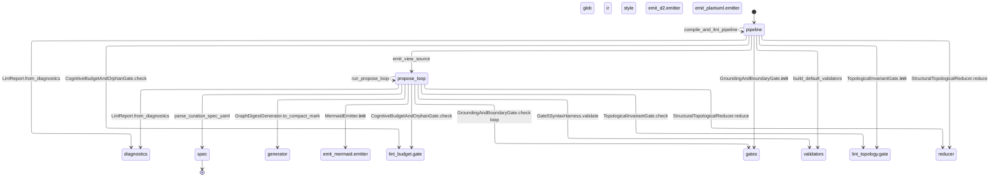
<!-- archigram:end showcase_uml_state_mermaid -->
