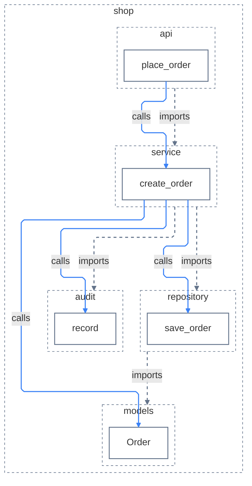
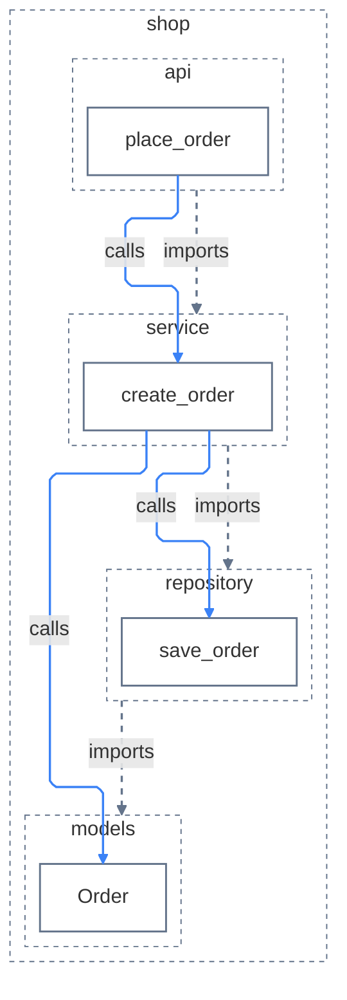
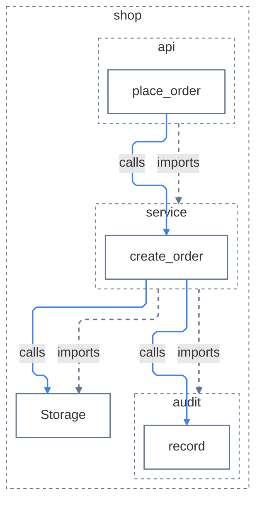
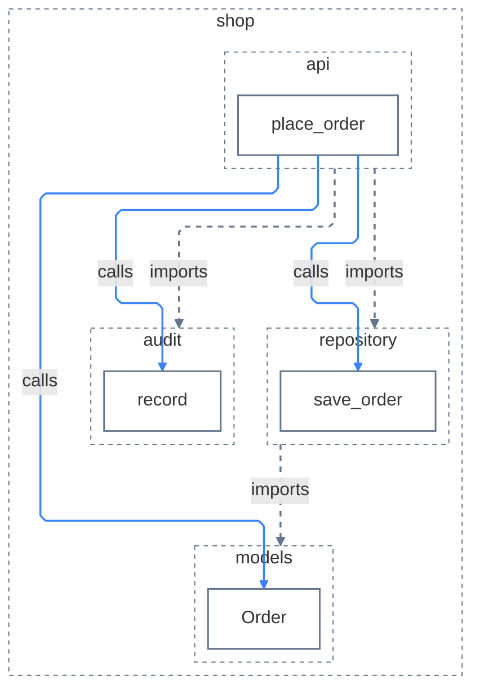

# Agent moves: what an agent may do to a diagram

An agent (or a person) never draws a diagram and never writes Mermaid or D2. It adds rules to a
spec, ArchiGram recompiles the diagram from the code, and five gates decide whether the result may
be written.

The specs in this folder show this on the six-module `shop` package from the
[quickstart](../../docs/quickstart.md). `00-start.yaml` is the diagram with no rules; each of the
other seven adds one move to it. Every move is checked against the same contract:

```yaml
invariants:
  protected_nodes: [shop.api, shop.repository]  # these boxes must stay visible
  require_reachability:  # shop.api must still import its way to shop.repository
    - {from_node: shop.api, to_node: shop.repository, via_relations: [imports]}
  node_budget: {min_count: 1, max_count: 12}  # at most 12 boxes
```

Run them all from the repository root:

```bash
for f in examples/agent-moves/*.yaml; do
  uv run archigram lint examples/python-quickstart/shop --spec "$f"
done
```

The [website](https://klcd.github.io/archigram/#moves) plays the same runs as an animation.

## Start: what the code says

[`00-start.yaml`](00-start.yaml) has no rules. Dashed arrows are `imports`, solid arrows are
`calls`.

<!-- archigram:start start -->

<!-- archigram:end start -->

## Allowed moves

### 1. Hide a leaf

[`01-allowed-hide-leaf.yaml`](01-allowed-hide-leaf.yaml): nothing depends on `shop.audit`, so it
can go without cutting any path.

```yaml
- op: prune_leaves
  id: hide_audit
  node_id_globs: [shop.audit, shop.audit.*]
```

<!-- archigram:start hide_leaf -->

<!-- archigram:end hide_leaf -->

### 2. Group boxes

[`02-allowed-group.yaml`](02-allowed-group.yaml): `shop.repository` and `shop.models` become one
`Storage` box. Arrows into either member now point at `Storage`, and the protected
`shop.repository` stays visible inside it.

```yaml
- op: collapse_partition
  id: storage
  target_node_id: shop.storage
  label: Storage
  member_globs: [shop.repository, shop.repository.*, shop.models, shop.models.*]
```

<!-- archigram:start group_boxes -->

<!-- archigram:end group_boxes -->

### 3. Skip a layer

[`03-allowed-skip-layer.yaml`](03-allowed-skip-layer.yaml): `shop.service` disappears and its
arrows are spliced through, so `shop.api` now points straight at what the service used. Both
relations are kept, so the required import path survives.

```yaml
- op: bypass_vertices
  id: skip_service
  node_id_globs: [shop.service, shop.service.*]
  preserve_edge_relations: [imports, calls]
```

<!-- archigram:start skip_layer -->

<!-- archigram:end skip_layer -->

A fourth kind of move, `scope: k_hop_neighborhood`, keeps only what lies within a few hops of
chosen symbols.

## Refused moves

A refused move writes nothing. The error names the gate, the rule and the symbols involved, so the
agent can repair its spec and try again.

### 4. Use a box the code does not have

[`04-refused-invent-box.yaml`](04-refused-invent-box.yaml): the agent assumes a cache layer
between the service and the repository and asks to skip it. The code has no `shop.cache`.

```yaml
- op: bypass_vertices
  id: skip_cache
  node_id_globs: [shop.cache]
```

```text
ArchiGram 5-Gate Linter: FAILED (1 error(s), 0 warning(s))
  [ERROR] ZERO_MATCH_GLOB (gate_1_grounding, view=invent_box, rule=skip_cache): Glob pattern 'shop.cache' in rule 'skip_cache' matched 0 symbols in the observed Canonical IR.
```

### 5. Hide a protected box

[`05-refused-hide-protected.yaml`](05-refused-hide-protected.yaml): the agent prunes the storage
layer, which removes the protected `shop.repository` and, with it, the required path.

```yaml
- op: prune_leaves
  id: hide_storage
  node_id_globs: [shop.repository, shop.repository.*, shop.models, shop.models.*]
```

```text
ArchiGram 5-Gate Linter: FAILED (2 error(s), 0 warning(s))
  [ERROR] PROTECTED_NODE_DROPPED (gate_2_boundary_leaf, view=hide_protected, rule=hide_storage): Protected node 'shop.repository' in view 'hide_protected' was eliminated by prune_leaves rule 'hide_storage'.
  [ERROR] REACHABILITY_SEVERED (gate_3_topology_poset, view=hide_protected, rule=hide_storage): Reachability from 'shop.api' to 'shop.repository' via relations ['imports'] was severed in view 'hide_protected'; ...
```

### 6. Cut a required path

[`06-refused-cut-path.yaml`](06-refused-cut-path.yaml): the same bypass as move 3, but it splices
only `calls`. The import path from `shop.api` to `shop.repository` is gone, and the error shows the
path as it exists in the code.

```yaml
- op: bypass_vertices
  id: skip_service
  node_id_globs: [shop.service, shop.service.*]
  preserve_edge_relations: [calls]
```

```text
ArchiGram 5-Gate Linter: FAILED (1 error(s), 0 warning(s))
  [ERROR] REACHABILITY_SEVERED (gate_3_topology_poset, view=cut_path, rule=skip_service): Reachability from 'shop.api' to 'shop.repository' via relations ['imports'] was severed in view 'cut_path'; ...
    Witness: shop.api -> shop.service -> shop.repository
    Bottlenecks: shop.service
```

### 7. Draw an arrow

[`07-refused-draw-arrow.yaml`](07-refused-draw-arrow.yaml): there is no rule that adds an edge, a
node or diagram syntax, so the spec does not even load and no gate runs. The command exits with
code 2.

```yaml
- op: add_edge
  id: draw_shortcut
  source: shop.api
  target: shop.repository
```

```text
Input/Usage Error: 1 validation error for CurationSpecV1
views.0.rules.0
  Input tag 'add_edge' found using 'op' does not match any of the expected tags: 'prune_leaves', 'bypass_vertices', 'collapse_partition' ...
```

## What the gates do not stop

The agent can also edit the contract itself, for example by removing `shop.repository` from
`protected_nodes`. The gates check rules against the contract, not the contract against your
intent, so review changes to the spec like code changes.

## Keep the diagrams current

The diagrams above are synced from the specs. After changing a spec, regenerate them:

```bash
for f in examples/agent-moves/0[0-3]-*.yaml; do
  uv run archigram apply examples/python-quickstart/shop --spec "$f" \
    --out-dir examples/agent-moves/diagrams --sync-md examples/agent-moves/README.md
done
```

`tests/fuzz/fuzz_agent_moves_example.py` fails when a spec, a diagram or this page drifts.
